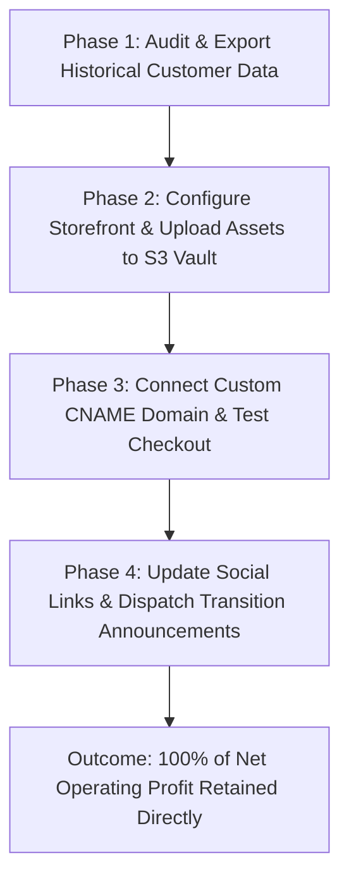
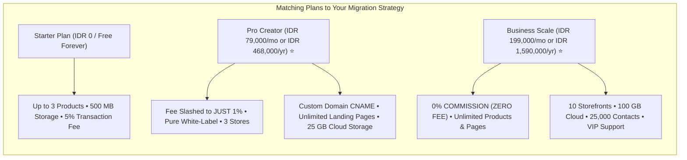

The moment you realize third-party intermediary platforms are siphoning millions in commission fees from your hard work is an eye-opening inflection point.

Yet in that same moment, natural concerns arise:
- *"Will updating my storefront URL confuse my existing audience?"*
- *"How do I transfer e-books, video modules, and templates without disrupting prior buyers?"*
- *"Doesn't setting up an independent digital storefront require expensive custom development?"*

The reality: **Migrating your digital product catalog to [SitusBisnis](https://situsbisnis.com) can be completed in under 30 minutes without writing a single line of code**.

This guide outlines the 4-phase roadmap to safely transition your sales operations from third-party platforms to **[SitusBisnis](https://situsbisnis.com)**—seamlessly protecting your customer relationships while reclaiming healthy profit margins.

---

## Phase 1: Securing Your Assets and Historical Buyer Data

Before changing any public links, back up your operational transaction history:

1. **Export Historical Order Logs:** Log in to your legacy dashboard, navigate to order history, and download complete CSV or spreadsheet customer records.
2. **Compile WhatsApp & Email Contacts:** Cleanly segment the names, email addresses, and phone numbers of previous buyers. This represents your most valuable commercial asset for your new storefront announcement.
3. **Organize Master Product Files:** Ensure all deliverable assets (PDFs, ZIP bundles, spreadsheets, video links) are systematically organized locally with standardized version naming.

---

## Phase 2: Configuring Your Storefront on SitusBisnis

Navigate to **[SitusBisnis.com](https://situsbisnis.com)** and create your account:

### Configuration Steps:
1. **Assign Store Name and Subdomain:**
   Upon registration, you immediately receive a free store subdomain formatted as `yourbrand.sibi.my.id`.
2. **Upload Deliverables to Cloud S3 Vault:**
   - Navigate to **Products** > **Add New Product**.
   - Input your title, outcome-oriented benefit description, price, and cover mockup.
   - Upload your master files to SitusBisnis's encrypted S3 Cloud Storage Vault (500 MB on Starter, 25 GB on Pro Creator, or 100 GB on Business Scale).
3. **Configure Automated Fulfillment Delivery:**
   Ensure automated fulfillment is toggled active. Upon payment verification, the system immediately presents an expiring signed download token while concurrently dispatching receipts to the customer's inbox.

---

## Phase 3: Connecting Your Custom Domain (Pro Creator & Scale Tiers)

Under the **Pro Creator** or **Business Scale** plans, you can connect an independent custom domain (such as `store.yourbrand.com` or `shop.yourdomain.id`):

1. Access your domain DNS registrar dashboard (Cloudflare, Namecheap, GoDaddy, or local registrars).
2. Add a standard **CNAME Record**:
   - Host/Name: `store` (or your preferred subdomain)
   - Value/Target: Enter the target CNAME provided in your SitusBisnis settings.
3. Save changes. Within minutes, your storefront is fully active under your personal domain, secured by automated SSL certificates (*HTTPS*).

---

## Phase 4: Traffic Transition and Courteous Customer Communication

With your independent storefront live, execute the transition without confusing visitors:

### 1. Update Profile Links Across Social Media
Update your primary bio links across Instagram, TikTok, YouTube channels, and LinkedIn:
- From: `legacyplatform.com/username`
- To: `store.yourbrand.com` (or `yourbrand.sibi.my.id`)

### 2. Post a Transition Notice on Your Legacy Page
If your old profile remains temporarily active, update its description:
> *"NOTE: All master guides and resource toolkits have transitioned to our independent storefront at [store.yourbrand.com], featuring updated bonus modules and instant checkout."*

### 3. Re-engage Historical Customers with a Welcome Incentive
Leverage the contact list exported in Phase 1 to dispatch a courteous update:

> *"Hi [Customer Name], thank you for supporting our digital resources in the past! Quick update: we have officially launched our independent digital storefront at [store.yourbrand.com].*
> 
> *As a thank-you to our early community, we have set up an exclusive 25% welcome voucher (Code: NEWHOME) applicable toward our newest releases. Instant checkouts are now live via the link. Thank you for building alongside us!"*

---

## Post-Migration Impact: Before vs. After

| Performance Dimension | Legacy Third-Party Storefronts | [SitusBisnis Pro Creator](https://situsbisnis.com) | Commercial Advantage |
| :--- | :--- | :--- | :--- |
| **Transaction Commission** | 3% to 10% deducted continuously | **Just 1%** *(or 0% on Scale)* | Substantially higher net margins per order |
| **Payout Transfer Costs** | IDR 5,000 per transfer | **IDR 4,000 / IDR 3,000** | Lower banking overhead |
| **Checkout Flow** | Crowded link lists / multi-step forms | **Branded layout + 10-second instant checkouts** | Reduced cart abandonment |
| **Customer Data Ownership** | Contact details masked by platform | **100% Exportable Customer CRM Database** | Full direct-marketing capabilities |
| **Brand Authority** | Platform watermarks & competitor links | **Pure White-Label with Zero External Ads** | 3x elevation in perceived authority |

---

## Take Ownership of Your Digital Commerce Operations

A resilient business rests on durable foundations: protected profit margins and unmediated relationships with your customers.

Do not let unnecessary middleman platform fees constrain your growth.

Initiate your migration today. Open your free storefront on **[SitusBisnis.com](https://situsbisnis.com)** and experience the confidence of operating an independent digital business with full control.
