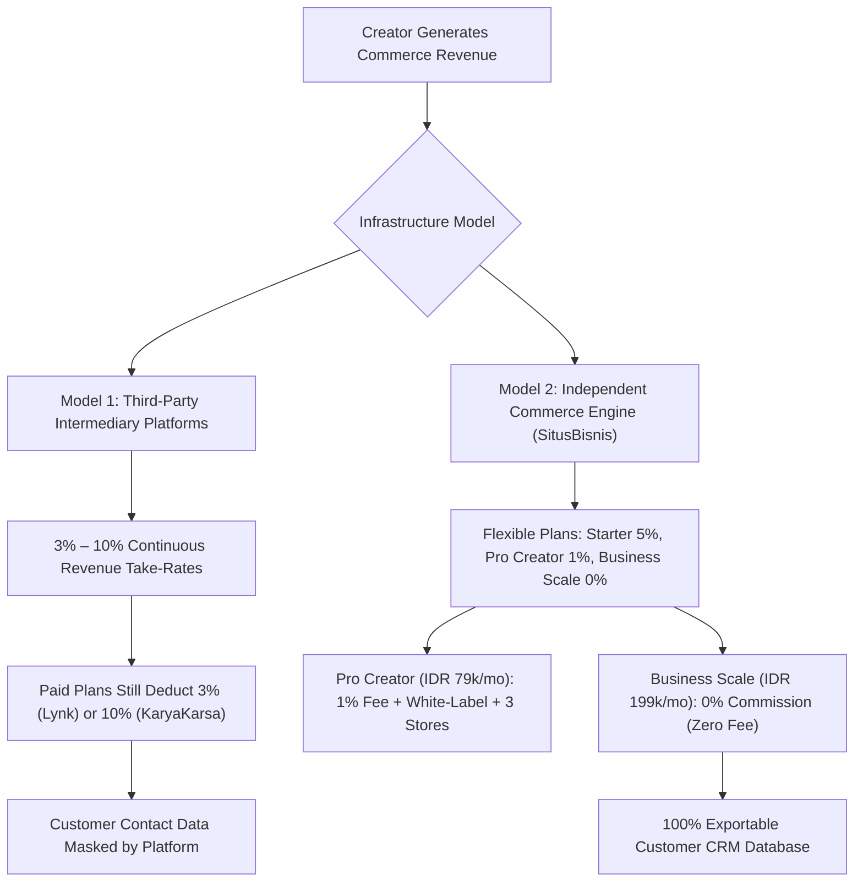
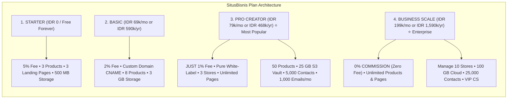

For anyone selling digital assets—from e-books and operational spreadsheets to video masterclasses, LMS courses, productized services, and physical items—the initial operational question is always:

*"Which platform provides automated checkout, keeps transaction fees low, and avoids operational headaches?"*

Many creators begin by signing up for whichever platform is trending on social feeds. Initially, everything feels effortless: sign up, upload a file, paste a link in bio, and await orders.

However, once sales volume climbs into hundreds of monthly orders, the reality sets in: **cumulative transaction commissions and withdrawal fees quietly siphon away thousands of dollars in operating profit.**

Even more concerning: **many platforms obscure customer contact details**, preventing creators from building long-term direct marketing relationships with their own buyers.

This guide provides an objective, data-backed comparative audit of popular platforms—including **Lynk.id, Mayar.id, KaryaKarsa, and Tribelio**—alongside the tiered pricing architecture of **[SitusBisnis](https://situsbisnis.com)**.

---

## 1. Deconstructing Platform Fee Structures and Friction Points

Review the operational parameters and fee mechanics across major platforms:

### A. Lynk.id (Link-in-Bio Storefront)
Popular for quick mobile link lists in social profiles.
* **Fee Structure:**
  - **Free Tier:** Charges a **5% transaction fee** per sale.
  - **Pro Plan:** Costs **IDR 99,000 monthly**, yet **still deducts a 3% transaction commission** on every sale.
  - **Payout Fee:** IDR 5,000 per bank withdrawal.
* **Friction Points:**
  - Even after paying monthly software fees, 3% continues to be deducted from all revenue. At IDR 30M in revenue, IDR 900,000 is lost to commissions every month.
  - Basic card-style layouts lack the authority required for high-ticket courses, enterprise toolkits, or consulting services.

### B. Mayar.id (Fintech Checkout & Payment Links)
Positioned primarily as fintech infrastructure for payment links, event tickets, and invoicing.
* **Fee Structure:**
  - **Digital Goods Fee:** Starter plan levies a **4% platform fee** on digital products (courses, downloads). The Business tier reduces this to **3%**.
  - **Gateway Fees:** In addition to platform fees, separate gateway costs apply (QRIS ~0.7%, Virtual Accounts ~IDR 4,000, e-wallets 1.5%–2%).
  - **Statutory Taxes:** VAT applies to transaction charges.
* **Friction Points:**
  - Layering platform fees (3%–4%) on top of gateway costs and tax pushes total transaction deductions to **4.5% to 6%**.
  - The payment flow feels like a technical banking portal rather than an engaging product landing page.

### C. KaryaKarsa (Creator Tipping & Story Paywalls)
Tailored for serialized fiction, comics, and artist tips.
* **Fee Structure:**
  - **Platform Cut:** Takes **10% of total revenue** or reader tips.
  - **Withdrawal Fee:** Standard bank transfer fees apply (~IDR 5,500).
* **Friction Points:**
  - A 10% take-rate represents one of the steepest commission models in the market.
  - Virtual coin mechanisms often confuse mainstream buyers seeking a simple, one-time checkout for business guides or spreadsheets.

### D. Tribelio / Tribelio Page (Funnel Ecosystem)
Combines landing page creation with messaging broadcast features.
* **Fee Structure:**
  - **Fixed Subscriptions:** Plans range from **IDR 149,000/mo** (Page) to **IDR 198,000/mo** (Basic) and **IDR 398,000/mo** (Premium).
  - **Payment Fees:** Standard processing gateway deductions apply per transaction.
* **Friction Points:**
  - High fixed monthly commitments required before establishing product-market validation.

---

## 2. The Tiered Architecture of SitusBisnis

In contrast to rigid commission models, **[SitusBisnis](https://situsbisnis.com)** provides a unified creator commerce architecture supporting **digital downloads, LMS courses, professional services, and physical items**:

### 1. Starter (IDR 0 / Free Forever)
- **Subscription:** IDR 0 (Access complete core features without a credit card).
- **Platform Take-Rate:** 5% per transaction.
- **Includes:** Free subdomain (`brand.sibi.my.id`), 3 active products, 3 landing pages, 500 MB cloud vault, up to 150 CRM contacts. Ideal for testing an initial digital product concept with zero capital.

### 2. Basic (IDR 69,000/month or IDR 590,000/year)
- **Subscription:** IDR 69,000/month (Save 29% annually).
- **Platform Take-Rate:** Slashed to **2% per transaction**.
- **Includes:** Custom Domain CNAME connection (`store.yourbrand.com`), 8 active products, 8 landing pages, 3 GB cloud storage, up to 500 CRM contacts.

### 3. Pro Creator (IDR 79,000/month or IDR 468,000/year) — Best Value
- **Subscription:** IDR 79,000/month or **IDR 468,000 annually** (equivalent to **IDR 39,000/month**, save 51%!).
- **Platform Take-Rate:** Slashed to **JUST 1% per transaction**!
  > *(Compare to Lynk.id Pro at IDR 99k/month which still takes 3%!).*
- **Key Features:**
  - Manage up to **3 Independent Storefronts/Brands**.
  - **Pure White-Label:** Completely removes platform watermarks.
  - **100% Ad-Free:** Zero competitor banners.
  - **Unlimited Landing Pages**.
  - 50 active products, **25 GB encrypted S3 Vault storage**.
  - **5,000 CRM Customer Contacts** with CSV export.
  - 1,000 monthly email broadcasts.

### 4. Business Scale (IDR 199,000/month or IDR 1,590,000/year) — 0% Zero Fee
- **Subscription:** IDR 199,000/month or IDR 1,590,000/year.
- **Platform Take-Rate:** **0% COMMISSION (Zero Fee) ⭐**
  > Regardless of revenue volume—whether IDR 50M, IDR 100M, or IDR 500M monthly—**SitusBisnis takes zero sales commission (IDR 0)**.
- **Enterprise Features:**
  - Up to **10 Independent Storefronts**.
  - Unlimited products and landing pages.
  - **100 GB Cloud Storage**, **25,000 CRM contacts**, 10 team seats, and VIP support.

---

## 3. Comprehensive Feature Comparison Matrix

| Core Dimension | Lynk.id Pro | Mayar Business | KaryaKarsa | SitusBisnis Pro Creator ⭐ |
| :--- | :--- | :--- | :--- | :--- |
| **Subscription Cost** | IDR 99k/mo | IDR 150k+/mo | IDR 0 | **IDR 79k/mo (or IDR 39k/mo/yr)** |
| **Platform Commission** | **3%** | **3%** | **10%** | **JUST 1% (or 0% on Scale)** |
| **Custom Domain CNAME** | Custom Add-on | Yes | No | **✓ Included** |
| **Storefronts Allowed** | 1 Profile | Multiple | 1 Profile | **Up to 3 Brands** |
| **White-Label Presentation**| Limited | Yes | No | **✓ 100% Pure White-Label** |
| **Customer Data Ownership** | Restricted | Exportable | Limited | **✓ Full CRM Export** |
| **Secure Digital Delivery** | Basic links | Yes | Internal app | **✓ Encrypted S3 Vault** |

---

## Summary: Selecting the Right Commerce Engine

Selecting a commerce platform is an operational decision with profound long-term financial consequences.

If you are starting out or growing an established storefront, surrendering 3% to 10% of gross revenue indefinitely is unnecessary.

Launch with **[SitusBisnis.com](https://situsbisnis.com)** today—protect your margins, build your brand authority, and retain 100% of the customer equity you work hard to earn.
