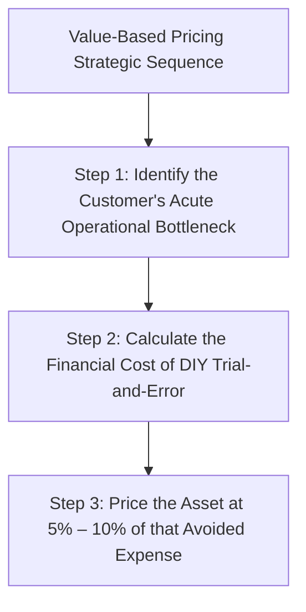
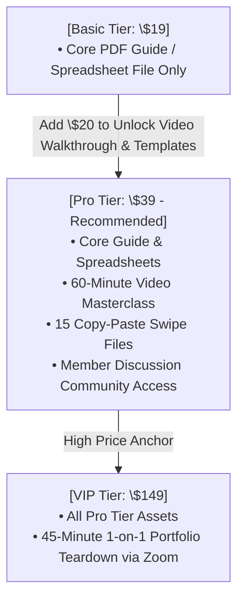

Have you ever prepared to launch your first digital guide, template toolkit, or online course, only to experience severe pricing anxiety:
> *"If I price this at \$20, will anyone buy? Should I discount it to \$2 just to guarantee early traction?"*

Nearly every creator has experienced this hesitation.

The fear of market rejection frequently drives first-time product creators to discount aggressively—selling comprehensive 8-hour masterclasses or intricate spreadsheets built over months for the price of a generic coffee.

Yet real-world consumer behavior reveals an unexpected truth:

When digital products are priced too cheaply (such as a \$1 e-book or \$0.50 template), prospective buyers **become immediately suspicious**:
- *"Why is this so cheap? Is this an unformatted copy-paste scraping of free Google articles?"*
- *"This must be shallow and superficial—reading it will just waste my time."*
- *"Could this be a phishing link or malware download?"*

Rather than driving high volume, **extreme underpricing actively erodes buyer trust**.

In this guide, we break down the psychology of digital product pricing: setting price points that respect customer budgets, reward your expertise, and reflect genuine commercial authority.

---

## 1. Stop Calculating Production Hours: Price on Saved Liability and Time

In manufacturing or food retail, pricing products based on ingredient costs (Cost-Plus Pricing) makes mathematical sense.

Digital assets operate under entirely different unit economics: the marginal cost to deliver an asset to 1 customer versus 10,000 customers is **zero dollars** (*Zero Marginal Cost*).

Never calculate your price based on *"how many hours I spent typing on my laptop"*. Price your offer based on **the volume of time, capital, or operational headaches you eliminate for the buyer**:

### Practical Scenario:
Imagine you create a comprehensive financial forecasting spreadsheet for small boutique cafes:
- Hiring an external accounting consultant costs at least **\$150 monthly** (\$1,800 annually).
- Attempting to construct complex accounting formulas from scratch demands **40 hours of frustrating trial-and-error**.
- If you offer a verified, plug-and-play spreadsheet model that resolves this problem immediately for **\$29**: is that expensive?

Not at all. For the cafe operator, investing \$29 is an obvious financial decision that saves thousands in professional advisory fees.

---

## 2. The Decoy Effect: 3 Tiers That Guide Customer Choice

Consider movie theater popcorn pricing:
- Small: \$4.00
- Medium: \$6.50
- Large: \$7.00

The vast majority of consumers select the Large size, reasoning: *"For just 50 cents more, I get the largest portion available!"*

This behavioral dynamic is known as the **Decoy Effect**. On your digital storefront, avoid presenting a single take-it-or-leave-it price. Present three structured tiers:

With the VIP Tier anchored at \$149:
- The Pro Tier at \$39 feels **highly accessible and practical**.
- Buyers feel they leave value on the table by choosing Basic, since a modest price increase unlocks substantial deliverables.
- Organically, **over 70% of purchasers select the Pro Tier!**

---

## 3. The Digital Product Pricing Sweet Spot

Across international digital commerce, transaction behaviors cluster into three distinct price corridors:

| Category | Typical Price Corridor | Buyer Behavior Dynamics |
| :--- | :--- | :--- |
| **Impulse Purchases (Zero Friction)** | \$5 – \$19 | Instant checkout decisions without requiring budgetary deliberation. |
| **Core Value (Deliberate Consideration)** | \$29 – \$79 | Buyers review sales pages, examine deliverables, and inspect proof. |
| **High Commitment (Career / Business Investment)** | \$99 – \$299+ | Demands explicit guarantees, comprehensive curriculum, or advisory support. |

---

## 4. How to Handle Discount Inquiries Gracefully

In digital commerce, prospective customers will occasionally message asking: *"Could you offer a discount? My budget is tight."*

How should you respond without damaging your market positioning?
- ❌ **Never discount the core offer arbitrarily:** Lowering prices ad-hoc in chat signals that your pricing is arbitrary and unprofessional.
- ✅ **Downsell to an entry-level tier:**  
  > *"Hi [Name]! The full master toolkit is \$39 because it includes comprehensive video teardowns and ready-to-use template assets. However, if your current budget is limited, you can access the core foundational guide for just \$15 via this link: [Link]. The frameworks inside provide immediate practical value to get started!"*

This approach respects customer financial constraints while preserving the commercial integrity of your primary offer.

---

## Core Takeaway

Your digital product pricing reflects your confidence in the real-world utility of your solution.

Never hesitate to charge a fair price if your work eliminates hours of trial-and-error for others. Deploy streamlined checkouts on your independent storefront via [SitusBisnis](https://situsbisnis.com), and allow the tangible value of your assets to build sustainable commercial revenue!
