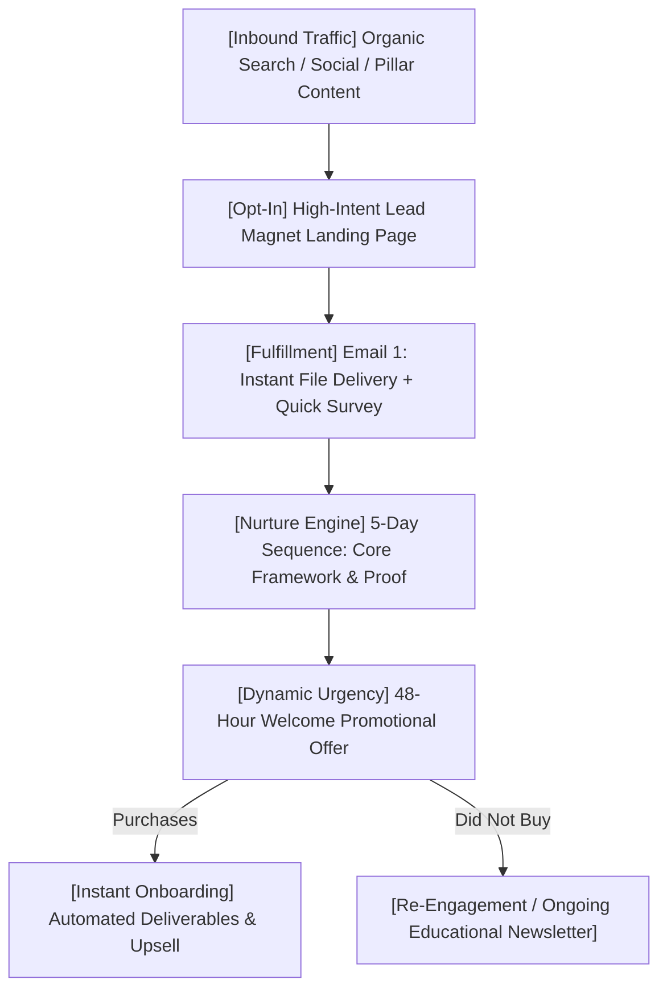

Many digital creators and educators remain trapped on an exhausting financial rollercoaster: harvesting substantial revenue one month during an intense commercial launch, followed by three dry months characterized by creative burnout and endless technical support tickets.

The traditional live-launch model demands immense operational energy:
1. Investing 4 to 8 weeks assembling speculative launch anticipation.
2. Enduring high stress during a tight 5-to-7-day open-cart window.
3. Experiencing an abrupt revenue drop the moment cart doors close.

The reality for modern solopreneurs is clear: **You cannot build a sustainable, durable business if your cash flow is held hostage by sporadic launch cycles.**

The strategic solution is transitioning your flagship assets into an **Automated Evergreen Sales Funnel**—a system that welcomes qualified prospective customers daily, builds trust through structured education, and presents commercial solutions at the exact moment prospects are ready to buy.

---

## 1. Live Launch Models vs. Automated Evergreen Systems

Understanding the philosophical differences between live launches and evergreen systems is crucial for sound system design:

| Evaluation Dimension | Seasonal Live Launch Model | Automated Evergreen Sales Engine |
| :--- | :--- | :--- |
| **Cash Flow Trajectory** | Highly volatile with feast-and-famine cycles. | Consistent, predictable, and compounding daily. |
| **Creator Stress Levels** | Extreme during active 7-to-14-day launch sprints. | Low and evenly distributed across the year. |
| **Conversion Timing** | Dictated by the creator's arbitrary calendar. | Dictated by the prospective buyer's readiness. |
| **Operational Demands** | Requires live broadcasts, daily webinars, and email blasts. | Runs autonomously via automated email sequences and webhooks. |
| **Traffic Dynamics** | Requires massive spikes in concentrated traffic. | Requires steady daily traffic from SEO and pillar content. |

> **Strategic Principle:**
> Evergreen does not mean passively displaying a product link on a website hoping visitors stumble across it. An evergreen funnel is an **individualized, automated launch sequence** experienced by each prospect based on the day they opt in to your lead magnet.

---

## 2. Blueprint of the Evergreen Funnel Architecture

Here is the operational sequence connecting your lead magnet, relational nurturing sequence, and frictionless checkout:

When a prospective buyer submits their contact information on a Tuesday afternoon, their personalized countdown begins. They receive a disciplined series of messages without disrupting subscribers who joined months earlier.

---

## 3. Four Core Pillars of a Resilient Evergreen Engine

To operate without continuous manual intervention, four components must work in sync:

### 1. Ingestion Point (High-Intent Lead Magnet)
The entry point must deliver a focused solution consumable in under 15 minutes (such as an operational checklist, financial calculator, or 10-minute video case study). The faster prospects experience a small win, the faster they trust your commercial offerings.

### 2. Relational Sequence (Trust Architecture)
Avoid pitching paid products on day one. Dedicate your first three communications to:
- Validating the core operational friction they experience.
- Deconstructing costly industry misconceptions.
- Introducing your unique methodology or framework.

### 3. Ethical Scarcity Mechanism (Dynamic Deadlines)
Without deadlines, human psychology defaults to procrastination. In an evergreen architecture, we deploy **Dynamic Deadlines**—where each individual subscriber receives a limited window (e.g., 48 to 72 hours) to secure a welcome promotional rate.

### 4. Zero-Friction Checkout Engine
When a customer decides to buy, eliminate manual transfer confirmations or delayed payment receipts. Provide streamlined checkouts supporting instant QRIS, virtual accounts, and cards via platforms like [SitusBisnis](https://situsbisnis.com).

---

## 4. Pre-Flight Evergreen Readiness Checklist

Before automating your sales engine, ensure your digital asset meets three validation standards:

- [ ] **Validated Proposition:** You have sold the asset manually to at least 10–20 paying customers with high satisfaction.
- [ ] **Documented Customer Objections:** You have cataloged the primary questions and hesitations prospective buyers raise before checkout.
- [ ] **Evergreen Traffic Channels:** You maintain at least 3 pillar blog articles or active content assets driving steady weekly inbound traffic.

---

## Summary & Next Steps

Building an evergreen sales funnel is not about chasing get-rich-quick shortcuts. It is about valuing your creative bandwidth—allowing you to focus on high-value asset creation while an automated system converts audience attention into commercial revenue.

In [Part 2](/en/posts/evergreen-sales-part-2-psychological-welcome-sequence/), we examine the **5-Day Psychological Welcome Sequence**: word for word, the emotional intent behind each email touchpoint, and how to introduce paid solutions without sounding abrasive.
