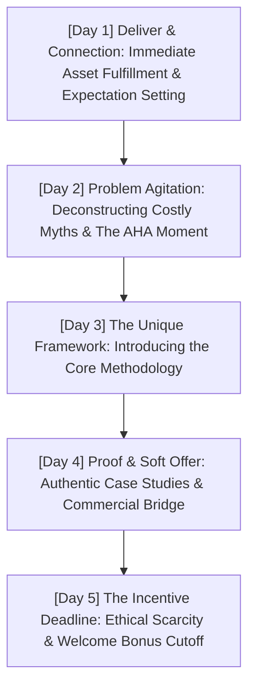

When a prospective customer downloads your free lead magnet, their curiosity and attention are at their absolute peak. Average open rates for the initial delivery email range between **50% and 75%**—dramatically outperforming standard periodic newsletters (which typically average 20% to 25%).

Unfortunately, most creators commit one of two critical errors:
1. **Vanishing for weeks** after delivering the initial download link. When they finally dispatch a promotional message a month later, the subscriber has completely forgotten who they are.
2. **Hard-selling immediately** in the first message with aggressive "Buy Now" links, instantly damaging trust.

The balanced solution is **The 5-Day Psychological Welcome Sequence**—a structured sequence that guides new subscribers from complete unfamiliarity to genuine respect, and ultimately into their first transaction.

---

## 1. The Emotional Journey of the 5-Day Sequence

Here is the psychological trajectory mapped across the 5 days:

Here is how each day is engineered:

---

## 2. Daily Sequence Breakdown

### Day 1: Deliver & Connection (Instant Delivery & Engagement)
- **Primary Objective:** Deliver the promised asset immediately and train email providers to route your future messages into the primary inbox.
- **Sample Subject Line:** `[Download] Your requested resource is ready (+ 1 quick note)`
- **Key Execution Rules:**
  - Place download links directly in the opening paragraph.
  - End with a low-friction question: *"What is your single biggest frustration regarding [Topic] right now? Hit reply and let me know—I read every response personally."*
  - Direct subscriber replies signal to mailbox algorithms (Gmail, Yahoo, Outlook) that your address is a trusted personal contact, keeping you out of promotional or spam tabs.

### Day 2: The Core Problem & Epiphany (Deconstructing Myths)
- **Primary Objective:** Explain why standard industry approaches fail. It is not due to a lack of effort on the reader's part, but because of fundamentally flawed assumptions.
- **Sample Subject Line:** `Why grinding 14-hour days is quietly holding back your sales...`
- **Narrative Arc:** Share personal operational mistakes from your early journey when you adhered to outdated practices, and reveal the mindset shift that unlocked breakthrough results.

### Day 3: The Framework (The Solution Methodology)
- **Primary Objective:** Explain *WHAT* needs to be executed conceptually without getting bogged down in complex technical minutiae.
- **Sample Subject Line:** `The 3-stage blueprint we use to achieve [Specific Outcome]`
- **Key Execution Rules:**
  - Present a clean visual framework or diagram.
  - Illustrate why attempting to piece this together via trial-and-error costs months of wasted time.

### Day 4: Proof & The Soft Offer (Demonstrating Efficacy)
- **Primary Objective:** Introduce your paid product as the implementation accelerator, supported by real-world case studies.
- **Sample Subject Line:** `How [Customer Name] unlocked [Result] in 14 days (walkthrough)`
- **Offer Positioning:**
  - Contrast the customer's state before deploying the system with their results afterward.
  - Provide a clean link to your independent storefront offer page.

### Day 5: The Incentive Deadline (Prompting Timely Action)
- **Primary Objective:** Encourage interested subscribers who are delaying to make a firm decision.
- **Sample Subject Line:** `[Final 8 Hours] Your welcome orientation bonus expires tonight`
- **Key Execution Rules:**
  - Include a concise FAQ addressing refund guarantees, delivery formats, and implementation scope.
  - Reiterate that the orientation discount or bonus package is reserved exclusively for new subscribers during their introductory window.

---

## 3. Performance Metrics: Hard-Selling vs. 5-Day Nurturing

| Performance Metric | Generic Aggressive Sales Blast | 5-Day Nurture Framework |
| :--- | :--- | :--- |
| **Average Open Rate** | Declines steeply after Day 1 (<15%) | Remains stable at 38% – 52% through Day 5 |
| **Unsubscribe Rate** | High (>2% per blast) | Very low (<0.4%) due to high educational value |
| **Customer Profile** | Impulsive buyers prone to refund requests | Qualified buyers who understand system value |
| **Opt-In Conversion Rate** | 0.5% – 1.2% | 2.5% – 4.8% of new subscribers |

> **Editorial Rule:**
> Never hesitate to present paid solutions on Days 4 and 5. If your asset delivers genuine operational relief, presenting it clearly is a service to qualified prospects who need that solution.

---

## Summary & Next Steps

A 5-day welcome sequence is the engine of an evergreen business—functioning as an automated sales representative that communicates with empathy around the clock.

In [Part 3](/en/posts/evergreen-sales-part-3-ethical-urgency-deadlines/), we explore **Dynamic Deadlines & Authentic Urgency**: how to configure credible time constraints without misleading prospects with fake reset countdown timers.
