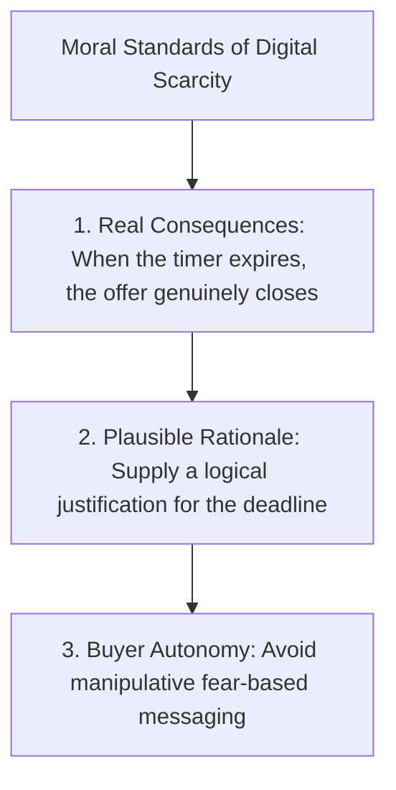

Have you ever landed on a sales page featuring a flashing red timer proclaiming: *"Offer expires in 00:14:32!"*—only to refresh the page or open an incognito window and watch the timer reset right back to 15 minutes?

Such manipulative tactics degrade professional credibility and shatter the most precious asset in digital commerce: **consumer trust**.

Modern digital buyers are sophisticated. The moment they realize a scarcity mechanism is fabricated, they question the legitimacy of your entire framework and any future recommendations.

Yet the fundamentals of consumer psychology remain unchanged: **people need a clear deadline to overcome analysis paralysis and take action.**

In this guide, we break down how to implement **Dynamic Urgency**—a legitimate, ethically grounded time-restriction mechanism that actually closes when the clock expires.

---

## 1. The Three Moral Pillars of Ethical Urgency

To implement scarcity with integrity, adhere to three core principles:

1. **Real Consequences:** If you state that a promotional rate of \$49 expires Friday at midnight, the checkout link must automatically redirect to the standard rate of \$89 at 12:01 AM. If late arrivals can still claim promotional pricing, you train your audience to ignore future deadlines.
2. **Plausible Rationale:** Provide an honest explanation for the constraint:
   - *"This introductory discount serves as a welcome subsidy for new subscribers who take action during their first 48 hours."*
   - *"Live audit bonus slots are capped at 15 participants to maintain advisory quality."*
3. **Respecting Buyer Autonomy:** Avoid aggressive guilt tactics such as *"If you pass on this, you are destined for failure"*. Adopt an objective, professional tone: *"The decision is entirely yours. If you are ready to accelerate your implementation with a proven framework, our welcome promotion remains open through midnight tonight."*

---

## 2. Technical Mechanics of Subscriber-Specific Deadlines

Unlike live launches where all participants share a static calendar deadline, evergreen funnels assign each subscriber a unique **timestamp** the moment they join your database:

| Workflow Phase | Technical Mechanism | User Experience |
| :--- | :--- | :--- |
| **Trigger Event** | Prospect downloads lead magnet (Day 0). | System records subscriber entry timestamp. |
| **Deadline Generation** | Day 4 at 9:00 AM, unique signed URL generated. | Subscriber receives personalized 48-hour access link. |
| **Timestamp Validation** | Server checks current timestamp against `expires_at`. | Prospect sees synchronized, persistent countdown across devices. |
| **Automatic Redirection** | Expiration timestamp reached (Hour 48 + 1s). | Link redirects automatically to full-price storefront or waitlist. |

> **Operational Insight:**
> A credible dynamic deadline requires **cross-device persistence**. Whether a prospect opens your email on a mobile handset or desktop workstation, the remaining time must match exactly.

---

## 3. Responding to Missed Deadline Inquiries

A critical test of commercial integrity occurs when a prospective customer messages customer support:
> *"Hi, I was traveling over the weekend and missed your email. Could I still get the welcome promotional rate?"*

How should you handle this request?
- ❌ **The Amateur Response:** *"Sure, I'll extend the discount link just for you."* (This completely dismantles the integrity of your deadlines).
- ✅ **The Professional & Principled Response:**
  > *"Hi [Name], thank you for reaching out! Regrettably, our introductory orientation promotion is automated via server triggers and closed automatically when the window expired yesterday evening. However, the complete system and all core modules remain available via our standard storefront here: [Storefront Link]. The return on investment from deploying the framework still vastly exceeds the standard investment."*

Serious buyers appreciate the professionalism and proceed with the purchase regardless.

---

## Summary & Next Steps

Urgency is not about emotional manipulation; it is an empathetic tool designed to help prospective customers move past indecision into action.

In [Part 4](/en/posts/evergreen-sales-part-4-automated-whatsapp-integrations/), we examine **Automated WhatsApp Integrations**: combining email nurturing with instant messaging notifications to lift checkout completion rates by up to 300%.
