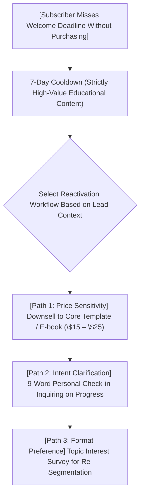

In even the highest-performing evergreen funnels globally, average conversion rates range between **3% and 7%**. This means that out of every 100 people who opt in to your lead magnet and read your welcome sequence, **93 to 97 decide NOT to buy** your initial offer.

Most creators dismiss this 95% majority as lost prospects, leaving their contacts dormant in forgotten email databases.

This represents one of the most substantial misallocations of value in digital business.

When someone declines your initial \$50 offer, it rarely means they dislike your work. Their hesitation typically stems from three everyday realities:
1. **Unfortunate Timing:** They are facing imminent deadlines, holidays, or awaiting their monthly budget replenishment.
2. **Budget Constraints:** They genuinely need a solution, but cannot justify an immediate \$50 investment today.
3. **Format Mismatch:** They lack the bandwidth to parse a 10-hour video curriculum; they simply need an operational spreadsheet or checklist they can deploy in five minutes.

In this concluding installment of the *Evergreen Sales & Funnel Automation* series, we break down actionable strategies for database reactivation and expanding **Customer Lifetime Value (LTV)**.

---

## 1. Three Workflows for Reactivating Dormant Leads

Never let inactive subscribers fade away. Route non-converting leads through these structured re-engagement cadences:

Here is how each path functions:

---

## 2. Tactical Reactivation Playbooks

### 1. The Strategic Downsell (Accessible Entry-Point Assets)
If your primary offer is a comprehensive video curriculum priced at \$149, present a streamlined subset of core assets (such as an *Operational Cheat Sheet + Plug-and-Play Template Bundle*) for \$19 to \$29.

**Why this delivers exponential leverage:**
- Completing a first transaction—regardless of price—fundamentally transforms customer psychology from a *"freebie seeker"* into an active *"paying customer"*.
- Once customers experience the practical quality of an entry-level asset, their likelihood of upgrading to your flagship system in the future increases by **over 400%**.

### 2. Dean Jackson's 9-Word Re-engagement Email
Three weeks after their introductory offer window closes, dispatch a plain-text email formatted as a quick personal note without images or marketing headers:

> **Subject:** `quick question {{first_name}}`
> 
> *Hi {{first_name}}, are you still planning to launch your digital product storefront this month?*
> 
> *Best regards,*  
> *[Your Name]*

This short format routinely drives reply rates **exceeding 25%** because it feels genuine and opens a direct, unhurried dialogue.

### 3. Targeted Monthly Payday Campaigns
Across many international and regional markets, consumer purchasing power clusters tightly around monthly payroll dates (typically between the **25th and 1st** of each month).

Align with this liquidity cycle by launching a concise 48-hour promotional window featuring dedicated bundles or exclusive bonus materials specifically for non-purchasers.

---

## 3. The Digital Product Value Ladder Architecture

Commercially resilient creators do not rely on a single standalone product and endlessly hunt for new audiences. They construct a structured **Value Ladder**:

| Value Tier | Offer Format | Target Price | Commercial Function |
| :--- | :--- | :--- | :--- |
| **Tier 0: Lead Magnet** | Tactical Checklist / PDF / Mini Guide | Free (Contact Exchange) | Attracts high-intent prospective buyers |
| **Tier 1: Downsell / Tripwire** | Spreadsheet Model / AI Prompts / Short Guide | \$15 – \$29 | Covers acquisition costs & qualifies buyers |
| **Tier 2: Flagship Evergreen** | Full Curriculum / End-to-End System | \$99 – \$249 | Primary driver of ongoing operational revenue |
| **Tier 3: High-Ticket / VIP** | 1-on-1 Diagnostic / Private Advisory | \$500 – \$1,500+ | Delivers peak net profit margins |

> **Strategic Principle:**
> Backed by a structured value ladder on [SitusBisnis](https://situsbisnis.com), you no longer need to chase massive social follower counts. An engaged list of 1,000 active subscribers can support an independent business generating healthy monthly profit.

---

## Series Conclusion

Building an evergreen sales engine is not about finding magical shortcuts to overnight wealth. It is about **honoring your creative bandwidth and your audience's time**.

When your business welcomes subscribers with structured value, shares authentic stories, deploys ethical dynamic deadlines, and delivers friction-free checkout experiences... you break free from seasonal launch burnout.

Your storefront operates sustainably every single day, giving you the freedom to build great assets and serve your community with confidence.
