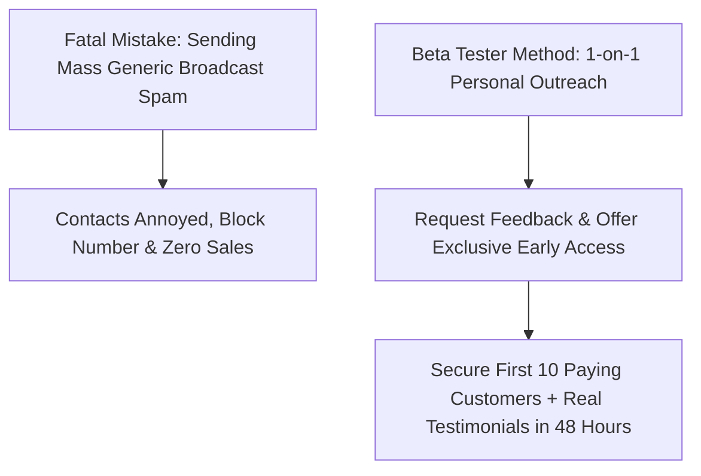
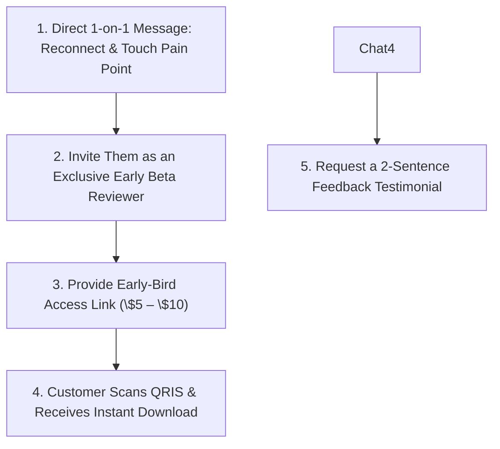

The most anxiety-inducing moment for an early-stage digital solopreneur is not creating the product—it is **waiting for that very first paid order to arrive**.

For operators with zero social following who have never managed paid advertising campaigns (Facebook or TikTok Ads), hesitation is natural: *"My digital guide is finalized, but who will buy if I have zero audience?"*

The initial answer is already in your hands: **The direct contact list on your mobile device**.

You do not need to navigate complex multi-stage funnels or spend hundreds of dollars on ad tests. You simply need a disciplined execution protocol: **The Warm Circle Beta-Tester Method**.

---

## Why You Must Avoid Mass Broadcast Spam

The most common rookie misstep is composing an overly long promotional pitch decorated with emojis, then sending it via broadcast to every contact in your phone.

The results are predictable:
- You are perceived as intrusive and spammy.
- Your messages are ignored.
- Close personal contacts mute or block your number out of awkwardness.

Nobody enjoys being hard-sold. However, **people genuinely appreciate being invited into an advisory role on a meaningful project**.

---

## The 3-Step Beta Tester Script

Identify 15 to 25 contacts in your messaging address book who have previously mentioned the specific challenge your digital asset resolves. Reach out to them individually (*1-on-1 direct messages*), never through public group threads.

Structure the dialogue using this sequence:

### Step 1: Validate the Problem Naturally
Send a brief, friendly check-in without using sales buzzwords like "discount" or "buy":

> *"Hi [Name]! Hope your week is going well. I remembered you mentioning recently that you were navigating [mention acute problem, e.g., corporate compliance filings / interview prep]. Over the last three days, I finalized a concise 5-page operational checklist detailing the exact workflow I used to resolve that problem step by step."*

### Step 2: The Beta Review Hook
Invite their perspective prior to official commercial release:

> *"I plan to launch this publicly next week for \$29. But before releasing it widely, I am looking for 10 initial practitioners to review the material and provide honest feedback on whether anything needs clarification. Would you be open to reviewing the draft?"*

Almost everyone experiencing that operational friction will respond: *"Absolutely, please send it over!"*

### Step 3: The Symbolic Early-Bird Commitment
Once they express interest, introduce an accessible commitment fee to ensure they actually review the asset:

> *"Awesome, thank you! To ensure we're both committed and to cover server costs, I'm opening access for our 10 beta reviewers at a token rate—just \$7 (75% off the official release price). If that sounds fair, here is the direct link: [Your SitusBisnis Storefront Link]. The moment checkout clears, the PDF toolkit downloads automatically to your device."*

---

## The Psychological Power of Your First 10 Customers

Securing 10 initial buyers at \$7 generates:

$$\text{Initial Revenue} = 10 \times \$7 = \$70$$

Financially, \$70 will not fund early retirement. Psychologically, however, **the impact is transformative**:

1. **Eliminating Fear of Failure:** You prove empirically that you can generate independent digital revenue from scratch.
2. **Securing Authentic Social Proof:** Two days later, follow up: *"How did the checklist work for your workflow?"* Screenshots of their positive responses become your most powerful marketing assets when pitching to external audiences.
3. **Genuine Market Validation:** You confirm that real people are willing to allocate personal capital to access your solution.

---

## Professional Post-Purchase Execution

Never complicate your first transactions by asking buyers to manually transfer funds to personal bank accounts and upload blurry transaction screenshots.

By hosting your offer on an independent storefront via [SitusBisnis](https://situsbisnis.com):
- Customers check out with confidence using familiar, secure payment channels (instant QRIS, cards, and virtual accounts).
- Deliverables are dispatched automatically without requiring manual seller intervention.
- You retain 100% of your earnings with **zero middleman commission penalties**.
