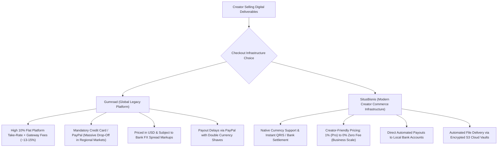
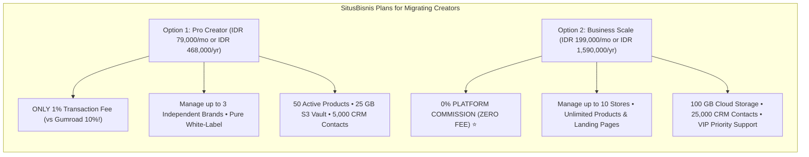

For digital creators, software developers, and template designers, Gumroad has long served as a default storefront. For years, the US platform was the benchmark for solopreneurs selling Notion systems, code boilerplates, design presets, and e-books.

However, over recent years, deploying Gumroad to reach audiences in Southeast Asia and regional emerging markets has turned into an operational bottleneck:

1. **Unilateral Fee Increases to a Flat 10%:** Gumroad raised its platform fee to a flat **10% of every sale**. When combined with credit card processing expenses (~2.9% + $0.30), total platform deductions regularly consume **13% to 15%** of gross revenue!
2. **The Credit Card Barrier:** Over 80% of regional consumers **do not own credit cards**. When directed to a checkout screen demanding credit card numbers or PayPal, prospective buyers abandon their carts.
3. **Foreign Currency (USD) Friction:** Quoting in USD triggers consumer hesitation due to bank foreign exchange markups and currency volatility.
4. **Payout Friction & Currency Spread Losses:** Creator revenue is trapped in USD balances, requiring transfers via PayPal or wire transfers that shave 3% to 5% off real market exchange rates.

This is why regional creators are migrating toward **local, self-hosted commerce platforms** supporting domestic currencies, instant **QRIS settlement**, and creator-first pricing structures.

---

## 1. Calculating the Real Cost of Gumroad's 10% Fee

Gumroad's shift to a flat 10% commission was one of the most controversial changes in the creator economy.

Examine the mathematical impact:
If you sell an e-book or template for **IDR 200,000 (roughly $12 USD)** and generate **100 orders monthly**:
* **Gross Revenue:** IDR 20,000,000 (~$1,200 USD).
* **Gumroad Platform Fee (10%):** IDR 2,000,000 (~$120 USD).
* **Payment Processing Deductions:** ~IDR 600,000 (~$36 USD).
* **PayPal FX Currency Conversion Losses:** ~3% to 4% below standard central bank rates (~IDR 600,000).
* **Total Monthly Deductions: Over IDR 3,200,000 (~$190 USD) every single month!**

Over a calendar year, you forfeit **IDR 38,400,000 (~$2,300 USD)** to platform deductions and foreign exchange spreads.

---

## 2. Consumer Friction: Why Foreign Checkouts Suppress Conversion

Beyond steep fees, the primary challenge of using Gumroad for domestic buyers is **drastically suppressed conversion rates**.

Consider local buyer behavior:
1. **QRIS Ubiquity:** Consumers across demographics expect to pay via dynamic QRIS from banking apps or e-wallets. A QRIS code is scanned and settled in 10 seconds.
2. **Hesitation Over International Credit Card Fields:** Entering 16-digit card numbers and 3-digit CVV codes into foreign forms raises fraud concerns.
3. **SMS OTP Failures:** International gateway transactions frequently fail when SMS authentication codes from regional issuing banks fail to deliver.

The outcome? Between 60% and 80% of high-intent visitors abandon the purchase simply because the payment flow is cumbersome.

---

## 3. SitusBisnis: An Engineered Alternative for Independent Commerce

**[SitusBisnis](https://situsbisnis.com)** was built to eliminate these systemic points of failure.

Here is a side-by-side comparison:

| Evaluation Dimension | Gumroad (Global Legacy) | SitusBisnis (Modern Creator Commerce) | Commercial Impact |
| :--- | :--- | :--- | :--- |
| **Settlement Currency** | US Dollars (USD) | **Rupiah (IDR)** | Buyers settle in native currency with zero FX anxiety. |
| **Primary Payment Methods** | Credit Card & PayPal | **Dynamic QRIS & Direct Bank VAs** | Checkout conversions increase up to 4x. |
| **Platform Commission** | **Flat 10%** *(High)* | **1% (Pro Creator) down to 0% (Business Scale ⭐)** | Operating profit remains entirely yours. |
| **Pro Tier Subscriptions** | None (Flat 10% across all tiers) | **Pro Creator: IDR 79k/mo (IDR 468k/yr)** | Predictable, fixed software costs. |
| **Balance Settlement (Payout)** | Delayed PayPal / Wise payouts | **Direct to National Banks (BCA/Mandiri/BRI/BNI)** | Rapid settlement with zero currency conversion shaves. |
| **File Storage Security** | Standard cloud hosting | **Dedicated S3 Cloud Storage Vault (25 GB – 100 GB)** | Expiring download links prevent unauthorized file leaks. |
| **Supported Product Types** | Digital downloads, basic email | **Digital, LMS Courses, Services, & Physical COD** | Multi-category storefront flexibility. |
| **Custom Domain CNAME** | Subject to custom plan terms | **✓ Full Custom CNAME Support (.com / .id)** | Complete brand authority and independence. |

---

## 4. Transparent Plans on SitusBisnis

For creators transitioning away from Gumroad, SitusBisnis provides two primary tiers:

### 1. Pro Creator (1% Transaction Fee)
* Subscription: **IDR 79,000 monthly**, or **IDR 468,000 annually** (equivalent to **IDR 39,000 per month**).
* Platform transaction commission slashed from Gumroad's 10% to **just 1%**.
* Full suite: 3 independent storefronts, unlimited landing pages, 50 active products, 25 GB encrypted S3 vault storage, 5,000 CRM customer contacts, and 1,000 monthly broadcast emails.

### 2. Business Scale (0% Platform Fee)
* Subscription: **IDR 199,000 monthly** or **IDR 1,590,000 annually**.
* **0% Platform Commission (ZERO FEE) ⭐**. You surrender zero transaction commissions to the platform, paying only standard central bank clearing fees (~0.7%).
* Enterprise scope: 10 storefronts, unlimited products, unlimited landing pages, 100 GB encrypted storage, and 25,000 CRM customer contacts.

---

## 5. Automated, Leak-Proof File Delivery Infrastructure

Protecting intellectual property is essential when selling digital assets. On **[SitusBisnis](https://situsbisnis.com)**, distribution is engineered to institutional standards:

1. **Encrypted S3 Storage Vault:** Deliverables (PDF, ZIP, MP4) are stored in secure, private S3 storage buckets rather than public web directories.
2. **Instant QRIS Verification:** The moment a customer scans a dynamic QRIS code on their device, settlement confirms in real time.
3. **Expiring Download Tokens:** The confirmation screen immediately presents a secure, time-restricted download link that cannot be shared publicly.
4. **Automated WhatsApp & Email Receipts:** Customers concurrently receive an automated receipt via email and messaging with backup access links.

---

## Conclusion: Build for Your Actual Market

The regional digital product ecosystem is expanding rapidly. Consumers actively purchase practical guides, educational resources, and professional assets.

You cannot capitalize on this demand while relying on international platforms that impose high fee structures and incompatible payment flows.

By migrating to **[SitusBisnis](https://situsbisnis.com)**:
- Buyers complete checkout in 10 seconds via native payment methods.
- Gumroad's 10% commission tax is replaced with **1% or 0% Zero Fee economics**.
- Every single customer email address and phone number is captured directly inside your own CRM.

Launch your independent storefront today on **[SitusBisnis](https://situsbisnis.com)** and build a sustainable digital enterprise on your own terms.
