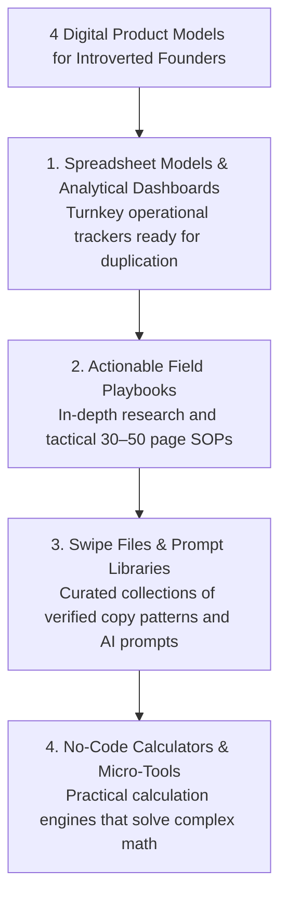

Consider what introverts often think when surveying the modern creator economy:
> *"To earn an independent income online, it feels like you must be loud on camera, speak like a broadcast presenter, and chase social media drama every week. That isn't me. Maybe digital business simply isn't an option for my personality."*

That assumption is **100% incorrect**.

In the digital economy, an introverted disposition is frequently a **hidden competitive advantage**.

Introverts naturally:
- Excel at observing subtle operational bottlenecks that others overlook.
- Enjoy structuring clean, logical, and repeatable systems.
- Communicate with depth and clarity in written form rather than superficial banter.

The digital deliverables that command the highest prices and customer satisfaction are **organized, structured tools that save buyers time**—precisely the assets introverts excel at building.

In this guide, we break down 4 camera-free digital product models (*faceless business models*) you can operate quietly from your home workspace.

---

## 1. Four Camera-Free Digital Business Models for Introverted Creators

Forget about ring lights and broadcast microphones. Consider these 4 product formats that require neither your face nor your voice:

### 1. Spreadsheet Models & Workflow Dashboards
Many operators find building financial models, project trackers, or editorial calendars from scratch daunting.
- You assemble a clean, functional spreadsheet dashboard once.
- Buyers click *"Duplicate to my workspace"*, and funds transfer directly to your account.
- Zero video calls, zero live demonstrations. A pure digital utility that operates autonomously.

### 2. Actionable Tactical Playbooks (30–50 Pages)
Modern digital buyers rarely seek lengthy academic textbooks. They want concise, outcome-driven Standard Operating Procedures (SOPs):
- *Example:* *"The 7-Step Guide to Securing Food & Beverage Compliance Permits Without Retainers"*.
- *Example:* *"The Independent Storefront Security & Backup Checklist"*.
People invest in your curated research because they lack the time to parse hundreds of disorganized forum threads.

### 3. AI Prompt Libraries & Copywriting Swipe Files
With the expansion of AI, users require tested operational prompts:
- A curated directory of 100 image-generation prompts for technical diagrams.
- 50 Tested sales outreach scripts with high response rates.
You curate and test the best approaches, organize them into a clean swipe file, and distribute them to eager practitioners.

---

## 2. Selling Effectively Without Video Broadcasting

How do you attract buyers without hosting video live-streams? Rely on **written insights and visual walkthrough screenshots**:

| Primary Platform | Ideal Written Formats for Introverted Founders |
| :--- | :--- |
| **X / Twitter & Threads** | Analytical case studies, step-by-step breakdowns, and system teardowns. |
| **LinkedIn / Carousels** | Minimalist visual slides highlighting operational takeaways without showing faces. |
| **SEO Blog Articles** | Deep-dive essays that rank on search engines when buyers seek solutions. |

> **Operational Insight:**
> Buyers do not evaluate what you look like. They evaluate one simple proposition: **Does your template or guide reliably solve their acute problem?**

---

## 3. Assembling an Automated Storefront Without Support Chats

The single most draining task for an introvert is fielding open-ended inquiries from casual chatters who never intend to buy.

The solution:
- Construct a transparent sales page featuring an exhaustive, objection-handling FAQ section.
- Deploy an independent storefront via [SitusBisnis](https://situsbisnis.com) with automated payment processing and instant digital delivery.
- Buyers visit the page, read the deliverables, complete payment via instant checkout, and receive files automatically in their inbox.

You complete legitimate commercial transactions without spending your days fielding manual chat messages.

---

## Quiet Focus, Tangible Impact

You do not need to reshape your personality into an extroverted influencer to build a successful digital business.

Embrace your natural focus, dedicate your energy to creating assets that simplify workflows for others, and allow the quality of your work to speak for itself.
