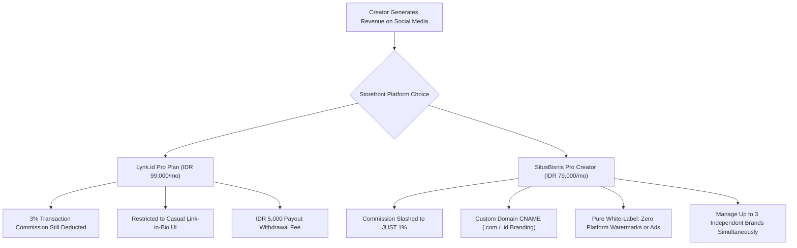
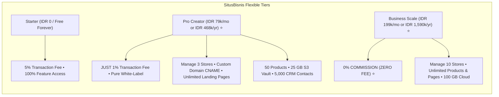

Have you ever calculated exactly how much capital is shaved from your revenue every time a digital product sells through your link-in-bio page?

For many early creators on TikTok and Instagram, Lynk.id is an easy starting point: sign up with a social account, assemble a list of links, set a price, and start selling e-books or templates within 10 minutes.

However, once monthly revenues exceed IDR 10M to IDR 30M, two major limitations emerge:

1. **The Paid Account Paradox:** Even after paying a recurring IDR 99,000 monthly fee, **the platform still clips a 3% commission on every transaction**, in addition to withdrawal fees on each transfer.
2. **The Link-in-Bio Brand Ceiling:** When pricing digital deliverables at IDR 350,000 or IDR 750,000, prospective customers hesitate because the storefront looks like a casual social media directory rather than an authoritative, branded commercial business.

This is why experienced creators, educators, and solopreneurs are seeking an **independent alternative**—transitioning to **[SitusBisnis](https://situsbisnis.com)** for significantly lower commission rates, pure white-label presentation, and full brand ownership.

---

## 1. The Cost Trap: Why Growing Stores Pay Exponentially More

Review the fee structure on standard link-in-bio platforms:
* **Free Account:** Imposes a **5% transaction fee** plus bank withdrawal fees.
* **Pro Plan:** Requires an **IDR 99,000 monthly fee**, yet continues to shave a **3% transaction commission** on every order.

Consider the compounding math:
If your digital storefront generates **IDR 20,000,000** monthly:
- Pro Plan Subscription: IDR 99,000
- 3% Commission Deduction: **IDR 600,000**
- Weekly Payout Fees: IDR 20,000
- **Total Platform Deductions: IDR 719,000 monthly.**

If monthly revenue scales to **IDR 50,000,000**:
- The 3% commission takes **IDR 1,500,000** every month (reaching **IDR 18,000,000 annually**!).

Why should a platform that simply provides a basic checkout page extract larger and larger cuts of your hard-earned revenue as you scale?

---

## 2. Perceived Value: Social Bio Links vs. Branded Digital Storefronts

A generic link-in-bio layout is designed to catalog diverse links (YouTube channels, articles, affiliate recommendations). When applied to mid-to-high-ticket digital assets, this layout creates psychological friction:

* **Appears Temporary:** Buyers considering a \$30 to \$50 course or operational template expect a polished digital storefront, not a button on a mobile link list.
* **Lack of Independent Custom Domains:** Tying your business to a third-party domain (`lynk.id/username`) reduces commercial authority when pitching corporate or enterprise buyers.
* **Choice Overload:** Stacking dozens of links on a single mobile screen distracts visitors from your primary high-margin offers.

---

## 3. SitusBisnis: An Engineered Commerce Infrastructure

**[SitusBisnis](https://situsbisnis.com)** is not an ordinary bio-link shortener. It is an **all-in-one creator commerce platform** engineered for scale:

### Head-to-Head Comparison: Pro Tiers

| Feature Dimension | Lynk.id Pro Plan | SitusBisnis Pro Creator ⭐ | Advantage |
| :--- | :--- | :--- | :--- |
| **Monthly Pricing** | IDR 99,000 / month | **IDR 79,000 / month** | **SitusBisnis (More Accessible)** |
| **Annual Pricing** | ~IDR 1,188,000 / year | **IDR 468,000 / year** *(Save 51%!)* | **SitusBisnis (Saves Over IDR 700k)** |
| **Platform Commission** | **3%** *(Continuous Deduction)* | **JUST 1%** *(3x More Affordable)* | **SitusBisnis (1% Fee)** |
| **Storefront Capacity** | 1 Profile Account | **Up to 3 Independent Brands** | **SitusBisnis** |
| **Landing Pages** | Bio-link cards only | **Unlimited Landing Pages** | **SitusBisnis** |
| **Custom Domain CNAME** | Custom add-on required | **✓ Connect Your Own Domain (.com / .id)** | **SitusBisnis** |
| **White-Label Presentation** | Limited | **✓ Pure White-Label (100% Clean)** | **SitusBisnis** |
| **Ad-Free Environment** | Platform banners appear | **✓ 100% Free of Competitor Ads** | **SitusBisnis** |
| **Cloud Storage S3 Vault** | Restricted | **25 GB Dedicated S3 Vault** | **SitusBisnis** |
| **Customer CRM Database** | Locked to platform | **5,000 Exportable Contacts** | **SitusBisnis** |
| **Broadcast Messaging** | Unavailable natively | **1,000 Monthly Email Broadcasts** | **SitusBisnis** |

---

## 4. Net Profit Realities: Financial Simulation

Consider an operator selling an operational guide at **IDR 150,000 per order**, processing **200 sales per month** (Gross Revenue: **IDR 30,000,000**):

| Financial Breakdown | Lynk.id Pro | SitusBisnis Pro Creator | SitusBisnis Business Scale |
| :--- | :--- | :--- | :--- |
| **Gross Monthly Revenue** | IDR 30,000,000 | IDR 30,000,000 | IDR 30,000,000 |
| **Subscription Cost** | -IDR 99,000 | -IDR 79,000 *(IDR 39k/mo annualized)* | -IDR 199,000 |
| **Platform Take-Rate** | **-IDR 900,000 (3%)** | **-IDR 300,000 (1%)** | **IDR 0 (ZERO FEE) ⭐** |
| **Estimated Central Bank QRIS (0.7%)**| Included | -IDR 210,000 | -IDR 210,000 |
| **Withdrawal Fees** | -IDR 5,000 | -IDR 4,000 | -IDR 3,000 |
| **Net Realized Cash** | **IDR 28,996,000** | **IDR 29,407,000** | **IDR 29,588,000** |
| **Retained Profit Advantage** | *Baseline* | **+IDR 411,000 / month** | **+IDR 592,000 / month** |

> **Financial Insight:**
> Retaining an additional IDR 400,000 to IDR 600,000 every single month equals **IDR 4,800,000 to IDR 7,100,000 per year**. That capital can fund paid acquisition tests, upgraded production gear, or simply bolster your business reserves.

---

## Summary: Moving Beyond Bio-Link Cards

Selling digital assets through casual link lists is fine for hobbyists. But building a durable digital business demands professional infrastructure: low commission rates, custom domain authority, and direct ownership of your customer list.

Migrate to **[SitusBisnis](https://situsbisnis.com)** today and operate with the margins and professional presentation your business deserves.
