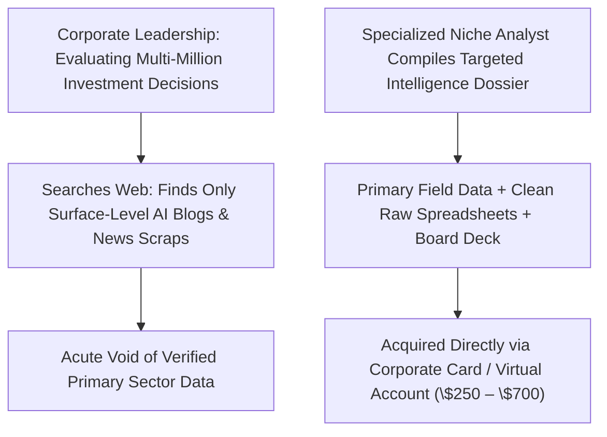
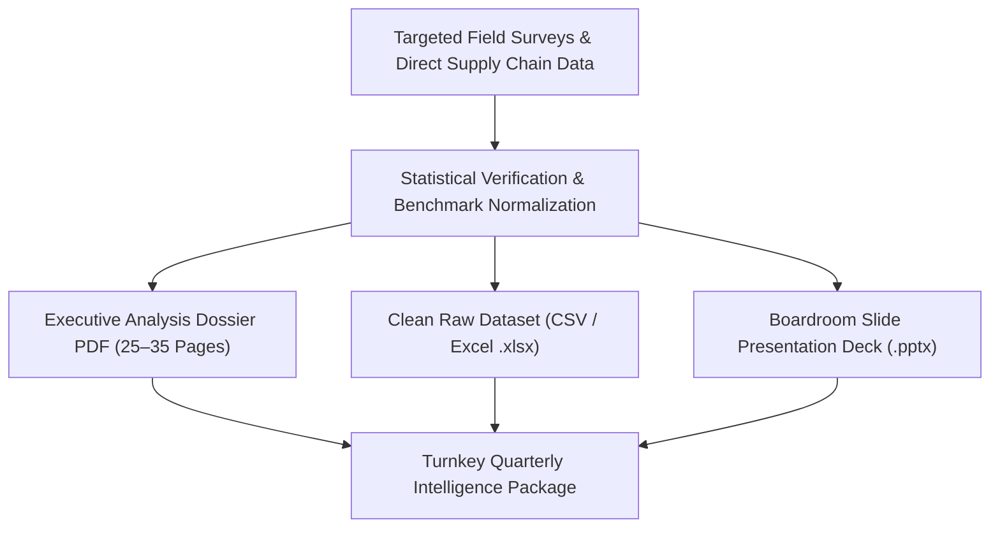

In an era saturated with synthetic AI-generated content, an unexpected reality has emerged: **verified, clean primary data on specialized industrial markets has become an exceptionally rare commodity**.

Corporate directors, heads of procurement, and enterprise strategy leads frequently spend weeks searching for reliable benchmarks:
- What are the true average inter-island refrigerated freight rates across specific regional trade corridors?
- What is the realistic compensation spectrum for senior data infrastructure talent in Series B tech ventures?
- How have regional raw agricultural commodity prices fluctuated following recent statutory export restrictions?

Global advisory giants like Gartner or McKinsey charge tens of thousands of dollars for broad macroeconomic whitepapers. This creates a lucrative opportunity for **Niche Micro-Intelligence Reports**: selling highly focused quarterly research dossiers for \$250 to \$700 per edition.

---

## Anatomy of a High-Value Executive Intelligence Report

An enterprise intelligence report is not measured by page count; it is valued for **the credibility of its primary dataset and its immediate utility in executive boardrooms**:

### 1. Primary Field Data (Not Recycled Media Scraps)
Commercially successful reports avoid rewording news headlines. Their value is derived from:
- Periodic closed surveys of 50 to 100 frontline industry operators.
- Anonymized data aggregation across real commercial agreements and logistics waybills.
- Direct operational observations that search engines and public AI models cannot crawl.

### 2. Clean Raw Dataset Attachments
Corporate analysts do not merely want to read your conclusions; they need to test assumptions within their own internal financial models:
- Include clean, structured CSV/Excel sheets.
- Detail data gathering methodologies, sample parameters, and confidence intervals.

### 3. One-Page Executive Board Deck
Leadership teams lack time to parse 60 pages of text. They require:
- A concise visual diagram capturing key supply chain trends for the upcoming quarter.
- Three tactical strategic imperatives for immediate executive consideration.
- A companion PowerPoint slide deck (.pptx) formatted for presentation in board meetings.

---

## Marketing and Selling Specialized Intelligence

Enterprise intelligence assets are not marketed through mass social media ad blasts. Distribution is driven by **authority-led positioning**:

1. **Publishing Provocative Data Findings on LinkedIn:** Share an unexpected finding from your research (for example: *"72% of Regional Cold-Chain Operators Experience Invoice Delays Exceeding 60 Days"*), accompanied by sharp analysis.
2. **Targeted Executive Outreach:** Connect with 30 Heads of Supply Chain or Chief Strategy Officers via email: *"Good morning [Name], we just completed our Q3 Cold-Chain Logistics Benchmark covering 45 regional carriers. Attached is a complimentary 2-page executive summary. If your team requires the full dataset and slide deck, access is available here."*
3. **Structuring Annual Subscription Access:**
   - Single Quarter Edition: \$350.
   - 4-Quarter Annual Intelligence Pass: \$990 (locking in predictable recurring cash flow).

---

## Distributing Intelligence on an Independent Storefront

Corporate buyers evaluate transaction security and receipt clarity closely. They require immediate settlement verification, corporate tax receipts, and encrypted delivery links.

With an independent storefront on [SitusBisnis](https://situsbisnis.com), you present a professional storefront supporting corporate payment channels, automated tax invoices, and instant digital fulfillment—with **0% platform commission deductions**.
