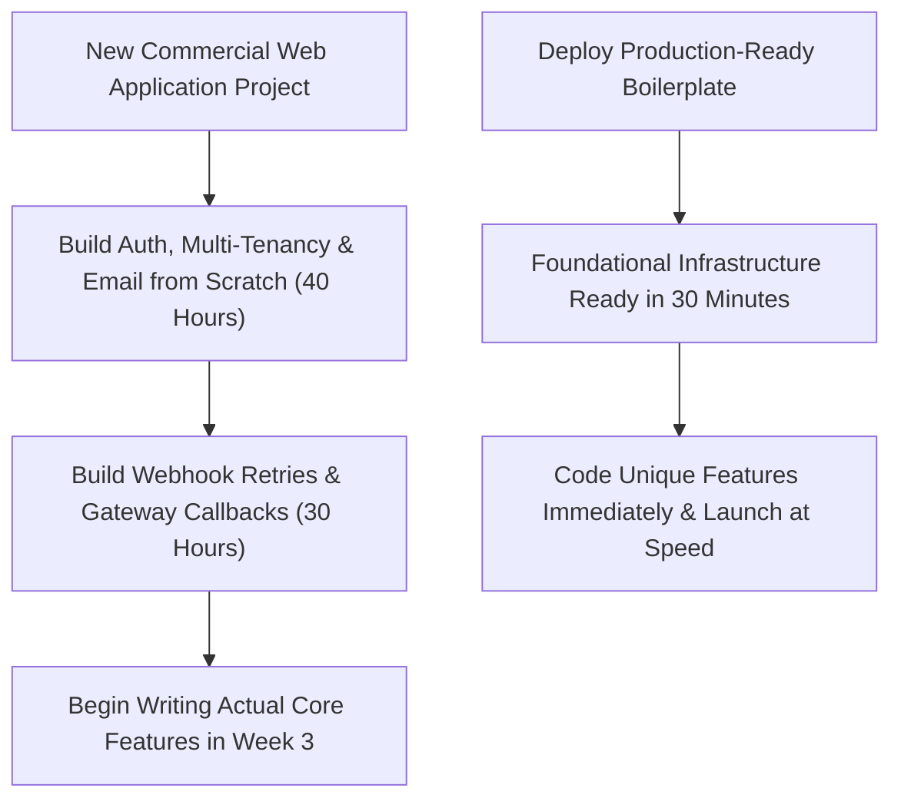
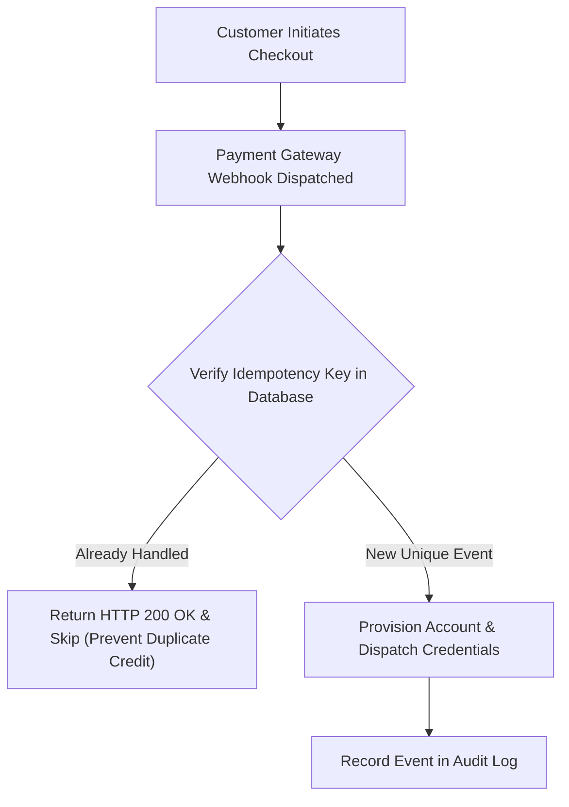

Any experienced software engineer who has built applications from scratch knows how tedious it is to configure foundational plumbing repeatedly: setting up authentication and password recovery loops, designing multi-tenant schemas, configuring transactional email services, and handling payment gateway webhooks.

An engineering team typically expends 40 to 80 hours assembling this baseline scaffolding before writing the first line of core product logic.

Globally, the **Developer Starter Kit and Boilerplate** movement has created independent technical founders earning significant recurring revenue. Demand is surging for production-ready foundations integrated with regional payment systems (QRIS, virtual accounts) and scalable architecture out of the box.

---

## What Makes a Code Boilerplate Worth Hundreds of Dollars?

Developers do not pay for cheap repos that simply stitch together open-source UI libraries. A commercial starter kit commands premium pricing because it resolves **difficult technical and architectural challenges**:

### 1. Robust Payment Gateway Webhook Handlers (Idempotency Engine)
The single most vulnerable point in web monetization is network instability or payment providers dispatching duplicate webhook callbacks.
- A production boilerplate includes *idempotency keys* and an *event queue* (via Redis or database transactions) to guarantee accounts are never credited twice.
- Automated retry logic gracefully recovers transactions if an API endpoint experiences momentary downtime during callback verification.

### 2. Multi-Tenant Architecture and Tenant Isolation
For developers building B2B SaaS applications, data isolation across organizations is essential:
- Configured PostgreSQL Row-Level Security (RLS) policies or database-per-tenant connection routing.
- Built-in Role-Based Access Control (RBAC): Owner, Workspace Admin, Branch Manager, and Member privileges.

### 3. Integrated Audit Logging and Observability
- Error-capturing middleware that dispatches structured alerts directly to Discord or Telegram channels.
- An immutable audit trail tracking administrative user events for security compliance.

---

## The Value Equation for Engineering Teams

Consider the cost of hiring a Senior Full-Stack Engineer. An engineering contractor commands \$50 to \$100+ per hour.

If a validated boilerplate saves 60 hours of engineering setup:

$$\text{Value Saved} = 60 \text{ Hours} \times \$60/\text{hr} = \$3,600$$

When you price that starter kit at **\$149 for a commercial license**, the purchase is an obvious financial decision for tech founders and boutique development agencies.

---

## Automated Repository Distribution Workflows

How do you license and distribute source code efficiently without public leakage or manually adding GitHub handles:

1. **Automated GitHub Private Repo Invites via API:** When a customer completes checkout on your storefront, a webhook automatically calls the GitHub API to invite the buyer's username as an outside collaborator to the private repository.
2. **Clear Markdown Documentation:** Include a local configuration guide with detailed `.env.example` configurations, database migration scripts, and deployment recipes for VPS or serverless hosting.
3. **Structured Commercial Licensing Tiers:**
   - *Solo Developer License:* 1 commercial project (\$99).
   - *Agency / Unlimited License:* Build unlimited commercial client applications (\$299).

Using an independent storefront like [SitusBisnis](https://situsbisnis.com), you can sell repository licenses, process payments via instant QRIS or credit cards, and route developers directly to your onboarding documentation—retaining 100% of your earnings with **zero platform commission cuts**.
