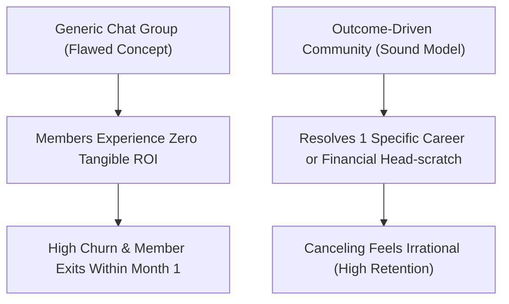
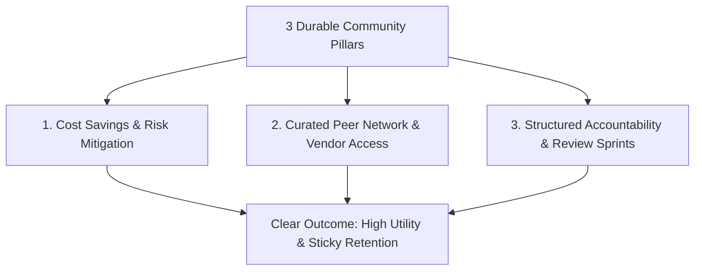

The most anxiety-inducing moment for digital creators and independent solopreneurs arrives on the first day of every month: revenue counters reset to zero, and you must conceive new promotional campaigns just to meet operating expenses.

This income volatility is exhausting. One month you generate \$2,500 from an asset launch; the following month revenue drops to \$300 as your creative energy runs dry.

The most durable stabilizing force in digital business is **an Independent Paid Community or Membership Engine**.

However, 80% of early community builders falter immediately by pursuing the wrong foundation: launching an informal "hangout group" or a generic discussion forum. In an era saturated with free public content, nobody pays monthly subscription fees merely to sit inside unstructured group chats.

In this opening guide of the *Paid Community Masterclass*, we examine how to architect an **Outcome-Driven Membership**—delivering tangible operational value that makes canceling feel financially counterproductive.

---

## The 3 Durable Pillars of Paid Communities

To ensure members willingly maintain monthly dues (\$5 to \$20/month), your community concept must anchor to at least one of these three core value propositions:

### 1. Cost Savings & Risk Mitigation
Members subscribe because the insights shared protect them from costly financial or legal mistakes.
- *Example:* A collective of early-stage cross-border importers sharing vetted shipping routes and regulatory customs compliance updates. If a single alert prevents a \$500 customs penalty, paying a \$10/month membership fee is an obvious financial decision.

### 2. High-Value Curated Peer Network
Members subscribe not merely to consume the host's content, but to build operational relationships with peers operating at their level.
- *Example:* A private group for restaurant operators generating over \$5,000 monthly, exchanging vetted wholesale vendor contacts and staffing SOPs.

### 3. Accountability Sprints & Tactical Teardowns
Members subscribe to combat procrastination, guided by structured accountability and regular feedback.
- *Example:* A cohort of technical writers with weekly draft teardown sessions and publication accountability check-ins every Monday morning.

---

## Structuring Introductory Membership Pricing

Avoid pricing yourself out of the market during initial validation:
- **Entry-Level Tier (\$3 – \$7 / month):** Comparable to the cost of a single specialty coffee. Friction is negligible; ideal for skill-building libraries or monthly asset drops.
- **Growth Tier (\$10 – \$25 / month):** Suitable for networks featuring monthly live advisory teardowns or exclusive vendor databases.
- **Annual Membership Pass:** Offer a "12 months for the price of 10" incentive (two months free) for upfront annual commitments. This locks in 365 days of guaranteed cash flow.

---

## Actionable Next Step

Draft a single-sentence mission statement for your community:
> *"This membership helps [Target Demographic] achieve [Tangible Outcome] without [Primary Friction Point]."*
> 
> *Example:* *"This community helps independent specialty coffee shop operators maintain a 35% net operating margin without hiring costly external hospitality consultants."*

In [Part 2: Designing a First-Week Member Onboarding Architecture](/en/posts/paid-communities-part-2-first-week-onboarding-architecture/), we map the first seven days of member onboarding designed to turn quiet newcomers into engaged, active participants.
