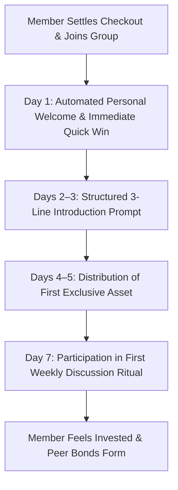
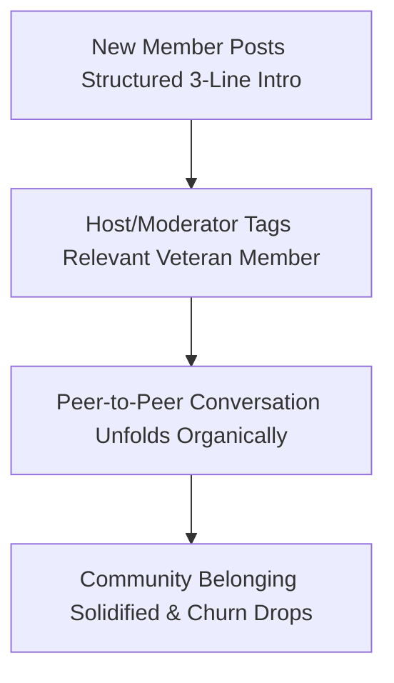

This scenario unfolds frequently in newly launched paid communities: an eager customer completes membership checkout and enters the private channel, only to encounter total silence. There are no instructions on where to begin, the atmosphere feels awkward, and the newcomer becomes a silent spectator.

When the 30-day renewal arrives, their immediate thought is: *"I derived zero value from this group; I should cancel."*

This is the silent killer of subscription economics: **The Crickets Syndrome**—an inactive community environment that decimates member retention during month one.

Having anchored your [community on an outcome-driven topic](/en/posts/paid-communities-part-1-selecting-topics-members-pay-for/), Part 2 of the *Paid Community Masterclass* covers your welcoming protocol: **The 7-Day Member Onboarding Architecture**, engineered to deliver an immediate win within 24 hours of joining.

---

## Day 1 Protocol: The 15-Minute Tangible Win

When someone transfers funds to join your community, their enthusiasm is at its highest point. Capitalize on this momentum by delivering an immediately useful asset:

1. **Automated Welcome Notification:** As soon as payment clears via [SitusBisnis](https://situsbisnis.com), dispatch an automated message complete with private invite credentials.
2. **The Quick-Win Asset:** Avoid telling newcomers to parse months of conversation logs. Supply a single high-utility PDF or template that delivers immediate ROI:
   - *Example:* "Verified Directory of 50 Direct Wholesale Suppliers with Zero Intermediary Markups".
   - Within 15 minutes of checkout, the member feels: *"The \$10 I paid just returned its value from this single document."*

---

## The Structured 3-Line Introduction Prompt

Never allow new members to post vague greetings like *"Hi everyone, excited to be here"*. Generic intros stifle conversation.

Pin a message in your welcome channel establishing a 3-part intro prompt:

> **New Member Introduction Framework:**
> 1. **Name & Current Commercial Focus:** [e.g., Alex, managing a boutique coffee shop in Seattle]
> 2. **Single Operational Bottleneck to Resolve This Month:** [e.g., Reducing bean waste in grinder calibration]
> 3. **One Specific Skill You Can Share with Peers:** [e.g., Espresso machine routine maintenance]

Structured introductions allow veteran members to step in immediately: *"Welcome Alex! We just audited espresso waste workflows in last week's notes—tagging the thread for you."* Organic interaction begins right away.

---

## Days 2 Through 7 Checklist

- **Day 2 (Direct Outreach):** Community managers touch base privately: *"Hi [Name], did you have a chance to review the supplier directory? Let me know if you have questions on any specific column."*
- **Day 4 (Member Case Study Spotlight):** Feature an unedited case study of an existing member who solved an operational challenge using community playbooks. This demonstrates real-world efficacy.
- **Day 7 (First Weekly Ritual Participation):** Invite the new member to participate in their first scheduled weekly touchpoint (e.g., *#MondayCommitments* or *#FridayWins*).

In [Part 3: Managing Quality Discussions Without Being Online 24/7](/en/posts/paid-communities-part-3-asynchronous-moderation/), we establish asynchronous communication rituals so your community thrives organically without requiring you to monitor chat notifications around the clock.
