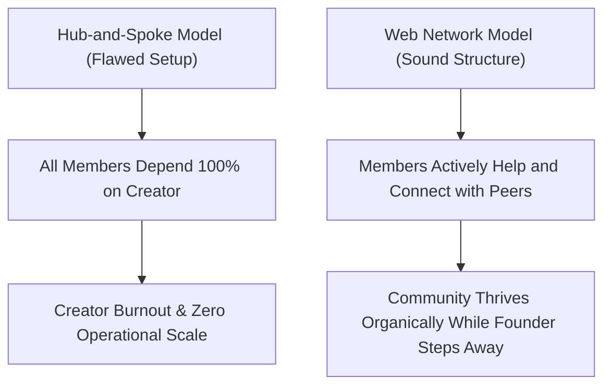
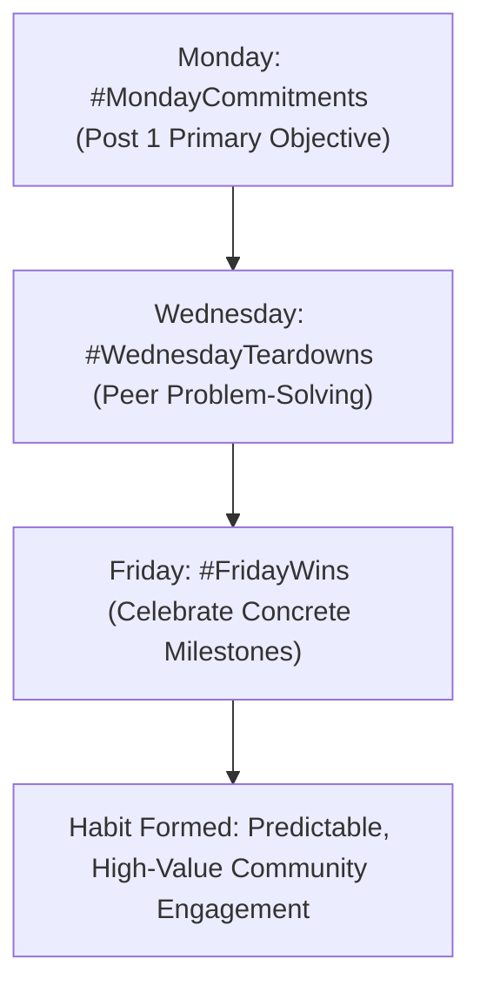

One of the greatest fears holding founders back from launching a paid community is this recurring concern: *"If members pay monthly dues, does that mean I must be online 24/7 answering questions instantly?"*

Many creators fall into the trap of believing they must act as round-the-clock moderators, answering every message within seconds.

The consequences are predictable:
- You exhaust your mental reserves and experience severe **creator burnout**.
- Members become passive observers, depending 100% on you for every answer rather than engaging with peers.
- The community's value proposition becomes fragile: the moment you take a three-day break, the space grinds to a halt.

Following our [7-day onboarding framework](/en/posts/paid-communities-part-2-first-week-onboarding-architecture/), Part 3 of the *Paid Community Masterclass* outlines an asynchronous moderation model: **how to build a peer-to-peer ecosystem where members learn from and support one another**, keeping the space vibrant and valuable without consuming your life.

---

## 3 Scheduled Weekly Rituals That Drive Independent Discussion

To eliminate the pressure of inventing conversation topics daily, establish **Structured Weekly Rhythms**. Focus on three dedicated days per week and let member participation drive the core dialogue:

### 1. Monday: Weekly Operational Focus (#MondayCommitments)
Every Monday at 9:00 AM, the host posts a single discussion prompt:
> *"Good morning everyone! What is the single most critical operational task that must be completed in your business before Friday at 5:00 PM? Drop it below so we can keep each other accountable."*
- Members articulate their operational goals.
- You do not need to respond to everyone—a quick reaction or brief encouraging note is sufficient.

### 2. Wednesday: Operational Diagnostic Teardown (#WednesdayTeardowns)
Every Wednesday, select one compelling question or challenge from a member for group teardown:
> *"This week let's help [Member Name], who is evaluating packaging vendors for eco-friendly shipping containers. Who here has experience with sustainable packaging providers in the Midwest?"*
- Experienced peers step forward to share vendor recommendations and practical lessons. This creates substantial collective value without adding to your production workload.

### 3. Friday: Weekly Wins & Lessons (#FridayWins)
At the end of the week, celebrate operational momentum:
> *"It's Friday! What was your single most impactful win or valuable lesson from this week? Share it in the comments below."*

---

## Establishing Explicit Asynchronous Boundaries

Publish clear communication guidelines in your community handbook from day one:
1. **No Expectation of Instant Replies:** State explicitly that the community is not an emergency hotline. Discourse is asynchronous, with typical response windows spanning 4 to 8 hours.
2. **Defined Host Review Hours:** Communicate your active presence windows (e.g., 10:00 AM – 11:30 AM and 4:00 PM – 5:00 PM). Outside those hours, the space belongs to peer interactions.
3. **Recognizing High-Contributing Members:** Reward active, helpful contributors with informal recognition or complimentary quarterly asset access.

Under this structure, you only need to dedicate **30 minutes in the morning and 30 minutes in the late afternoon**, while your community delivers substantial daily value to all members.

In [Part 4: Reducing Churn and Automating WhatsApp Renewals](/en/posts/paid-communities-part-4-reducing-churn-automated-renewals/), we unpack how to protect subscription retention and automate recurring renewal workflows.
