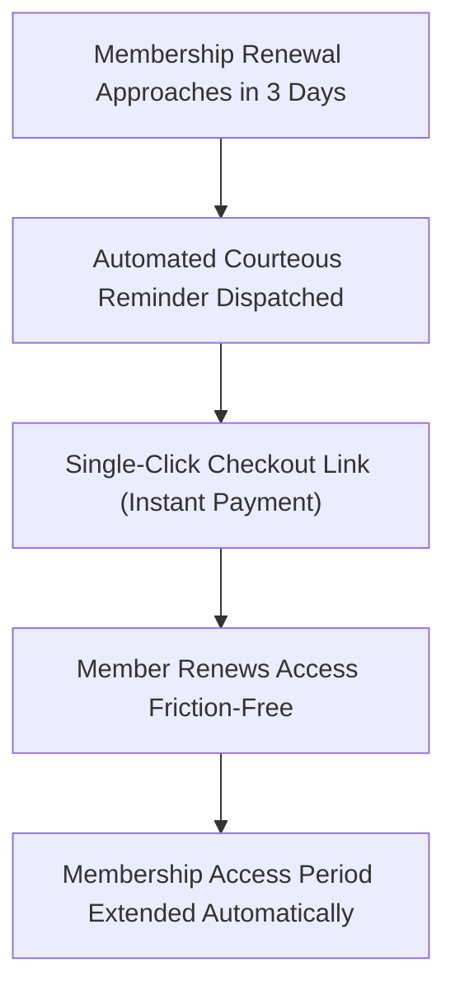
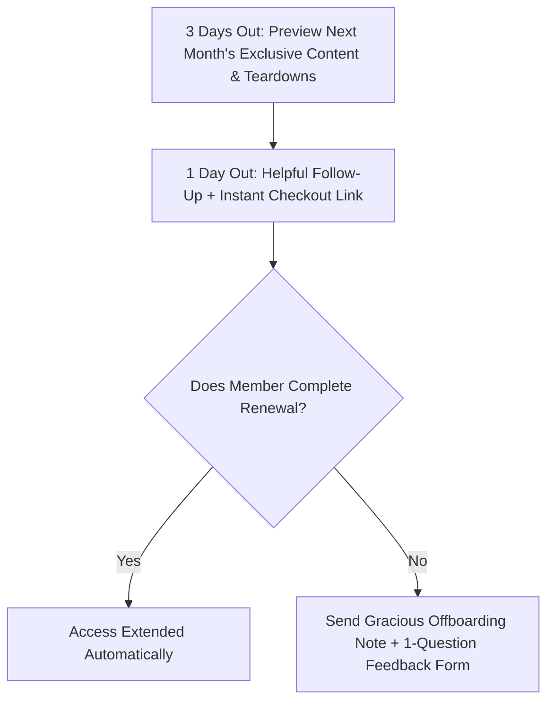

Imagine acquiring 100 members during your launch month. It feels like an incredible milestone. But when month two arrives... 35 members quietly let their subscriptions lapse.

Suddenly, you must work twice as hard just to acquire 35 new members to prevent your revenue from declining.

This is the challenging reality of **subscription churn**. Research into digital memberships consistently reveals that **most members do not leave because they are dissatisfied—they churn due to minor friction: forgetting their renewal date, or running into broken manual payment links**.

Having established [asynchronous moderation rhythms](/en/posts/paid-communities-part-3-asynchronous-moderation/), this final installment of the *Paid Community Masterclass* protects your recurring financial baseline: **deploying automated renewal workflows and annual upgrade incentives** to maintain monthly churn safely under 8%.

---

## The 3-Day Renewal Reminder Sequence

Avoid sounding like a collections agent. Frame renewal notices around appreciation and upcoming exclusive deliverables:

### 1. 3 Days Before Expiration (Value-Forward Notification)
> *"Hi [Name], thank you for contributing to our community this past month! Your active membership window renews in 3 days on [Date].*
>
> *Next month, we are conducting an exclusive teardown on: [Upcoming High-Utility Topic]. To ensure your access to discussions, files, and templates remains uninterrupted, you can confirm your renewal with one click here: [Storefront Renewal Link]."*

### 2. 1 Day Before Expiration (Helpful Final Notice)
> *"Hi [Name], quick note that tomorrow is the final day of your current community access window. We have prepared brand-new operational worksheets for next month's sprint, ready for download tomorrow morning. You can renew your seat directly via this link: [Renewal Link]. Thank you for building with us!"*

---

## The Annual Bridge: Converting Monthly Dues into Guaranteed Annual Passes

The fastest way to eliminate monthly churn anxiety is **incentivizing members to upgrade to upfront annual terms**:

1. **Offer a 2-Month Free Incentive:** If the monthly rate is \$15 (\$180/year), offer an annual pass for **\$150** (saving \$30, or two months complimentary).
2. **Optimal Timing for the Offer:** Day 14 of membership, when the customer has experienced their first wins and is most engaged with the community.
3. **Financial Advantage:** You secure \$150 in upfront operating cash flow immediately, and that member's churn rate becomes mathematically 0% for the next 365 days.

---

## Scaling an Independent Community with Zero Commissions

Many third-party platform providers take a 10% to 20% cut of recurring subscription revenue. With an independent storefront on [SitusBisnis](https://situsbisnis.com):
- You configure both monthly and annual subscription tiers easily.
- You provide local and international settlement options (instant QRIS, major debit cards, and bank virtual accounts).
- **0% platform commissions**: 100% of your community dues belong to you, enabling you to reinvest into high-value assets and sustainable financial independence.

---

### Paid Community Masterclass Series Summary
1. **[Part 1: Selecting an Outcome-Driven Topic](/en/posts/paid-communities-part-1-selecting-topics-members-pay-for/)**: Build memberships anchored on tangible cost savings, risk protection, or peer access.
2. **[Part 2: 7-Day Onboarding Architecture](/en/posts/paid-communities-part-2-first-week-onboarding-architecture/)**: Deliver an immediate win in 15 minutes and implement structured 3-line introductions.
3. **[Part 3: Asynchronous Community Moderation](/en/posts/paid-communities-part-3-asynchronous-moderation/)**: Establish Monday-Wednesday-Friday rhythms to encourage peer-to-peer discussions.
4. **[Part 4: Reducing Churn & Automated Renewals](/en/posts/paid-communities-part-4-reducing-churn-automated-renewals/)**: Deploy polite 3-day renewal sequences and offer 2-month-free annual passes.
