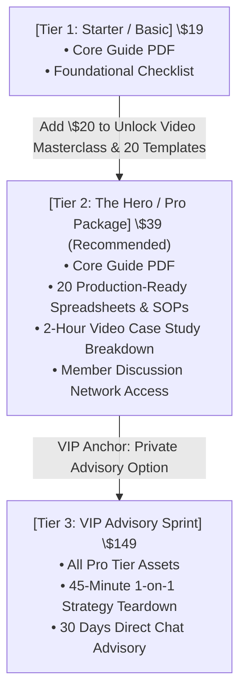

When you offer only a single standalone product at one fixed price (for example, *an E-book for \$20*), you leave substantial commercial revenue on the table.

Why? Because your audience naturally divides into three distinct customer profiles with varying willingness to pay:
1. **The Budget-Conscious Cohort:** They seek a foundational solution at the lowest feasible financial barrier.
2. **The Mainstream Pragmatists:** They desire the most complete, value-dense solution (*the best balance of price and deliverables*).
3. **The 'Do-It-For-Me' / VIP Cohort:** Approximately 10% to 15% of your buyers are willing to pay 3x to 5x more for personalized guidance, accelerated turnaround, or direct access.

By deploying **Tiered Pricing**, you grant each cohort the autonomy to select their preferred level of investment—simultaneously expanding your **Average Order Value (AOV)** without needing more traffic.

---

## 1. Price Anchoring: The Goldilocks Effect

The human brain struggles to evaluate absolute value in isolation. Anchoring across three structured tiers provides an objective frame of reference:

In this architecture:
- **Tier 3 (VIP)** acts as the *price anchor*. When viewing the \$149 tier, Tier 2 at \$39 appears remarkably accessible and practical.
- **Tier 1 (Starter)** reminds buyers that for just \$20 more, they unlock substantial time-saving tools, video breakdowns, and community access in **Tier 2**.
- Empirical consumer research demonstrates that **60% to 75% of buyers organically choose Tier 2 (The Pro Tier)**.

---

## 2. Assembling Tiered Deliverables Without Multiplying Your Workload

Many creators avoid tiered pricing out of fear that they must build three separate products from scratch. In practice, tiering relies on **layering high-leverage companion assets**:

| Deliverable Layer | Tier 1: Starter (Core Asset) | Tier 2: Pro (Asset + Acceleration Tools) | Tier 3: VIP (Asset + Direct Access) |
| :--- | :--- | :--- | :--- |
| **Core Documentation** | Primary PDF Playbook / Guide | Primary PDF Playbook / Guide | Primary PDF Playbook / Guide |
| **Acceleration Tools** | — | Ready-to-Use Spreadsheets / SOPs / Prompts | Ready-to-Use Spreadsheets / SOPs / Prompts |
| **Learning Format** | Self-study text | Self-study text + Video Walkthrough | Self-study text + Video Walkthrough |
| **Support Scope** | Self-directed | Peer Community Network | 1-on-1 Private Consultation Sprint |
| **Creator Time Required** | 100% completed upfront | 2 days extra (template packaging) | 0 hours asset prep (allocated calendar time) |

> **Operational Insight:**
> Strictly cap availability for Tier 3 (e.g., *Limited to 10 advisory spots monthly*). This safeguards your schedule while introducing genuine scarcity that prompts prompt decisions.

---

## 3. Financial Mechanics: Flat Pricing vs. 3-Tier Architecture

Examine the comparative financial outcome across 100 buyer transactions:

### Scenario A: Flat Single-Price Model
- 100 buyers × \$20 = **\$2,000**
- *Average Order Value (AOV):* \$20

### Scenario B: 3-Tier Structured Model
- 20 buyers select Tier 1 (Starter @ \$20) = \$400
- 70 buyers select Tier 2 (Pro @ \$45) = \$3,150
- 10 buyers select Tier 3 (VIP @ \$150) = \$1,500
- **Total Gross Revenue:** **\$5,050**
- *Average Order Value (AOV):* **\$50.50** (+152% expansion with zero additional customers!)

---

## 4. Designing High-Converting Pricing Cards

When presenting your pricing options:
1. Feature a prominent visual badge on the primary tier: *"Most Popular"* or *"Recommended Choice"*.
2. Apply high-contrast accent border styling to Tier 2 (such as warm amber UI highlights on [SitusBisnis](https://situsbisnis.com)).
3. Display crossed-out cumulative values to emphasize the bundle savings delivered in the Pro package.

---

## Summary

Avoid constraining your revenue with a single static price tag. Provide structured choices, bundle acceleration tools that compress client time, and capture the full economic potential of your customer base.
