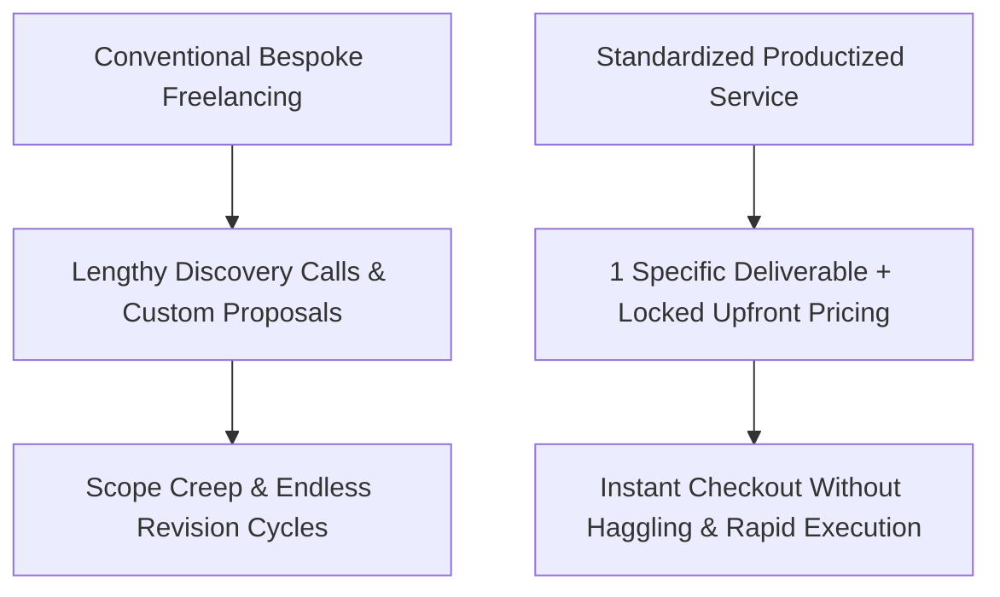
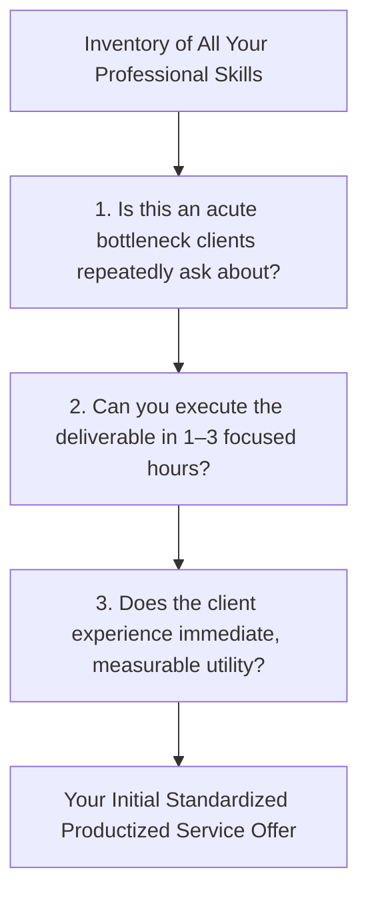

Nearly every freelance practitioner, designer, consultant, or technical advisor has experienced this exhausting cycle:
1. Receive a new inquiry via social media or personal referral.
2. Spend 45 minutes on an unpaid discovery video call listening to sprawling, vague client requests.
3. Spend two late nights assembling a customized 15-page formal proposal.
4. Endure tedious budget negotiations: *"Our departmental budget was just cut in half—can you discount this by 50%?"*
5. Once agreed, get dragged into a painful seventh round of uncompensated revisions.

Bespoke client work slowly erodes both your energy and your commercial growth. Most of your operational bandwidth is consumed by administrative negotiation rather than high-leverage execution.

In this opening guide of the *Productized Service Playbook*, we examine the exit strategy from the "hours-for-dollars" trap: **taking your single highest-performing skill, packaging it into a standardized solution with rigid boundaries, and selling it like an off-the-shelf digital asset in an online shopping cart**.

---

## Bespoke Freelancing vs. Productized Services

To understand the operational shift, compare how the same skill is deployed under each model:

| Operational Parameter | Conventional Bespoke Freelancing | Standardized Productized Service |
| :--- | :--- | :--- |
| **Service Scope** | "Generalist graphic designer available for anything: logos, flyers, social feeds." | "48-Hour Landing Page Audit: 5 Concrete Visual Tweaks to Boost Conversion." |
| **Pricing Model** | "Depends on project complexity—message me for a custom quote." | "\$149 paid in full upfront before the diagnostic sprint begins." |
| **Turnaround Schedule** | Sprawls over weeks waiting for delayed client feedback loops. | Guaranteed: Final audit deliverable submitted exactly 48 hours after questionnaire submission. |
| **Revision Cycles** | Uncapped or blurred due to awkwardness around saying no. | Strictly 1 written follow-up Q&A window over the 24 hours following delivery. |

---

## The 3 Filters for Selecting Your Core Skill

Never attempt to package everything you know into one massive bundle. Filter your candidate capabilities through the **3-V Framework** (*Validated, Velocity, Value*):

### 1. Validated (Inquiries You Repeatedly Receive)
Review your inbox and messages over the past six months:
- *"Could you review my ad campaign to figure out why no one is clicking?"* $\rightarrow$ Product: **24-Hour Paid Ad Audit**.
- *"Can you help calculate margins on our new food and beverage menu?"* $\rightarrow$ Product: **10-Item Menu Recipe & COGS Breakdown**.

### 2. Velocity (Completable in Under 3 Focused Hours)
Select tasks that appear bewildering to a layperson, but that you—backed by years of pattern recognition—can execute cleanly within 1 to 3 hours of focused production.

### 3. Tangible Value (Immediate Real-World Impact)
Clients must experience tangible utility quickly. Avoid promising "vague long-term strategic brand equity." Deliver a concrete, itemized diagnostic checklist they can implement tomorrow morning.

---

## Actionable Next Step

Take a sheet of paper, list your three primary professional skills, and reframe them from professional job titles into **tangible customer transformations**:
- Not: "Boutique Corporate Accounting Consultant".
- Instead: **"Pre-Audit Tax Compliance & Penalty Safeguard Review"**.

In [Part 2: Defining Rigid Scope Boundaries to Eliminate Scope Creep](/en/posts/productized-service-part-2-scope-boundaries-anti-scope-creep/), we will establish how to lock down scope boundaries so you are permanently protected from uncompensated revision requests.
