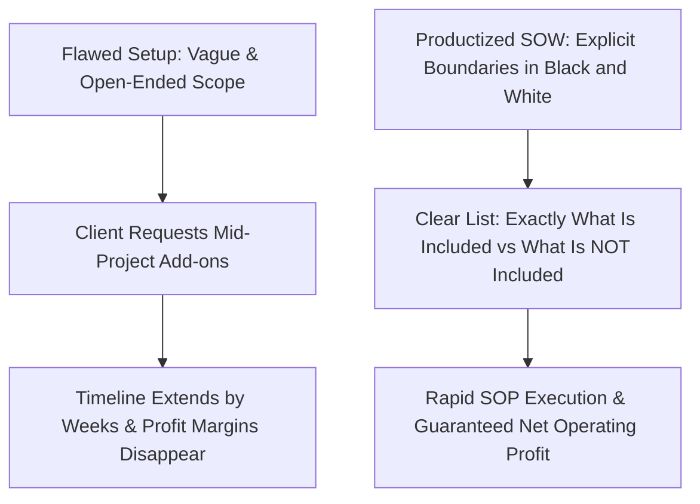
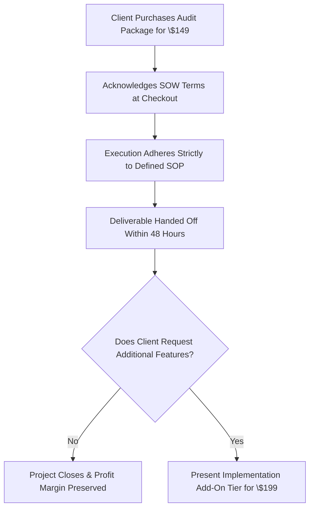

Have you ever agreed to a design or technical audit engagement for \$150, only for the client to nonchalantly message three weeks later: *"Could you also design matching corporate stationery, email signatures, and billboard banners since it's the same branding theme?"*

If you refuse, the client threatens to withhold final payment. But if you comply, your delivery timeline extends by weeks and your effective hourly rate drops below minimum wage.

This is the classic dynamic of *scope creep*—uncontrolled expansion of deliverables midway through a project without corresponding compensation.

Having isolated [one specialized core skill](/en/posts/productized-service-part-1-packaging-specialized-skills/), Part 2 of the *Productized Service Playbook* establishes your defensive perimeter: **how to construct a transparent, ironclad Scope of Work (SOW)** that sets unambiguous client expectations and permanently insulates your business from endless revision loops.

---

## The "Inclusions vs. Exclusions" Structural Framework

On your product checkout page, never limit your description to what you will execute. **It is equally critical to articulate what is explicitly NOT included in the engagement**.

Consider this clear scope definition for a *48-Hour Storefront Conversion Audit*:

### 1. Exactly What the Client Receives (The Deliverables)
- 1 Comprehensive 15-Page Evaluation PDF covering mobile load speeds, checkout form friction, and primary navigation flow.
- 1 10-Minute Screen-Recorded Video Teardown diagnosing conversion leaks across their live store.
- 1 Dedicated 24-Hour Written Follow-Up Q&A Window via chat after deliverable hand-off.
- **Guaranteed Turnaround:** Exactly 48 business hours after the intake brief questionnaire is submitted.

### 2. What Is Explicitly Excluded (The Exclusions)
- Does NOT include custom backend code refactoring or CSS stylesheet modifications.
- Does NOT include asset production (e.g., custom studio photography or copywriting overhauls).
- Does NOT include unscheduled video calls or Zoom conferences outside written parameters.
- *(Note: Should you require full-stack implementation, a separate Implementation Sprint add-on is available).*

When these terms are stated clearly on the checkout page, clients cannot reasonably argue: *"I assumed all design redesigns were included."*

---

## Eliminating Meeting Friction: The Asynchronous Communication Policy

What consumes the greatest volume of professional bandwidth? **Unfocused 60-minute calls that could have been resolved in three concise sentences**.

In a standardized productized model, implement an **Asynchronous Delivery Policy**:
1. Zero preliminary video calls for data gathering. All requisite project inputs are submitted via a structured digital intake questionnaire.
2. Deliverables are presented via a structured PDF dossier paired with a concise screen-recorded video walkthrough (e.g., Loom or drive link).
3. Clients appreciate this approach because they can review findings at their own pace without navigating complex scheduling conflicts across time zones.

In [Part 3: Self-Service Storefronts with Integrated Intake Questionnaires](/en/posts/productized-service-part-3-instant-intake-storefront/), we examine how to connect payment processing directly to automated brief forms—eliminating manual onboarding communications entirely.
