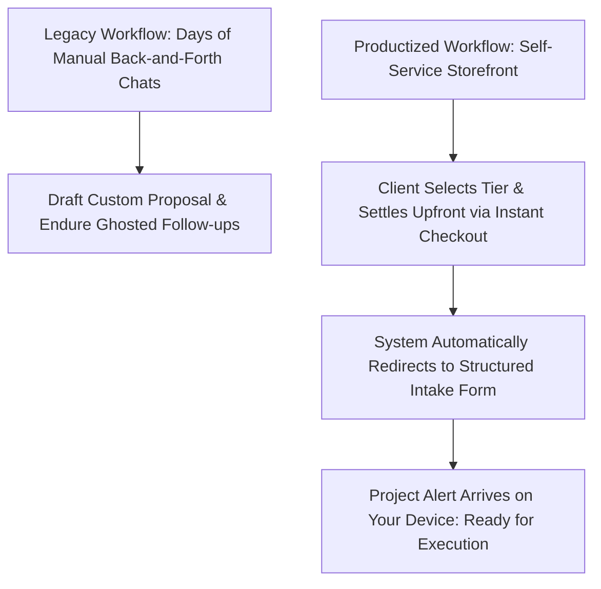
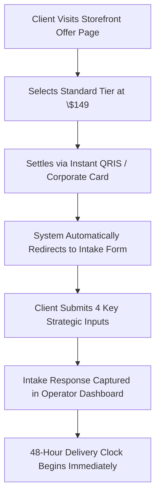

Calculate how many hours you lose each month fielding inquiries like these:
- *"What is your typical pricing range?"*
- *"Can you send over portfolio samples matching my exact industry?"*
- *"Could you draft a customized formal proposal for our leadership team to evaluate?"*

Then, after investing hours drafting a proposal, the prospective client goes completely dark.

Having established [ironclad scope boundaries](/en/posts/productized-service-part-2-scope-boundaries-anti-scope-creep/), it is time to eliminate this administrative friction. In Part 3 of the *Productized Service Playbook*, we transform your service offerings into a **Self-Service Commercial Storefront**: an automated system where prospective clients review clear packages, pay 100% upfront before work begins, and submit their project briefs through an integrated intake workflow—without requiring manual guidance.

---

## Anatomy of a Productized Service Offer Page

Your product page must be clean, structured, and focused on removing buyer hesitation:

### 1. Concrete Outcome-Driven Headline
- Not: *"Welcome to my independent consulting portfolio."*
- Instead: *"Lift Your Storefront Checkout Conversions in 48 Hours Without Redesigning Your Entire Site."*

### 2. Three Transparent Package Tiers (Good, Better, Best)
Empower clients to choose without asking for customized quotes:
- **Sprint Tier (Foundational Diagnostic):** 10-page evaluation report (\$75).
- **Professional Tier (Diagnostic + Video Walkthrough):** Most popular tier, featuring a 15-minute detailed screen recording (\$149).
- **Enterprise Tier (Complete Audit + Ready-to-Deploy Copy Swipe Files):** Full-suite package for founders looking for turnkey implementation (\$290).

### 3. Automated Post-Checkout Intake Form
The key to hands-off execution is the post-payment intake form. When a client completes their transaction, the checkout system redirects them to an automated questionnaire (Google Forms, Tally, or Notion) with four targeted questions:
1. What is the live URL of the storefront or sales page to be audited?
2. Who is your primary target customer demographic?
3. What is the single most common checkout objection reported by your sales team?
4. Provide links to relevant brand guidelines or access permissions required for review.

---

## Normalizing 100% Upfront Payment

Many service providers hesitate to request full payment upfront, fearing prospective clients will walk away.

Real-world experience reveals the exact opposite: **Professional business owners prefer upfront payment because it establishes guaranteed delivery schedules and clarity of accountability**.

To remove hesitation around upfront settlement:
- Integrate familiar, secure payment channels (instant QRIS, national bank virtual accounts, and major credit cards).
- Provide an explicit operational turnaround SLA: *"If your comprehensive evaluation dossier is not delivered within 48 business hours, you receive a 100% refund and keep the final deliverables at zero cost."*

By operating through an independent digital storefront like [SitusBisnis](https://situsbisnis.com), you can launch service packages within minutes, capture instant payments without commission cuts, and route clients directly to your automated intake workflow.

In [Part 4: Automated Client Onboarding & Retainer Conversions](/en/posts/productized-service-part-4-automated-client-onboarding/), we explore deliverable presentation and how to transition one-time audit buyers into predictable monthly recurring retainers.
