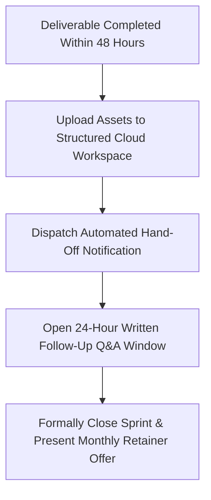
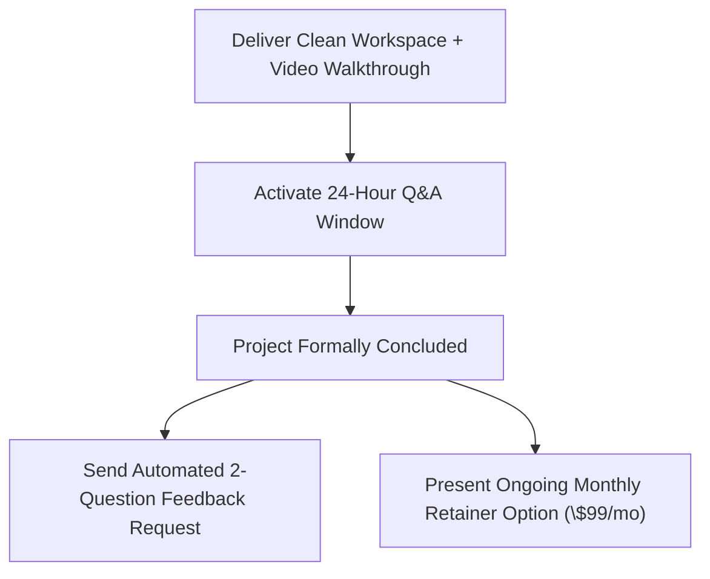

Many independent operators execute client work meticulously, only to falter at the finish line: dropping random, unorganized file links in chat threads, omitting instructions on how to implement recommendations, and fielding repetitive technical questions for weeks afterward.

First impressions matter, but your **final project hand-off** dictates whether a client enthusiastically refers your services to peers or vows never to engage you again.

Following our setup of [self-service storefronts and automated intake forms](/en/posts/productized-service-part-3-instant-intake-storefront/), this concluding installment of the *Productized Service Playbook* covers the bridge separating ad-hoc freelancing from scalable agency operations: **The Frictionless Hand-Off Protocol and Automated Monthly Retainer Conversions**, transforming one-time project clients into predictable monthly recurring revenue.



---

## Structuring an Institutional-Grade Delivery Workspace

Never send raw, unorganized file attachments over chat apps. Provide a single, well-organized cloud folder (Google Drive or Notion Workspace) featuring standardized document numbering:

```
📁 [Client Name] - 48-Hour Conversion Audit
│
├── 📄 01-Executive-Summary-Findings.pdf
├── 🎥 02-Screen-Recorded-Video-Teardown.mp4 (or stream link)
├── 📊 03-Tactical-Action-Plan-Spreadsheet.xlsx
└── 📜 04-Immediate-Implementation-Checklist.pdf
```

When clients open your link to discover this level of organization, perceived professional value increases dramatically. The \$150 to \$300 they invested feels like an undeniable bargain.

---

## Defining a Strict 24-Hour Written Q&A Window

To prevent unorganized queries from cluttering your communication channels weeks down the line, frame post-delivery communication within an explicit, professional window:

Dispatch this standardized hand-off notice:

> *"Hi [Client Name], your 48-Hour Storefront Conversion Audit has been finalized and is accessible via this private workspace: [Workspace Link].*
>
> *To assist your team in deploying these improvements, we are opening our **Dedicated 24-Hour Written Q&A Window** (active until tomorrow at 5:00 PM). Please review your deliverables, and should your team require clarification on any specific recommendation, post your questions directly in this thread."*

This framework delivers two key benefits:
- The client feels supported and given dedicated time for clarification.
- You establish an unambiguous cutoff point for the active engagement.



---

## Transitioning One-Off Projects into Predictable Recurring Retainers

The single highest-converting moment to sell an ongoing engagement is **immediately following the successful delivery of your initial sprint**.

Once the project is formally closed, present an ongoing monitoring tier:
> *"Hi [Client Name], our diagnostic highlighted three primary conversion leaks across your checkout flow. To ensure your key performance metrics remain steady and do not degrade as you launch new products, we provide our **Monthly Retainer Monitoring Program** for \$99/month: we perform a comprehensive checkup on the first of each month and deliver automated performance reporting. If you would like to secure this recurring slot, you can activate your subscription here."*

Securing **10 retainer clients at \$99/month** establishes **nearly \$1,000 in baseline recurring cash flow** from just a few hours of monthly review.

Operating through [SitusBisnis](https://situsbisnis.com) grants you complete control over your service catalog, automated intake workflows, and instant checkout processing—with zero middleman commission penalties.

---

### Productized Service Playbook Series Summary
1. **[Part 1: Packaging One Specialized Skill](/en/posts/productized-service-part-1-packaging-specialized-skills/)**: Isolate repetitive inquiries and bundle them into concrete deliverables.
2. **[Part 2: Defining Rigid Scope Boundaries](/en/posts/productized-service-part-2-scope-boundaries-anti-scope-creep/)**: Define explicit inclusions and exclusions to protect operational margins.
3. **[Part 3: Self-Service Storefronts & Intake Workflows](/en/posts/productized-service-part-3-instant-intake-storefront/)**: Collect 100% upfront payments linked directly to automated questionnaires.
4. **[Part 4: Frictionless Hand-Offs & Monthly Retainers](/en/posts/productized-service-part-4-automated-client-onboarding/)**: Deliver structured workspaces and convert one-time buyers into predictable recurring retainers.
