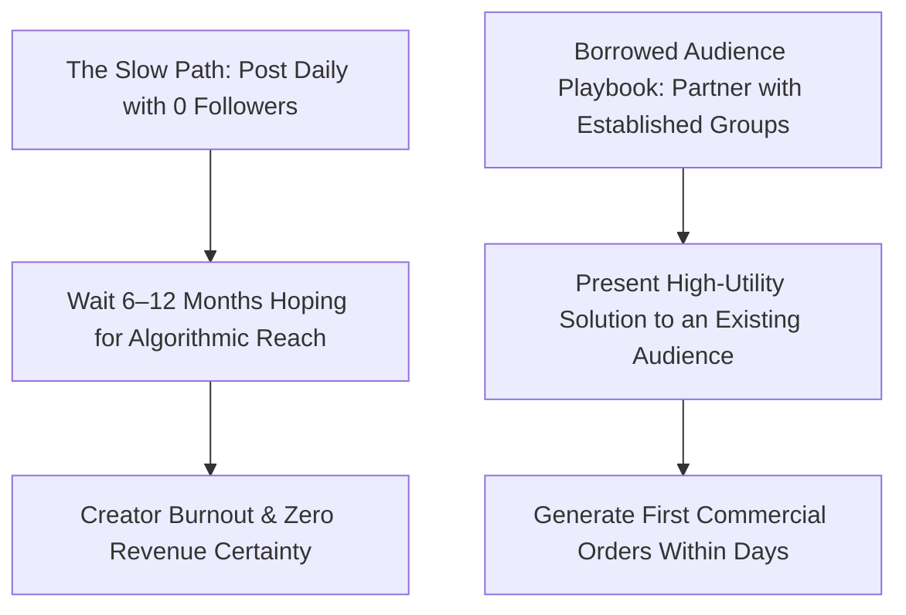
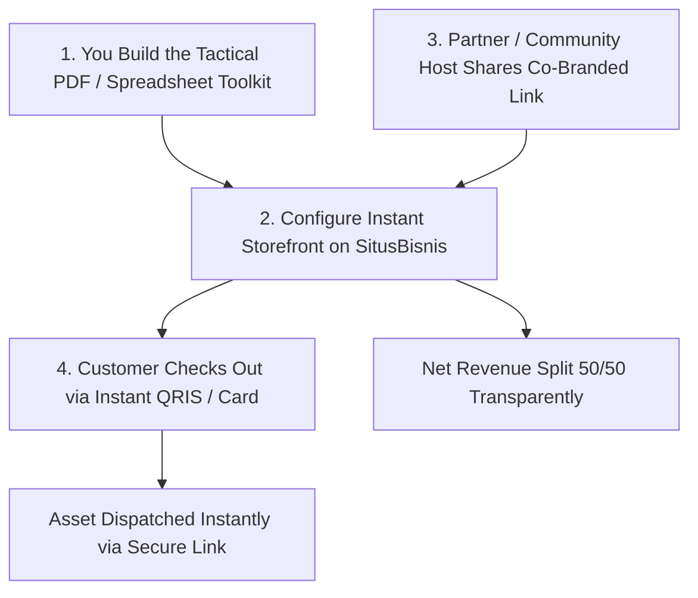

The most common piece of advice discouraging beginners from starting an online business is: *"You must post daily on social media, build 10,000 followers, and only then can you think about selling products."*

For busy professionals, introverts, or individuals uncomfortable on camera, that advice feels like an insurmountable barrier. Building an audience from zero in today's saturated algorithm environment can require months of unpaid labor.

Here is the operational reality: **You do not need a pre-existing social following to generate income from digital products**.

There is a legitimate, time-tested commercial alternative deployed by smart operators for decades: **The Borrowed Audience Playbook**.

---

## The Strategic Premise: Why Dig a Well When a River Already Flows?

If you want to sell umbrellas during a rainstorm, do you build an entire city from scratch and invite residents to move in?

Of course not. You simply walk to the train station exit where commuters have already gathered and need immediate shelter.

Online, those "train stations" represent places where your ideal customers already congregate:
- **Niche Community Channels & Groups:** Industry associations, alumni forums, local business networks, or specialized hobby groups.
- **Micro-Creators (2,000 to 10,000 Followers):** They have earned genuine audience trust, but lack the bandwidth or know-how to build their own digital products.
- **Niche Newsletter Curators:** Industry publications with highly engaged, specialized reader bases.

---

## The 3-Step Borrowed Audience Framework

### 1. Build an Asset Addressing One Acute Pain Point
Avoid writing a broad, generic 200-page guide. Construct an asset targeted directly at a specific bottleneck faced by that specific community:
- *For job-seeker communities:* "A 5-Page Field Guide: Vetted Resume Templates and Interview Script Responses That Pass Applicant Tracking Systems (ATS)".
- *For small hospitality operators:* "Monthly Recipe COGS & Kitchen Inventory Spreadsheet Model".

### 2. Propose a Structured 50/50 Revenue-Share Partnership
Contact the community moderator or micro-creator directly. Never ask for free promotions; propose an aligned, mutually beneficial commercial partnership:

> *"Hi [Name], I noticed that members in your community frequently raise questions regarding [specific operational challenge]. I packaged a practical checklist and template system that resolves this challenge directly. What if we make this available to your community as an exclusive co-branded resource? We can offer it for \$29, splitting all net revenue 50/50. You simply share the private link with your members; my storefront handles instant payment processing and automated digital fulfillment."*

For the audience host, this represents **instant, hands-off monetization with zero upfront production burden**. High-integrity hosts readily welcome proposals that deliver clear value to their members.

### 3. Automate Fulfillment to Eliminate Support Overhead
Do not handle delivery manually through chat messages. Asking buyers to upload transfer screenshots creates support chaos.

Use an automated storefront like [SitusBisnis](https://situsbisnis.com):
1. Upload your digital deliverable once.
2. Set your price (e.g., \$29).
3. Generate a dedicated, branded storefront URL.
4. Share that link with your distribution partner. Whenever a customer completes payment, files are delivered to their device automatically.

---

## Collaboration as a Growth Lever

The Borrowed Audience Playbook is the fastest path to commercial traction because it leverages **trust that has already been cultivated over years**.

You supply the practical solution, the host unlocks new revenue, and community members solve an acute bottleneck. All three parties benefit, and you secure initial customer sales without needing thousands of followers.
