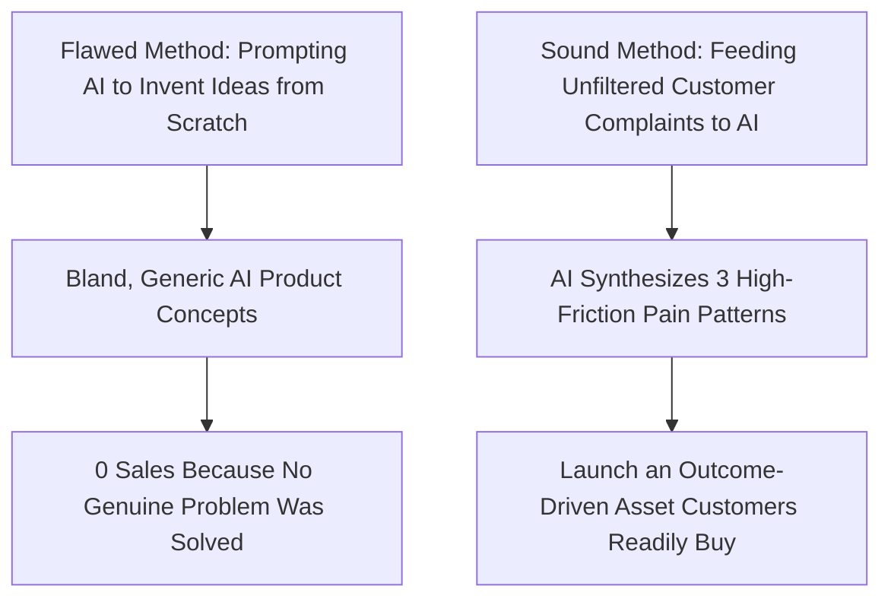
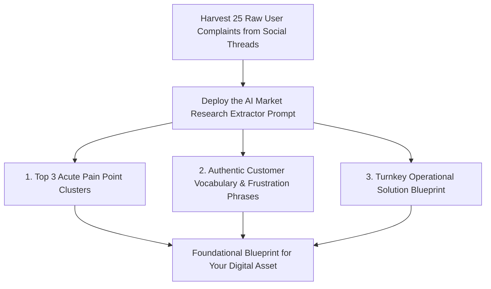

Operating as a solo founder is a double-edged sword: you enjoy complete autonomy, but every single operational role—from market research and content drafting to sales copywriting and support—falls entirely on your shoulders. It is no surprise that many solopreneurs burn out before publishing their first asset.

Modern artificial intelligence (AI) can serve as an exceptional operational multiplier. Yet 9 out of 10 beginners utilize it incorrectly: **prompting AI to invent product concepts from scratch**. The output? Bland, cliché digital deliverables that nobody buys because they resolve no genuine human pain points.

In this opening guide of the *Solopreneur AI Playbook*, we bypass unrealistic overnight wealth claims. We outline a tactical workflow: deploying AI not as an ungrounded brainstorming tool, but as a **high-precision data analysis engine to map authentic customer complaints directly from the field**.

---

## Harvesting Raw Customer Complaints

Before opening ChatGPT, Claude, or Gemini, collect unfiltered sentiment from channels where prospective buyers voice their everyday frustrations:
1. **Short-Form Video Comments (TikTok / Instagram):** Search high-engagement clips in your vertical, focusing on comments opening with phrases like *"The hardest part is...", "What do you do if...", "I'm totally stuck on..."*.
2. **1-Star and 2-Star Reviews on Marketplaces and Bookstores:** Examine low-rating reviews for bestselling guides or courses in your niche. Disappointed buyers reveal precisely what current solutions fail to deliver!
3. **Discussion Forums (Reddit, Quora, Niche Communities):** Identify recurring operational questions asked by multiple participants.

Aggregate 20 to 30 unedited comments into a clean text file.

---

## The Pain Point Extractor Prompt

Once you have compiled authentic user feedback, run this structured prompt through your AI model:

> *"Act as a Senior Market Research Analyst specializing in digital commerce and consumer psychology. I have provided 25 authentic customer comments from prospective buyers in the [Specify Your Vertical, e.g., Boutique Coffee Shop Owners] space.*
>
> *Your assignment:*
> 1. *Synthesize these 25 comments into the top 3 acute bottlenecks that consume the most time or drain the most capital.*
> 2. *Extract the emotional language, slang, and recurring frustration keywords they use.*
> 3. *Outline a 5-page practical operational toolkit (checklist or spreadsheet model) that immediately resolves Bottleneck #1.*
> 
> *Here are the raw comments:*
> *[Paste the 25 raw comments here]"*

---

## Why This Approach Yields Exponentially Higher Traction

With this workflow:
- You never guess what the market wants; demand is verified upfront.
- Your promotional messaging automatically adopts the **exact vocabulary of your prospective buyers**, eliminating academic jargon.
- You compress a two-week market research sprint into **30 minutes of structured analysis**.

In [Part 2: Drafting Human-Centric Curriculum Without Robotic Slop](/en/posts/solopreneur-ai-part-2-drafting-human-centric-curriculum/), we examine production frameworks to draft guides and worksheets at speed without sounding like a generic AI machine.
