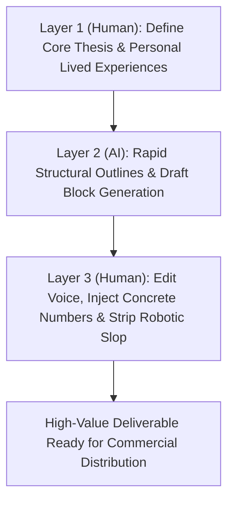
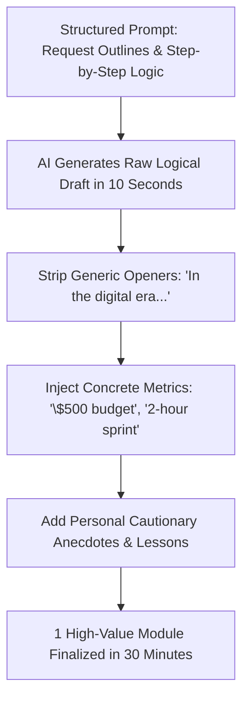

Have you ever purchased a digital guide or e-book, only to realize on page one: *"This is a 100% unedited ChatGPT output"*?

The tells are unmistakable and predictable:
- Opening with tired clichés: *"In today's fast-paced, ever-evolving digital landscape..."*
- Flooded with generic transition phrases: *"A testament to"*, *"Delve deep into"*, or *"It is crucial to remember"*.
- Concluding with bizarre robotic congratulations: *"Congratulations! You are now fully equipped to conquer the business landscape..."*

Deliverables of this nature leave customers feeling shortchanged and permanently damage your brand reputation. Buyers do not pay for synthetic text generation—they pay for empathy, lived perspective, and actionable execution frameworks.

Following our [problem-discovery framework](/en/posts/solopreneur-ai-part-1-problem-discovery-knowledge-curation/), Part 2 of the *Solopreneur AI Playbook* covers production: **how to draft high-velocity modules and worksheets using AI while preserving authentic human voice and operational depth**.

The operational solution is **The Human-AI Sandwich Method**: AI constructs structural skeletons and rapid draft blocks, while the human author injects lived experience, real metrics, and specific case studies.

---

## 3 Golden Rules to Eliminate AI Slop

When instructing AI models to assemble draft materials, integrate these explicit style guardrails into your prompts:

1. **Ban Conversational Clichés:** Enforce strict instructions: *"Do not open paragraphs with 'In today's fast-paced world', 'It goes without saying', or 'It is important to remember'. Begin immediately with the concrete operational problem."*
2. **Require Concise, Active Syntax:** Instruct: *"Write in direct, punchy professional English. Limit sentence length to under 18 words where possible, write in the active voice, and address the reader directly as 'you'."*
3. **Mandate Structured Visual Elements:** Forbid dense walls of continuous prose. Demand structured comparison tables, code blocks, or sequential checklists.

---

## Practical Exemplar: Transforming Raw AI Output into Authoritative Guidance

Compare how the same lesson on small-business cash flow management reads before and after applying the Sandwich Method:

### Raw AI Draft (Abstract & Detached)
> *"Financial liquidity management constitutes a fundamental cornerstone for micro-enterprises. Amid contemporary market volatility, business operators must continually monitor financial inflows and outflows to mitigate unforeseen insolvency hazards."*

### Post-Sandwich Refinement (Concrete & Action-Oriented)
> *"Many cafe owners see crowded dining rooms every day, yet find their bank accounts completely empty at month's end. The problem isn't low traffic—it's that they mix personal household grocery spending with operational cafe registers. Before buying raw beans tomorrow morning, establish two separate bank accounts."*

Notice the difference: the second version pinpoints the reader's exact operational frustration, employs everyday vocabulary, and presents an immediate 5-minute action step.

---

## Action Worksheets That Multiply Product Utility

Never deliver standalone text files. Conclude every chapter with an **Actionable Implementation Worksheet**:
- **Self-Audit Diagnostic Checklist:** Rapid assessment tables.
- **Plug-and-Play Swipe Scripts:** Ready-to-use communication templates.

In [Part 3: 1-Hour Promotional Automation and Sales Page Drafting](/en/posts/solopreneur-ai-part-3-automated-promotions-in-one-hour/), we deploy AI to assemble a high-converting sales page and promotional swipe copy in under 60 minutes.
