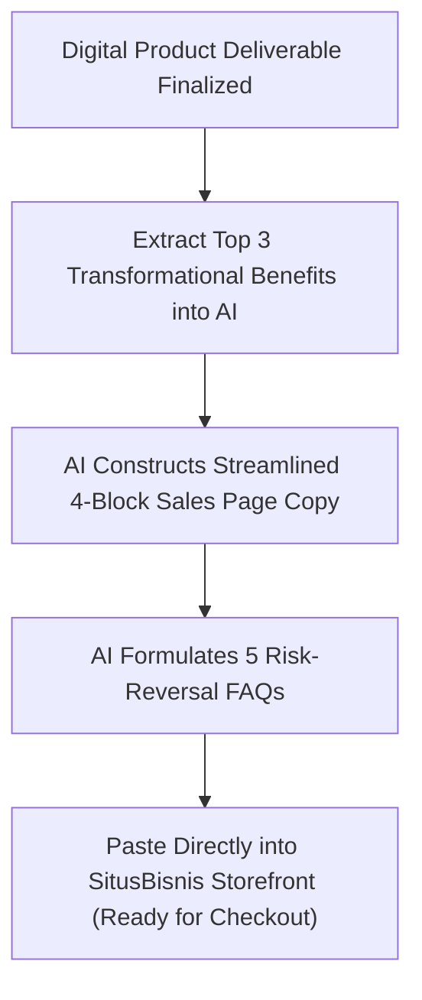
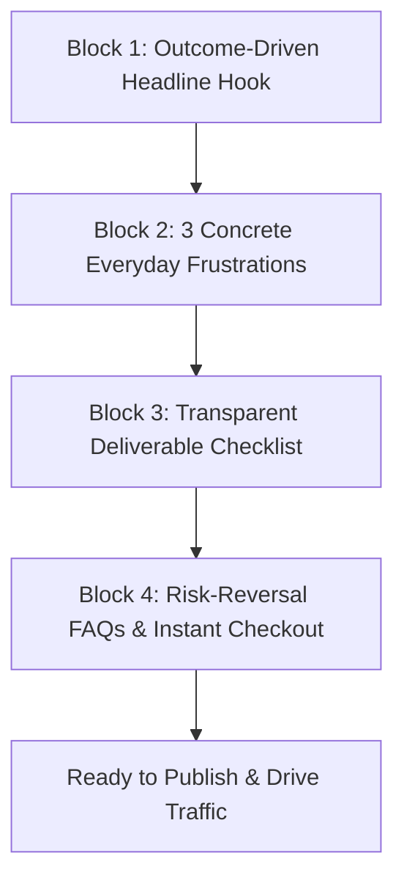

Staring at a blinking cursor on an empty screen is an agonizing experience for any creator preparing to launch a digital asset.

Your curriculum and worksheets are organized, your deliverables are polished, yet your momentum grinds to a halt before a wall of *copywriting paralysis*:
- How should the primary headline be framed to avoid sounding spammy?
- Is the feature breakdown too verbose or confusing?
- What Call-to-Action (CTA) phrasing will convince prospects to complete payment?

Because of this hesitation, product launches that should take hours get delayed by weeks.

You do not need years of agency copywriting experience to build a high-converting sales page. In Part 3 of the *Solopreneur AI Playbook*, we assemble the entire sales asset—a 4-block single-page offer, a risk-reversal FAQ section, and promotional swipe variations—**completed in under 60 minutes** using directed AI workflows.

---

## The 4-Block High-Converting Sales Page Framework

Digital offer pages do not require complex, sprawling layouts. Focus on four concise sections:

### Block 1: Headline Hook & Core Promise
State the immediate customer outcome and concrete timeframe:
- *Example:* *"Pass Food & Beverage Regulatory Audits on Your First Submission Without Costly Agency Retainers."*

### Block 2: The Core Frustration Breakdown
Highlight three acute operational bottlenecks your customer experiences daily:
- *"Exhausted from having submissions rejected due to confusing label font size regulations?"*
- *"Confused trying to draft statutory sanitation affidavits that comply with current mandates?"*

### Block 3: Concrete Deliverable Checklist (The Breakdown)
Enumerate deliverables using clear value-oriented bullet points:
- Module 1: Pre-Submission Audit Checklist (Pass on First Review).
- Module 2: Plug-and-Play Compliance Affidavits (Insert Brand Details).
- Module 3: 10-Minute Video Guide to Navigating the Regulatory Portal.

### Block 4: Objection-Busting FAQ & Instant Checkout Trigger
Resolve the three primary buyer concerns:
- *"I am not technical—is this simple to implement?"*
- *"What file formats are included?"*
- *"How does automated payment work?"*

---

## The 1-Page Storefront Copy Prompt

Run this structured prompt through your AI model:

> *"I have built a digital product consisting of an operational guide and checklist PDF designed to help [Specify Target Customer] achieve [Specify Primary Outcome]. The offer is priced at \$[Specify Price, e.g., 29].*
>
> *Your task: Draft a high-converting single-page sales offer using a 4-block architecture:*
> 1. *Three alternative outcome-focused headlines that are compelling and professional.*
> 2. *Three short paragraphs detailing the exact operational bottlenecks prospects face today.*
> 3. *A 4-part deliverable breakdown focusing on tangible transformation rather than technical specs.*
> 4. *Four persuasive FAQs addressing customer skepticism, complete with reassuring answers.*
>
> *Style guidelines: Direct, empathetic, outcome-oriented, completely free from generic corporate jargon."*

Within 30 seconds, your AI model generates a comprehensive sales copy draft ready for review and deployment.

---

## Direct Deployment to Your Independent Storefront

You do not need custom front-end development or complex WordPress plugins.

Open your dashboard on [SitusBisnis](https://situsbisnis.com), paste your copy into the product description editor, set your pricing, and save. Your store is immediately live and equipped to process instant payments with zero commission cuts.

In [Part 4: 24/7 Automated Customer Support and FAQ Systems](/en/posts/solopreneur-ai-part-4-automated-faq-customer-service/), we address post-purchase workflows, ensuring customer technical inquiries are handled automatically while you sleep.
