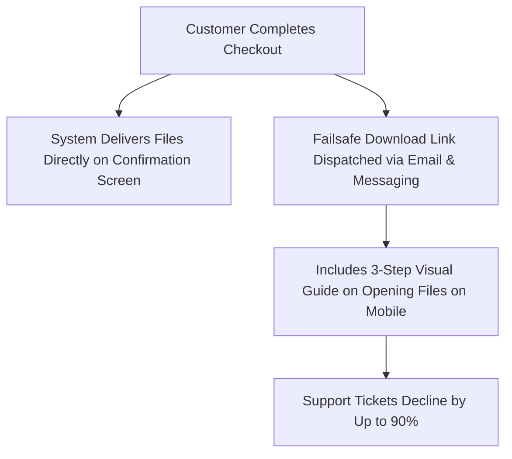
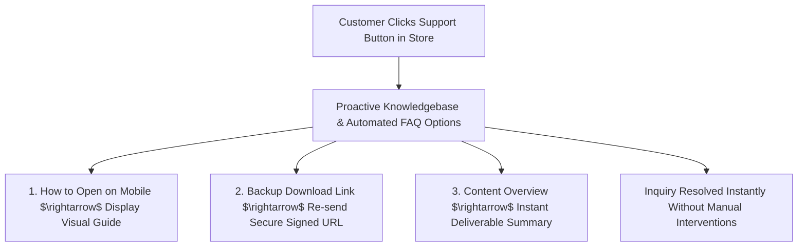

Imagine this scenario: your digital storefront is finally generating consistent daily sales, but your phone never stops buzzing. At 1:30 in the morning, new message alerts chime:

- *"I just completed payment, but where do I find my download link?"*
- *"The spreadsheet won't open on my iPhone—how do I access the formulas?"*
- *"Can I send payment via manual bank transfer instead?"*

If you must manually answer these identical questions dozens of times a week, the promise of an automated digital enterprise turns into an exhausting night shift that robs you of sleep.

Having launched our [sales page and promotional assets](/en/posts/solopreneur-ai-part-3-automated-promotions-in-one-hour/), this concluding chapter of the *Solopreneur AI Playbook* locks down post-purchase support: **building a proactive FAQ knowledgebase and automated fulfillment sequence** that handles inquiries instantly without requiring you to monitor a screen.

The solution is deploying a **Proactive Fulfillment Architecture** that resolves customer questions before they even think to ask them.

---

## Resolving the 3 Queries That Drive 90% of Support Requests

Transaction data across digital storefronts indicates that 9 out of 10 customer inquiries center around three predictable topics:

### 1. Misplaced or Overlooked Download Links
Customers who close their browser window immediately after payment often overlook the primary download button.
- **Automated Solution:** Configure your storefront to dispatch an immediate backup access link via email and messaging within seconds of verified settlement.

### 2. Mobile File Formatting (Specifically iOS and Android Archive Formats)
Non-technical buyers frequently struggle to open `.zip` archives or complex spreadsheets on mobile handsets.
- **Automated Solution:** Include a clean, 1:1 square graphic titled *"3-Step Guide to Opening These Files on Mobile"*:
  1. Android users: Tap Files app $\rightarrow$ Downloads folder.
  2. iPhone users: Open Files app $\rightarrow$ Downloads $\rightarrow$ Tap the archive once to uncompress.
  3. Cloud mirror: Provide a direct Google Drive link for devices with low storage.
- Attach this graphic directly inside the order confirmation dispatch.

### 3. Payment Status Confirmation
Buyers seek immediate assurance that their transaction cleared successfully.
- **Automated Solution:** Deploy instant checkout systems like SitusBisnis that immediately update the UI with a verified success indicator—eliminating the need to submit manual transfer receipts.

---

## The Smart Support Knowledgebase Prompt

Deploy this structured prompt to generate a complete suite of automated customer support responses:

> *"I sell a digital product bundle consisting of [Specify Product Name and File Formats]. My customers are mainstream consumers accessing files on both Android and iOS devices.*
>
> *Your task: Draft operational customer service responses for four common scenarios:*
> 1. *A warm order confirmation message including backup download links and mobile file extraction instructions.*
> 2. *A concise reply resolving 'Download link isn't clicking' reports.*
> 3. *A polite, professional response explaining automated payment methods if a customer asks for manual offline transfers.*
> 4. *A Day-3 follow-up message checking on customer implementation satisfaction and requesting a review.*
>
> *Format: Concise, actionable snippets using [Bracketed Placeholders] for easy customization."*

Save these snippets into your messaging application's *Quick Replies* or device clipboard. When a customer reaches out, typing a simple shortcut like `/access` resolves their ticket in two seconds.

---

## An Independent Engine: Real Solopreneur Freedom

The ultimate purpose of building an independent digital commerce brand is not to create a new job for yourself—it is to **reclaim your time and operational freedom**.

By connecting:
- Real-world problem research using AI ([Part 1](/en/posts/solopreneur-ai-part-1-problem-discovery-knowledge-curation/)),
- Human-centric curriculum drafting without synthetic slop ([Part 2](/en/posts/solopreneur-ai-part-2-drafting-human-centric-curriculum/)),
- Rapid sales page creation ([Part 3](/en/posts/solopreneur-ai-part-3-automated-promotions-in-one-hour/)),
- And an independent storefront with automated fulfillment on [SitusBisnis](https://situsbisnis.com) ([Part 4](/en/posts/solopreneur-ai-part-4-automated-faq-customer-service/)),

You establish an **independent commercial engine operating 24 hours a day, 7 days a week**—generating high-margin revenue that remains 100% yours.

---

### Solopreneur AI Playbook Series Summary
1. **[Part 1: Real-World Problem Discovery](/en/posts/solopreneur-ai-part-1-problem-discovery-knowledge-curation/)**: Extract authentic market complaints from social communities without guesswork.
2. **[Part 2: Drafting Human-Centric Curriculum](/en/posts/solopreneur-ai-part-2-drafting-human-centric-curriculum/)**: Use the Sandwich Method to blend AI velocity with personal lived experience.
3. **[Part 3: 1-Hour Promotional Automation](/en/posts/solopreneur-ai-part-3-automated-promotions-in-one-hour/)**: Build a 4-block sales page and objection-busting FAQs in under 60 minutes.
4. **[Part 4: 24/7 Automated Customer Service](/en/posts/solopreneur-ai-part-4-automated-faq-customer-service/)**: Deploy proactive fulfillment and quick replies to safeguard your personal time.
