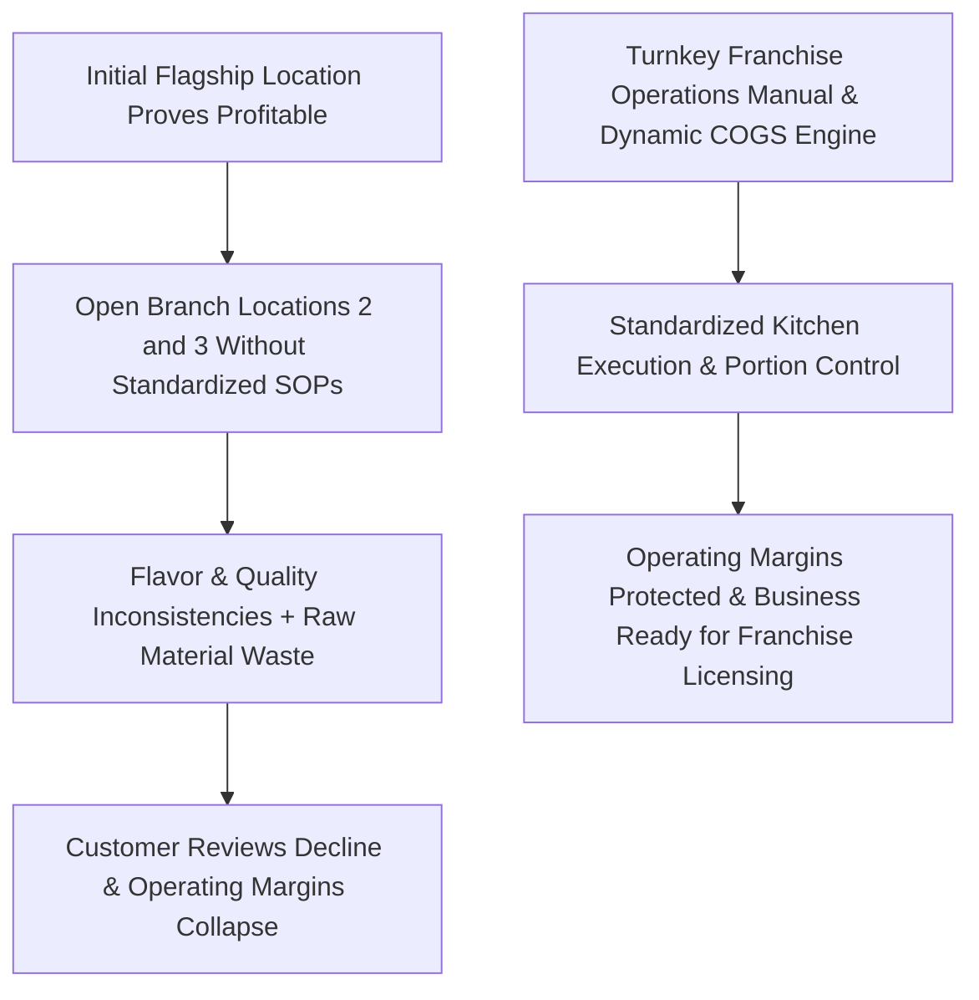
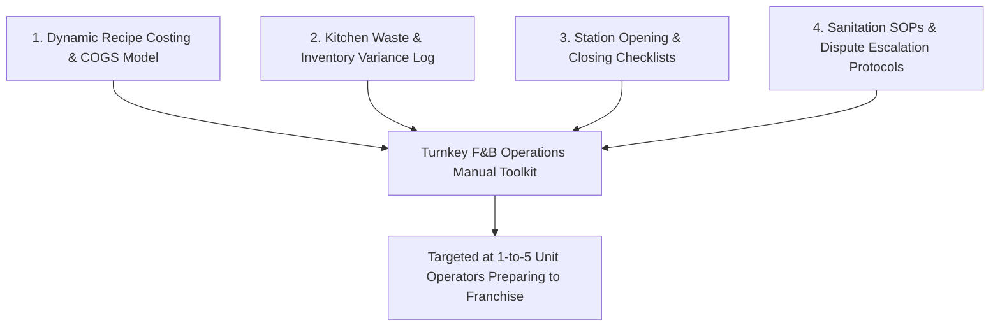

The Food & Beverage (F&B) industry is one of the most dynamic yet unforgiving business sectors globally. Hundreds of cafes, bakeries, and fast-casual concepts launch every month, yet over 60% shutter within their first twelve months.

The leading driver of failure is rarely food quality; it is **kitchen waste, unstandardized inventory leakage, and inconsistent preparation across expanding branch locations**.

This challenge represents a lucrative opportunity for operators with commercial restaurant or hospitality experience: **Selling Turnkey F&B Operational Standardization Toolkits**.

---

## The Four Core Pillars of a Commercial F&B Operational Toolkit

Independent restaurant founders looking to license or expand into multi-unit operations lack the time to draft hundreds of operational procedures from scratch. They require four primary assets:

### 1. Dynamic Gram-Accurate Recipe Costing Engine (COGS Model)
Many food operators price their menus by arbitrarily surveying nearby competitors. This practice frequently leads to insolvency.
- A dynamic spreadsheet calculating cost per gram or milliliter for every ingredient, protein, condiment, and packaging element.
- Built-in ingredient yield factors accounting for raw material shrinkage during butchering, preparation, and cooking.
- Real-time gross margin sensitivity modeling when commodity food prices fluctuate.

### 2. Kitchen Waste & Variance Control Log
The largest margin leak in hospitality stems not from commercial rent, but from spoiled prep, uncontrolled portioning, or unreported kitchen waste.
- Daily digital logs recording wasted inventory alongside standardized cause categorizations (burned, dropped, expired).
- Variance formulas reconciling POS inventory deductions against physical count audits.

### 3. Station Opening & Closing Checklists
Step-by-step visual verification checklists for kitchen and front-of-house staff:
- Daily temperature logs for commercial chillers and freezers.
- Sanitation checklists for food preparation stations and cooking oil cycling.
- Espresso grinder calibration schedules and steam wand sanitation routines.

### 4. Customer Dispute & Escalation Protocols
Actionable resolution guidelines when a customer experiences foreign objects in food, incorrect orders, or delayed service:
- Standardized verbal scripts that staff must use and phrases that are strictly forbidden.
- Clear complimentary remediation thresholds that managers can authorize immediately without ownership escalation.

---

## The Financial Justification: Why \$150 Feels Like a Bargain

Consider an operator managing two fast-casual noodle shops losing an average of \$10 daily per location to inaccurate portioning, spilled sauces, and unrecorded cashier items.

Over a single month, that leakage accumulates:

$$\text{Monthly Operational Leakage} = 2 \text{ Locations} \times \$10/\text{day} \times 30 \text{ Days} = \$600$$

Investing \$150 once for an operations manual and variance tracker that plugs a \$600 monthly drain is an immediate, sensible business decision for any serious owner.

---

## Packaging and Distributing F&B Toolkits

1. **Hybrid File Formats:** Provide editable Word/Google Docs files for written SOPs (allowing owners to easily brand them with their corporate logo), paired with formula-protected Excel/Sheets models for COGS engines.
2. **Printable Station Cards:** Include A5 printable kitchen station cards designed for lamination and display directly above prep stations.
3. **Problem-Oriented Positioning:** Do not sell "generic restaurant documents." Sell "how to protect a 35% net margin and eliminate kitchen inventory leakage."

By distributing through an independent storefront like [SitusBisnis](https://situsbisnis.com), you can provide instant access to private drive folders the moment owners complete checkout—with **zero platform commission cuts**.
