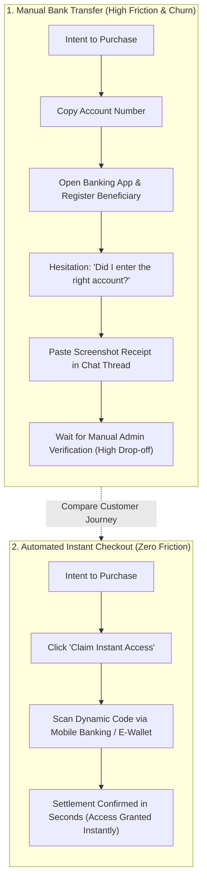

Consider the typical friction when purchasing from an independent shop via chat messaging:
1. You ask: *"Is this available and how much is it?"*
2. The seller replies two hours later: *"Yes, it's \$10. Would you prefer Bank A or Bank B?"*
3. You reply: *"Bank A please."*
4. The seller pastes an unformatted account string: `Bank A 8271928391 John Doe`.
5. You must copy the number, open your banking app, register a new transfer beneficiary, enter your PIN, transfer funds, and **take a screenshot of the digital receipt to paste back into the chat**.
6. You then wait while the seller manually logs into their banking app to reconcile the transaction.

It is an exhausting, multi-step chore.

In modern commerce, **every additional hurdle you place in front of a prospective customer suppresses checkout conversion by 10% to 15%.**

If your business still relies on manual bank transfers in chat threads, you are surrendering a substantial portion of interested buyers to competitors with streamlined checkout experiences.

Here is why automated, single-click checkouts have become an essential operating standard.

---

## 1. Friction Anatomy: Manual Transfers vs. Instant Checkouts

Compare customer friction between manual transfers and modern instant checkouts:

With an automated checkout flow, buyers never need to copy account numbers, worry about typographical transfer errors, or upload transaction screenshots.

The entire transaction is finalized in **seconds**.

---

## 2. The Hidden Costs of Manual Sales Workflows

Many sellers stick with manual chat workflows assuming they are "free" because they avoid software fees. In reality, manual processes carry steep hidden costs:

| Hidden Operational Cost | Real Business Consequence |
| :--- | :--- |
| **Pending Order Abandonment** | Between 35% and 45% of prospects who request account details never complete payment. |
| **Wasted Operational Bandwidth** | Spending 2 to 3 hours daily manually reconciling banking records and emailing links one by one. |
| **Severe Bottleneck on Scale** | Receiving 50 orders in a single day creates support chaos and risks sending incorrect files to customers. |

> **Operational Insight:**
> The hours lost to manual payment checks are far better invested in creating new digital assets or refining your customer acquisition strategies.

---

## 3. Implementing Automated Checkouts Without Engineering Overhead

Historically, integrating automated payment gateways required:
- Formal corporate registration paperwork.
- Extensive regulatory licensing reviews.
- Custom payment gateway API integrations requiring senior engineering talent.

Today, independent commerce platforms have democratized this infrastructure. Using an integrated storefront like [SitusBisnis](https://situsbisnis.com):
1. Your storefront is equipped to accept **all major domestic and mobile payment channels** (QRIS, national bank virtual accounts, and credit cards).
2. Settlement reconciliation runs automatically 24/7 through official banking clearing networks.
3. The moment payment settles, digital deliverables are dispatched automatically to the customer's email and messaging apps.
4. **Zero platform sales commissions** (0% platform transaction cuts).

---

## Respect Customer Attention to Accelerate Growth

Simplifying checkout is not merely a technical tweak—it is **the highest expression of respect for your customer's time and convenience**.

Leave manual chat payments behind, activate automated checkouts on your independent storefront today, and eliminate friction between customer intent and completed sales.
