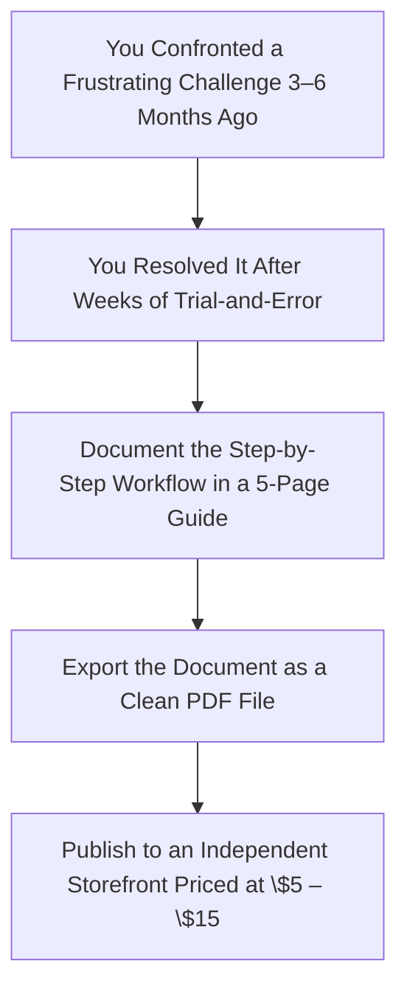
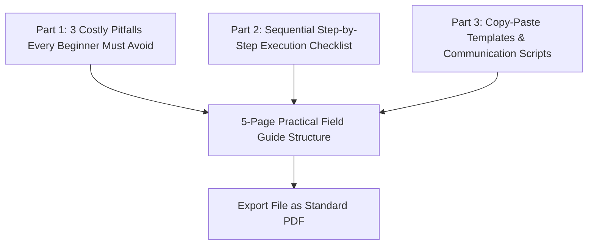

The most common mental barrier facing beginners when they encounter the term "digital products" is imposter syndrome:
- *"I am not a university professor, certified consultant, or famous influencer."*
- *"I do not understand software coding or web development."*
- *"I could never write a 200-page book."*

Let go of those assumptions immediately. **Online buyers do not care about academic degrees or extensive page counts**.

They care about one simple outcome: **Does this resource save me time and resolve the frustrating bottleneck I am experiencing right now?**

If you successfully navigated an irritating life or career obstacle three to six months ago, you already possess everything needed to create your first digital product.

---

## The Core Rule: Target Problems You Recently Solved

The ideal audience for your initial product is not someone far ahead of you, but **someone standing exactly where you were three months ago**.

Consider these real-world examples of straightforward, non-technical digital assets that generate consistent sales:

| Real-World Challenge Solved | Digital Asset Format | Typical Price Point |
| :--- | :--- | :--- |
| **Navigating Small-Business Food Licensing Alone** | 7-Page PDF: Complete checklist of required agency documentation + sample affidavits | \$10 |
| **Passing Civil Service Administrative Application Screening** | 1-Page Checklist: Document compression settings, formatting templates, and photo guidelines | \$7 |
| **Managing Home Renovation Contractors on a Budget** | Simple Spreadsheet: Bill-of-materials breakdown, contractor day-rates, and milestones | \$12 |
| **Meal Prep Planning for Working Parents** | Monthly Menu PDF: Grocery budget schedules, storage guidelines, and 15-minute quick prep routines | \$9 |

Notice what these assets have in common: none require custom coding or expensive video studios. Every single one is **a structured summary of lived experience organized so others can avoid repeating the same costly mistakes**.

---

## 4 Steps to Build a Sellable Asset Without Coding

### Step 1: Open Your Word Processor
Do not wrestle with complex graphic design software. Open Google Docs or Microsoft Word on your computer or mobile device.

### Step 2: Use a 3-Part Modular Structure
1. **Critical Pitfalls to Avoid:** Highlight three mistakes that typically cause beginners to fail or lose money (e.g., *"Never purchase Material X because it cracks within two weeks"*).
2. **Step-by-Step Execution Sequence:** Detail the exact workflow from Day 1 to completion using concise, numbered instructions.
3. **Plug-and-Play Templates:** Include copy-paste message scripts, sample forms, or budgeting tables readers can use immediately.

### Step 3: Export as a Standard PDF
Once your guide is drafted (aim for 5 to 10 dense, high-utility pages), click **File $\rightarrow$ Download / Save As $\rightarrow$ PDF Document**. Your digital asset is now complete.

### Step 4: Connect to an Automated Checkout Engine
Non-technical creators often worry about payment logistics: *"How do I accept payments and deliver files automatically without setting up complex merchant servers?"*

The solution is an integrated storefront like [SitusBisnis](https://situsbisnis.com):
1. Create your storefront account in under two minutes.
2. Upload your exported PDF file.
3. Set your price (e.g., \$9).
4. You immediately receive a branded checkout link with **Single-Click Instant Payment**.

When a customer completes payment via modern payment channels, the storefront verifies settlement in real time and delivers the PDF directly to the buyer's screen and inbox.

You never have to reconcile bank accounts manually, and **you pay zero platform commissions**. You are officially operating an independent digital business from your home workspace.
