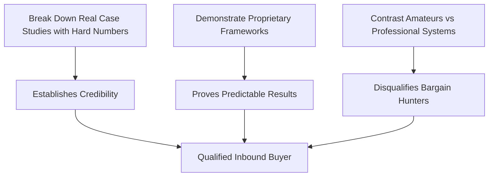

You have almost certainly witnessed this phenomenon, or perhaps experienced it firsthand:

A short-form video on TikTok or Instagram Reels unexpectedly takes off. View counts climb rapidly—500,000, 1 million, 2 million impressions. Your phone vibrates incessantly with notifications until the battery drains. Comment sections fill with thousands of laughing strangers and passionate debates.

For a brief 48-hour window, you feel like you have conquered the social algorithm.

Yet, when you open your business analytics dashboard or examine store orders, total revenue has barely budged. More often than not, **you made exactly zero sales**.

Why does this disconnect happen so consistently?

The answer is straightforward: **Most creators confuse broad entertainment with commercial authority. They excel at entertaining passive scrollers, but fail to provide any logical or emotional justification for a qualified prospect to buy from them.**

---

## 1. Vanity Metrics vs. Pipeline Velocity

Social media algorithms are optimized for attention retention, not your commercial profitability. The algorithm rewards outrage, humor, shock value, and surface-level relatable sketches—all of which attract a predominantly passive audience with zero intent to invest in professional transformation.

| Dimension | Viral Entertainment Content | Authority Commercial Content |
| :--- | :--- | :--- |
| **Primary Goal** | Maximizing total watch time & shares | Solving a specific operational bottleneck |
| **Target Audience** | General public & casual scrollers | Qualified operators & budget holders |
| **Comment Depth** | "Lmao so true 😂" or angry debates | "How can we implement this for our team?" |
| **Sales Conversion** | Extremely low (<0.01%) | Predictably high (2% to 8%) |
| **Shelf Life** | 24 to 72 hours before fading | Months or years (search & evergreen utility) |

---

## 2. The 3 Structural Mistakes Sinking Viral Creators

### A. The "Too Broad" Dilemma
When your content attempts to appeal to college students, freelance designers, stay-at-home parents, and corporate managers simultaneously, the message is diluted to meaningless platitudes. Specificity is what creates pricing power. A checklist on "General Productivity" sells for \$5 to reluctant buyers; a workflow system on "Automating Financial Close for Remote Agencies" commands \$290 with minimal resistance.

### B. Lack of an Off-Platform Funnel
Relying on social platform bio links with 15 confusing buttons drives decision paralysis. If an interested viewer clicks your profile, they should encounter a single, frictionless gateway: an opt-in asset or a dedicated product landing page built on your sovereign store.

### C. Failing to Ask for the Sale
Many creators suffer from an irrational fear of being perceived as "salesy". They produce 100 consecutive free posts without ever introducing a structured paid solution. Audiences treat you according to how you train them: if you only ever give free superficial entertainment, they will feel entitled to your labor for free perpetually.

---

## 3. The Authority Content Matrix

To convert viewers into high-intent buyers, shift 40% of your publishing schedule toward authority assets:

- **Teardown Case Studies:** Walk through an actual client transformation, detailing the baseline metric, the intervention executed, and the measured outcome.
- **Contrarian Truths:** Dispel common industry myths that keep your audience stuck in low-leverage work.
- **Implementation Walkthroughs:** Show the real dashboard, the database schema, or the exact spreadsheet template in action.

You do not need 1,000,000 views to build a durable 7-figure creator business. You need 1,000 highly aligned professionals who recognize that your specific solution is worth 100x what you charge.
