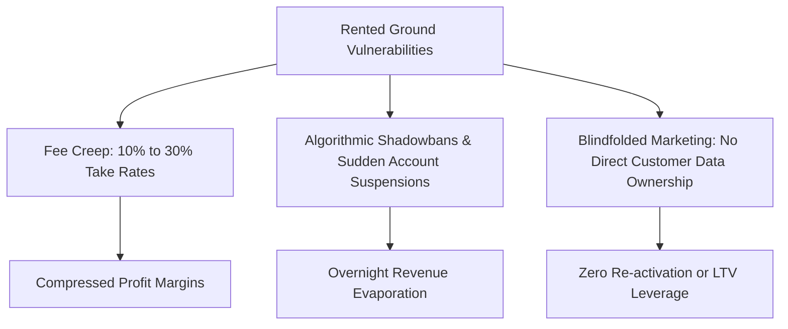

Over the past three years, the global cohort of developers, writers, educators, and product designers selling digital products has exploded.

Yet beneath the excitement of generating passive revenue online lies an uncomfortable reality confronting modern creators: **the more gross revenue you generate, the more profit you surrender to third-party marketplaces and legacy middlemen.**

Legacy marketplaces regularly extract 10%, 15%, or even up to 30% from every transaction. To make matters worse, these platforms lock away your most valuable asset: **you are denied access to the direct email addresses, phone numbers, and purchasing histories of your own buyers.**

This asymmetric dynamic has ignited the **Zero-Commission Commerce** movement—a structural shift where independent creators build sovereign storefronts under their own brand, keeping 100% of their net margins.

---

## 1. The Three Existential Risks of Rented Ground

Entrusting your entire livelihood to a closed marketplace ecosystem introduces systemic business vulnerabilities:

### A. The Hidden Tax on Scale
When your store grosses \$1,000 monthly, a 15% platform cut is \$150—annoying, but tolerable. When your business reaches \$20,000 monthly, that same platform tax costs you \$3,000 every 30 days. Over three years, you have handed over \$108,000 to a platform for doing little more than hosting an HTML form.

### B. Algorithmic Risk and Account Freezes
Marketplaces operate automated moderation bots that frequently freeze merchant funds with zero human recourse. An unexpected surge in sales or a disgruntled competitor submitting a false copyright report can freeze your payout pipeline for months while your recurring server and living expenses remain due.

### C. The Customer Data Black Hole
When a transaction occurs on a third-party marketplace, that customer belongs to the marketplace—not you. You cannot import them into your automated CRM, you cannot run targeted broadcast announcements, and you cannot build a long-term Customer Lifetime Value (LTV) flywheel.

---

## 2. The Sovereign Commerce Architecture

Independent commerce does not require hiring an engineering department or writing bespoke payment integrations from scratch. Modern creator infrastructure provides the complete stack out of the box:

1. **Direct Gateway Settlement:** Payments flow directly into your own merchant account via official payment gateways (such as QRIS, Virtual Accounts, and Cards) with immediate liquidity and zero platform commission markup.
2. **First-Party Data Custody:** Every buyer's full name, email address, WhatsApp number, and UTM attribution source lands immediately in your database.
3. **Custom Domain Identity:** All transactions occur on your own canonical brand domain (e.g., `store.yourbrand.com`), insulating your reputation from marketplace branding.

---

## 3. Comparing Economics: Marketplace vs. SitusBisnis

Let's evaluate the real numbers on a creator generating \$5,000 monthly across 200 orders of a \$25 playbook:

| Metric | Traditional Marketplace (15% Take Rate) | Sovereign Store on SitusBisnis |
| :--- | :--- | :--- |
| **Gross Sales** | \$5,000 / month | \$5,000 / month |
| **Platform Take Rate** | -\$750 / month | **\$0 (0% Commission)** |
| **Annual Fee Drag** | -\$9,000 / year | **\$0 saved to reinvest** |
| **Customer Email Access** | Masked / Prohibited | **100% Exportable CSV** |
| **Direct WhatsApp Follow-up**| Disallowed | **Built-in automated notifications** |
| **Branding Experience** | Marketplace logos & competitor ads | **Pure bespoke brand aesthetic** |

The choice is evident: stop building real estate on rented land. Build a sovereign digital storefront where your brand, your relationships, and your profits remain entirely your own.
