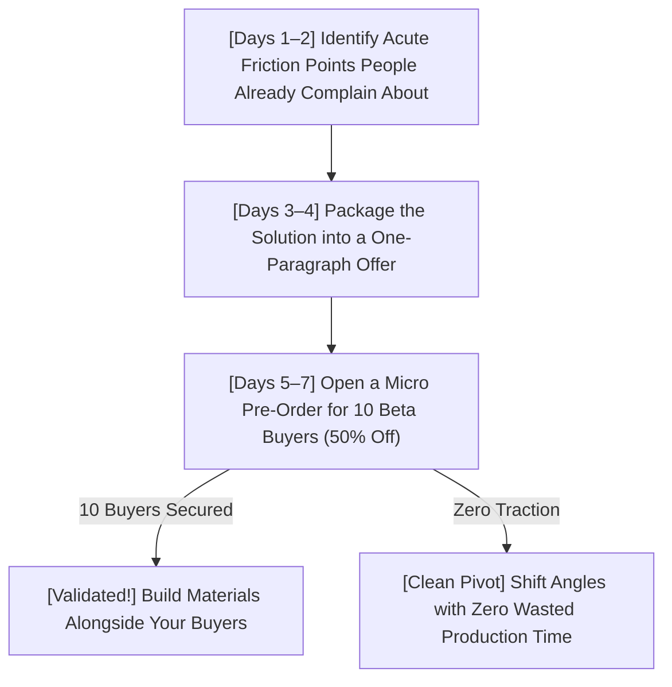

Have you ever found yourself in this scenario?

You stumble upon an exciting idea for an e-book or online course. Fueled by adrenaline, you stay up late every night for two straight months, assemble 60 meticulously formatted presentation slides, record gigabytes of high-definition video, and subscribe to pricey hosting software.

Then launch day arrives... and absolute silence. Not a single person buys.

It hurts. More crucially, **nearly 85% of early creators fall into this exact trap**. They fall in love with an abstract concept in their own heads without ever verifying whether someone is willing to swipe their card for it.

The foundational principle for reaching your first IDR 50 million in sales is simple: **Never build exhaustive curriculum until your offer has collected cash upfront.**

In Part 1 of this series, we unpack the leanest, lowest-friction framework to validate digital product ideas within 7 days—without spending a single dime on capital or paid ads.

---

## 1. The Fast-Track Idea Validation Roadmap

Here is the operational sequence to validate demand from scratch:

If zero people bite during the pre-order sprint, you have lost nothing. You merely spent a few days publishing social posts rather than two months grinding on an unwanted asset.

---

## 2. Pinpoint Pain Points People Gladly Pay to Remove

The most common rookie mistake is attempting to monetize abstract topics, such as *"A Guide to Productivity"*.

Frankly, nobody pays IDR 150,000 for the broad concept of "productivity." Free productivity advice saturates YouTube and TikTok.

Buyers authorize mobile banking transfers only when a solution **directly resolves an acute, irritating bottleneck**. Notice the sharp difference below:

| Vague Ideas That Struggle to Sell | Specific Offers That Trigger Immediate Demand | Why the Specific Offer Wins |
| :--- | :--- | :--- |
| Personal Finance Management Tips | Monthly Budgeting Spreadsheet for Newlyweds | Highly targeted, ready to use, no complex formula setup required. |
| How to Increase Online Sales | 30 Auto-Closing WhatsApp Chat Templates for Fashion Boutiques | Solves ghosted inquiries and abandoned buyer conversations instantly. |
| Commercial Graphic Design Guide | 50 Ready-to-Edit Instagram Carousel Templates for Real Estate Agents | Saves hours of design time from scratch every single week. |

> **Editorial Rule:**
> Never sell "the learning process." Sell **acceleration tools** or **plug-and-play shortcuts** that make your buyer's workflow 10x easier within minutes.

---

## 3. The "Hand-Raiser" Post: Demand Signaling Without Hard Selling

How do you test audience interest without spending money on ads? Deploy a *Hand-Raiser Post* on LinkedIn, Twitter/X, or Threads:

> *"Over the last week, I refined our WhatsApp follow-up cadence, which lifted our store checkout recovery rate from 12% to 38% without adding extra support staff.*  
> *If I turn this into a concise checklist + copy-paste chat templates, would anyone find this useful? Drop 'INTERESTED' in the comments and I'll send over a preview."*

Notice that you haven't pitched anything for sale yet. You are solely testing appetite.
- **Fewer than 3 responses:** The framing lacks urgency or bite. Pivot the angle.
- **Dozens of responses:** You have identified validated commercial demand.

---

## 4. The Micro Pre-Order: Cash Upfront is the Ultimate Validation

Once prospective buyers respond, avoid handing out the entire asset for free. Respond to their comments or private messages with an exclusive beta proposition:

> *"Thanks for raising your hand! I'm currently finalizing the checklist and plug-and-play templates to ensure they're rock solid. The official release is scheduled for next week at IDR 199,000.*  
> *However, for the first 10 beta reviewers who help test the initial version, I'm opening early-bird access for just IDR 79,000—plus direct chat feedback with me.*  
> *You can secure your early access slot here: [Your Storefront Checkout Link]"*

Why is the 10-buyer threshold so critical? Because when 10 strangers transfer real funds for a product whose curriculum is still in development, **your concept is verified by real market forces**.

---

## Next Steps

You now possess a low-risk framework to validate product ideas with zero upfront budget.

In [Part 2](/en/posts/zero-to-50m-part-2-turning-followers-into-buyers/), we will examine: **How to turn your first 100 followers into loyal repeat buyers who eagerly anticipate your launches**—even in the face of shifting social algorithms!
