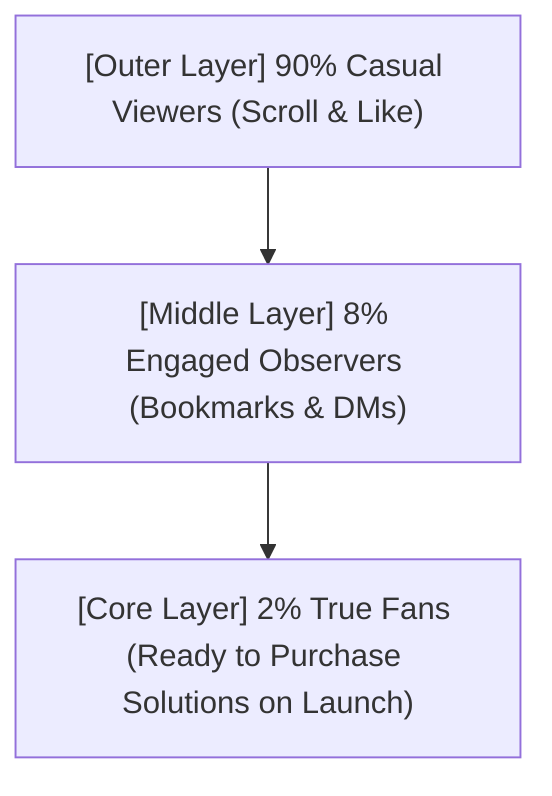
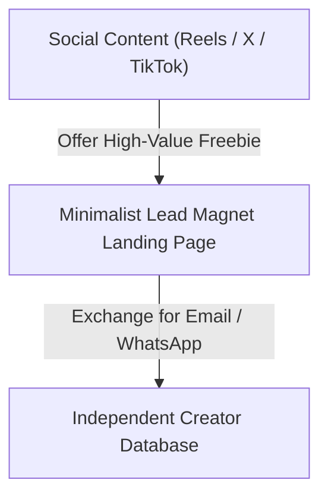

The most pervasive myth paralyzing early creators is this excuse:
> *"My account only has 300 followers. Who's going to buy from me? I'll wait until I reach 10,000 followers before launching my store."*

If you wait for 10,000 followers, chances are you will never launch.

Here is the operational reality: **Plenty of creators with 500,000 TikTok followers struggle to sell a single IDR 100,000 t-shirt.** Conversely, focused solopreneurs with an Instagram audience of 800 people regularly generate IDR 20,000,000 monthly from actionable templates and specialized advisory sprints.

Conversion is not driven by view counts; it is governed by **the depth of trust you cultivate with a qualified cohort of prospective buyers**.

In Part 2 of this series, we unpack how to transform modest followings into an engaged customer base eager for your commercial releases.

---

## 1. The Audience Trust Pyramid

Avoid treating all followers as a homogeneous group. In digital commerce, your audience organizes into three distinct tiers:

You do not need hundreds of thousands in the outer layer to reach your first IDR 50 million. You only need:
- **100 customers in your Core Layer** purchasing an asset at IDR 500,000, OR
- **250 customers** purchasing a bundle tier at IDR 200,000!

Securing 100 to 250 buyers is an achievable operational target—even for a brand-new storefront established within the past month.

---

## 2. The 3E Content Framework: Converting Lurkers into Buyers

To keep your audience engaged without burning them out with endless sales pitches, maintain this disciplined content mix:

| Content Format | Primary Objective | Concrete Example |
| :--- | :--- | :--- |
| **Educate (40%)** | Deliver an actionable quick win that followers can execute immediately. | *"A 3-minute workflow to structure customer WhatsApp contacts in Excel without nested formulas."* |
| **Empathize (40%)** | Share authentic operational challenges that demonstrate you understand their frustrations. | *"Last year I lost significant capital due to an unvetted hiring decision and broken team workflows..."* |
| **Excite (20%)** | Provide behind-the-scenes previews of in-development assets (*build in public*). | *"Drafting our new QRIS checkout integration playbook. Do you prefer an interactive SOP document or a video walkthrough?"* |

> **Editorial Rule:**
> When you invite your audience into your product development process, they feel invested in the outcome. When launch day arrives, they aren't just buying a product—they are celebrating a solution they helped shape.

---

## 3. Transition Followers from Rented Land to Owned Channels

Social media platforms are rented real estate. Instagram algorithms shift overnight, TikTok accounts face arbitrary restrictions, and organic impression reach can decline in a single algorithm update.

The moment a prospective customer demonstrates interest in your content, **transition them into an owned channel—such as an email subscriber list or a direct customer database**:

By maintaining an independent buyer database on a self-hosted platform like [SitusBisnis](https://situsbisnis.com), you can contact your customer base directly at zero marginal cost—completely free from third-party algorithmic throttles.

---

## Summary & Next Steps

Stop measuring your potential against viral influencers. Focus your efforts on the first 10 to 50 people interacting with your posts, study their operational pain points, and build solutions around their needs.

In [Part 3](/en/posts/zero-to-50m-part-3-frictionless-landing-page-setup/), we examine your primary conversion asset: **How to construct a single-page landing page that keeps visitors engaged and drives friction-free checkout conversions**—complete with copy structures you can implement today!
