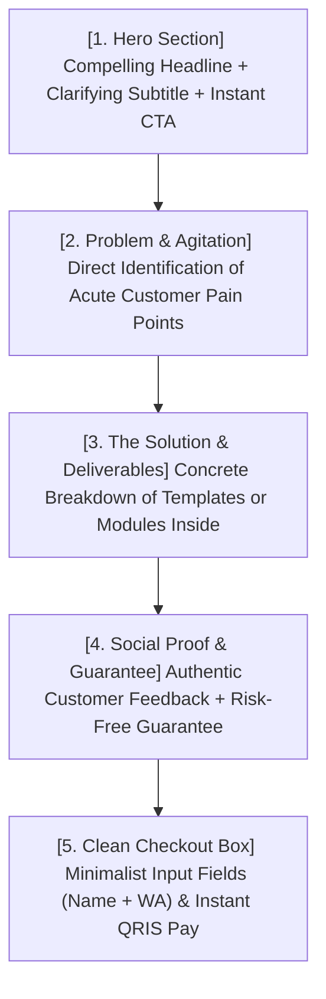

We have all experienced this scenario:

You tap a product link in a social bio, only to be met with a lagging page load, distracting layout animations, mismatched typography, and endless scrolling before you can even decipher: *"What exactly is this person selling?"*

The result? You close the tab within five seconds.

Many first-time creators assume an effective digital storefront requires the sprawling complexity of an enterprise website—replete with expensive agency retainers, complex coding, and heavy 3D motion graphics.

In real-world commerce: **The highest-converting sales pages are clean, load instantly on mobile devices, and address customer intent without unnecessary friction.**

In Part 3 of this series, we unpack the five structural building blocks of an effective single-page sales letter designed to maximize purchase completion.

---

## 1. The 5 Essential Landing Page Structural Blocks

Avoid filler content. A high-converting offer page requires only five focused sections arranged vertically:

Here is how to execute each section cleanly:

---

## 2. Drafting Each Block for Maximum Conversion

### Block 1: The Hero Section (The First 5 Seconds)
The hero section has one single objective: **prevent immediate bounce and communicate tangible value**.
- **Headline:** State the specific outcome or transformation your product delivers.
  > *Example:* "Launch an Independent Digital Storefront Ready for QRIS Payments in 15 Minutes—Without Writing Code."
- **Subtitle:** Clarify who the product is built for and what operational headaches it eliminates.
  > *Example:* "A tactical blueprint and plug-and-play storefront setup for creators, educators, and solopreneurs looking to eliminate marketplace commission cuts."
- **CTA Button:** *"Claim Instant Access Now →"*

### Block 2: Problem & Agitation (Demonstrating Empathy)
Avoid jumping straight into feature lists. Articulate the everyday friction points your buyer experiences:
- *"Are you exhausted from manually answering chat messages just to paste bank transfer details?"*
- *"Frustrated watching marketplace platforms shave double-digit percentages off your hard-earned revenue?"*
- *"Struggling to build digital assets from scratch because client deliverables consume your entire week?"*

When prospective buyers read this, they instantly recognize that the product was engineered specifically for their situation.

### Block 3: The Solution (Tangible Deliverables Over Fluff)
Digital buyers require concrete clarity. Avoid vague promises like *"Includes premium guidance."* Display crisp screenshots of your spreadsheet dashboards, modern 3D asset mockups, or concise video walkthrough previews.

Provide a transparent, itemized value checklist:
- ✅ **Module 1:** Market Validation Blueprint (Valued at IDR 150,000)
- ✅ **Module 2:** High-Converting Copywriting Swipe Files (Valued at IDR 200,000)
- ✅ **Bonus:** Private Creator Network Access (Valued at IDR 300,000)

### Block 4: Social Proof & Guarantee (De-risking the Purchase)
Online transactions trigger natural buyer hesitation. Mitigate this with two mechanisms:
1. **Unedited Social Proof:** Authentic screenshots of chat messages or emails from early users praising your deliverables.
2. **Clear Guarantee:** *"Review the entire material. If within 14 days you find these frameworks haven't provided clear value for your business, contact our team for a 100% refund—no hassle."*

### Block 5: Streamlined Checkout
The golden rule of digital sales: **Never ask for information you do not strictly need.**
For digital deliverables, require only:
1. Full Name
2. Email Address (for automated deliverable dispatch)
3. WhatsApp Number (for instant receipts and fallback access)

Do not demand home addresses, postal codes, or redundant account registrations. Minimizing form fields directly lifts successful checkout completion rates.

---

## 3. High-Converting Pages vs. Common Design Pitfalls

| Common Rookie Pitfalls | Battle-Tested Conversion Standards |
| :--- | :--- |
| Autoplay media and intrusive overlay popups | Clean typography, uncluttered layout, and sub-2-second mobile load speeds |
| Generic CTA buttons labeled "Submit" or "Send Message" | Value-oriented action triggers: *"Yes, Grant Me Instant Access!"* |
| Forcing users through account registration and email verification loops | Direct single-page checkout supporting instant QRIS scanning |

> **Operational Insight:**
> Using a dedicated commerce infrastructure like [SitusBisnis](https://situsbisnis.com), mobile-optimized landing templates and streamlined QRIS checkout forms are pre-configured out of the box, allowing you to focus on your core offer rather than wrestling with backend code.

---

## Summary & Next Steps

A profitable digital sales page isn't the one with the most visual flair—it's the one that delivers clarity of value and a frictionless payment experience.

In [Part 4](/en/posts/zero-to-50m-part-4-automated-closing-workflows/), we integrate this storefront with an automated customer workflow: **How to deploy automated WhatsApp messaging to close pending invoices 24/7 without staying glued to your screen!**
