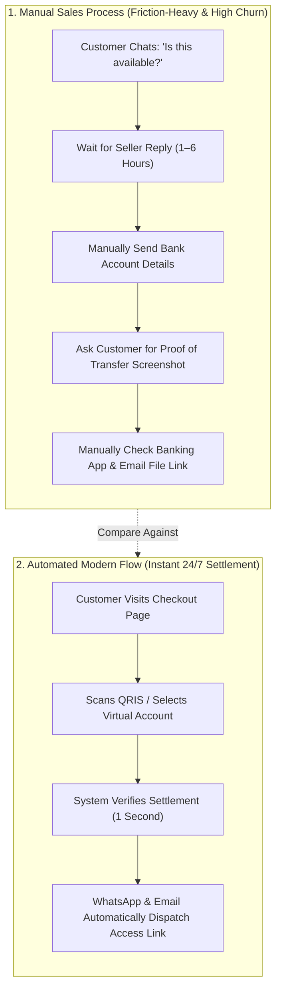

Consider this familiar scenario:

It is Sunday night at 11 PM. You are asleep or relaxing with your family. Suddenly, an alert chimes on your phone from an interested prospective buyer asking how to purchase your digital template.

If you are running your business through traditional manual channels:
1. You only see and answer the message the next morning at 8 AM.
2. By then, the buyer's impulse has cooled, or their budget has been allocated elsewhere.
3. Once you reply with manual bank account details, the buyer replies *"Thanks, I'll transfer shortly"*—and disappears indefinitely.

Manual transfer confirmations and delayed response times are **the leading killers of digital product transactions**.

When people decide to purchase a digital asset, they seek instant fulfillment: complete payment this second, unlock access the next.

In Part 4 of this series, we unpack how to assemble an **Automated WhatsApp Closing Workflow**—a hands-off system that handles transactions 24/7 without requiring you to monitor chat notifications around the clock.

---

## 1. Manual Invoicing vs. Modern Automated Checkouts

Compare the customer journeys between these two setups:

In the automated scenario, the entire transaction lifecycle wraps up in under 60 seconds. You could be asleep, travelling, or in meetings, while your storefront processes orders seamlessly.

---

## 2. Three Automated WhatsApp Triggers Every Digital Storefront Needs

An effective automated sequence delivers timely, context-aware updates triggered by specific buyer actions:

### 1. Instant Fulfillment & Welcome Message (Second 0)
As soon as the customer completes QRIS payment, the system greets them immediately via WhatsApp:
> *"Hello [Name], thank you for purchasing [Product Name]! Your QRIS payment has been automatically verified.*  
> *Your access link and downloadable resources are live and ready to use here: [Access Link].*  
> *Keep this number saved should you require any operational support. Welcome aboard!"*

### 2. Abandoned Invoice Recovery Notification (Hour 1)
Approximately 30% of prospective buyers drop off during checkout due to sudden interruptions (an incoming phone call, bad signal, or a momentary app distraction).

One hour later, your system delivers a helpful follow-up:
> *"Hi [Name], quick note that your invoice for [Product Name] remains active.*  
> *To skip re-entering your details, you can complete payment directly via QRIS / Virtual Account here: [Invoice Link]. Let us know if you need any assistance!"*

This simple touchpoint routinely **recovers 25% to 40% of otherwise abandoned orders**.

### 3. Expiration Warning (Hour 20)
Four hours before the temporary invoice link expires:
> *"Hi [Name], your reserved promotional rate for [Product Name] will expire automatically in 4 hours.*  
> *Did you experience any payment issues earlier? Feel free to reply directly to this message if you have any questions."*

---

## 3. Integrating Automated Checkouts Without Coding Hassles

Many founders assume that configuring dynamic QRIS payment callbacks and WhatsApp webhooks requires months of custom engineering.

Historically, that was true. However, with an integrated platform like [SitusBisnis](https://situsbisnis.com):
- QRIS settlement and automated bank Virtual Accounts are **active out of the box without requiring manual payment gateway license applications**.
- Order state transitions trigger instant email dispatches and webhook messaging automatically.
- You operate with zero commission penalties—retaining 100% of your product margins.

---

## Summary & Next Steps

Scaling an independent digital commerce brand is not about working longer shifts or sacrificing sleep to respond to chat inquiries. It is about implementing reliable systems that work on your behalf.

In [Part 5 (The Finale)](/en/posts/zero-to-50m-part-5-tripling-revenue-with-upsells/), we explore our final growth lever: **How to triple your average order value by embedding one small checkbox right before checkout!**
