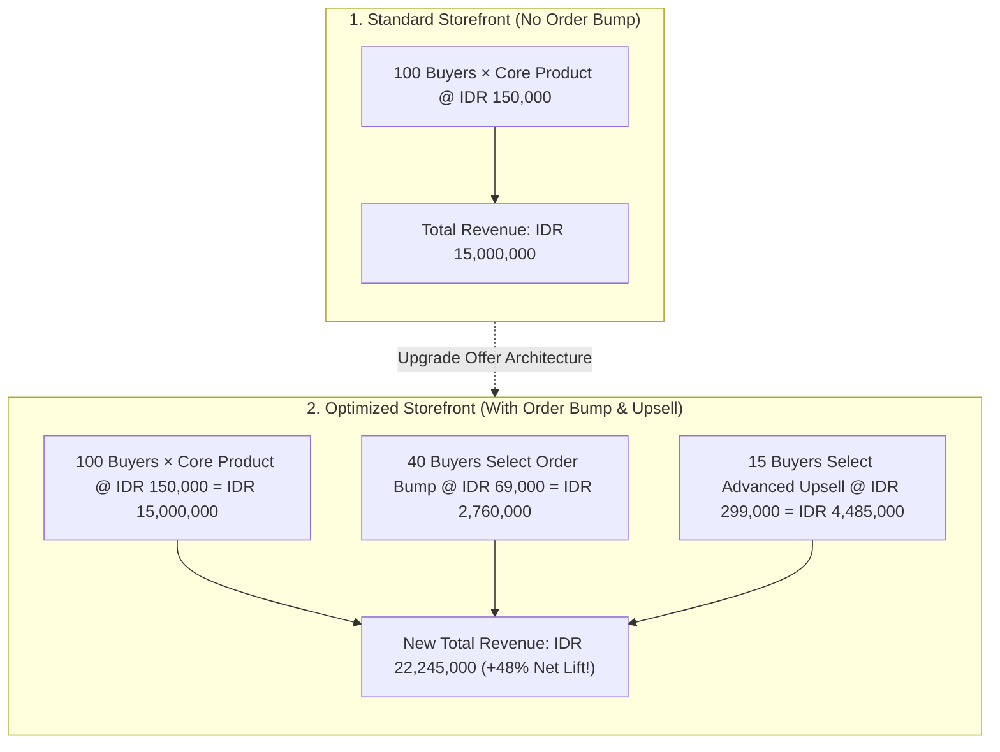

Have you ever ordered a meal at a quick-service restaurant counter, only for the cashier to politely offer:
> *"Would you like to add waffle fries and a beverage for an extra IDR 15,000?"*

Almost instinctively, you answer: *"Sure, go ahead."*

That simple question represents one of the most profitable mechanisms in modern retail. The business incurred zero additional marketing expense to acquire you, yet your transaction value surged by 30% to 50% in a single instant.

In digital commerce, this mechanic is known as an **Order Bump**—a targeted, one-click add-on offer embedded directly inside the checkout form immediately prior to payment confirmation.

In this concluding installment of the *From 0 to IDR 50 Million in Digital Product Sales* series, we break down how to structure order bumps and post-purchase upsells that reliably expand your revenue from existing customer demand.

---

## 1. The Unit Economics of the Order Bump

Examine the comparative financial outcome for a digital business processing 100 customer checkouts per month:



Notice the critical leverage: **The customer acquisition volume remains identical (100 buyers), but your realized revenue expands by millions of rupiah.**

Furthermore, because digital assets carry zero marginal production, packaging, or shipping expenses, nearly 100% of this supplementary revenue flows directly into **net operating profit**.

---

## 2. Three Criteria for an Irresistible Order Bump Offer

Do not arbitrarily attach random files to your checkout form. A high-converting order bump must satisfy three clear requirements:

| Required Criterion | Strategic Explanation | Practical Example |
| :--- | :--- | :--- |
| **1. Impulse Price Point** | Priced at 30% to 50% of the core product price, making the decision friction-free. | Core product IDR 149,000 → Order bump IDR 49,000. |
| **2. Time Compression (*Speed*)** | An asset that enables the buyer to extract results from the core product faster. | *"Add IDR 49,000 to unlock 25 ready-made templates so you don't start from an empty screen."* |
| **3. Immediately Deployable** | High-utility swipe files, checklists, or prompt libraries that require no lengthy setup. | 50 Production-Ready AI Copywriting Prompts for Landing Pages. |

> **Editorial Rule:**
> An order bump must never feel like a missing piece of the primary purchase that renders it incomplete without the add-on. It should serve as a high-utility accelerator, not a forced upsell.

---

## 3. High-Converting Order Bump Presentation

On your checkout page, style the order bump with high-contrast, tactile UI treatment (such as an accent border with a warm neutral background):

```
┌──────────────────────────────────────────────────────────┐
│ ☑ YES, INCLUDE THE SPREADSHEET AUTOMATION KIT (SAVE 70%)  │
│                                                          │
│ Add just IDR 49,000 (Regularly IDR 199,000).            │
│ Get 30 plug-and-play spreadsheet models that             │
│ automatically calculate your cash flow and taxes.        │
└──────────────────────────────────────────────────────────┘
```

Psychologically, when prospective customers have already entered their contact information and are preparing to pay, their mindset has shifted to *buying*. Checking an inexpensive box that complements their primary purchase feels frictionless.

---

## 4. The Complete Flywheel: From Zero to IDR 50 Million

Connecting all five components of this series creates a durable commercial engine:

1. **Validation:** Verify genuine market friction and secure your first 10 paying customers with zero upfront capital ([Part 1](/en/posts/zero-to-50m-part-1-zero-capital-idea-validation/)).
2. **Audience:** Transition social followers into an owned direct customer database ([Part 2](/en/posts/zero-to-50m-part-2-turning-followers-into-buyers/)).
3. **Storefront:** Structure a clean, high-intent single-page offer that eliminates friction ([Part 3](/en/posts/zero-to-50m-part-3-frictionless-landing-page-setup/)).
4. **Automation:** Connect instant QRIS payments and automated WhatsApp delivery workflows ([Part 4](/en/posts/zero-to-50m-part-4-automated-closing-workflows/)).
5. **Value Expansion:** Maximize customer value through targeted order bumps and upsell tiers ([Part 5](/en/posts/zero-to-50m-part-5-tripling-revenue-with-upsells/)).

With [SitusBisnis](https://situsbisnis.com), this infrastructure is fully integrated and accessible to creators—enabling you to operate independently without paying platform commission cuts.

---

## Series Conclusion

Generating your first IDR 50 million in digital asset sales is not reserved for celebrity influencers or VC-funded startups. It is the direct output of **taking disciplined action, understanding genuine buyer pain points, and operating with reliable sales infrastructure**.

Take the first step today. Establish your storefront, publish your initial asset, and build an independent digital enterprise on your own terms.
