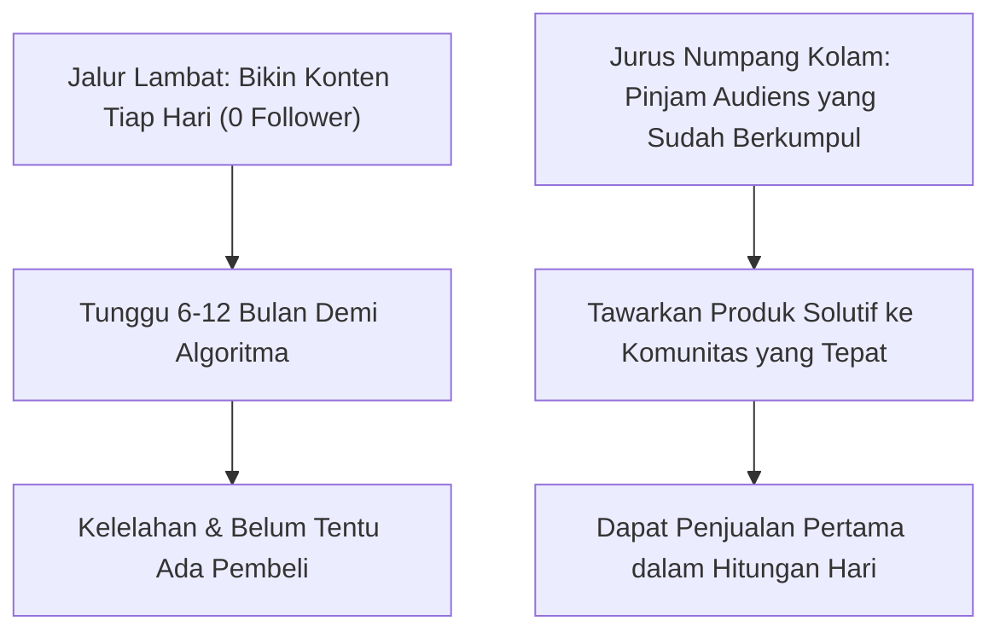
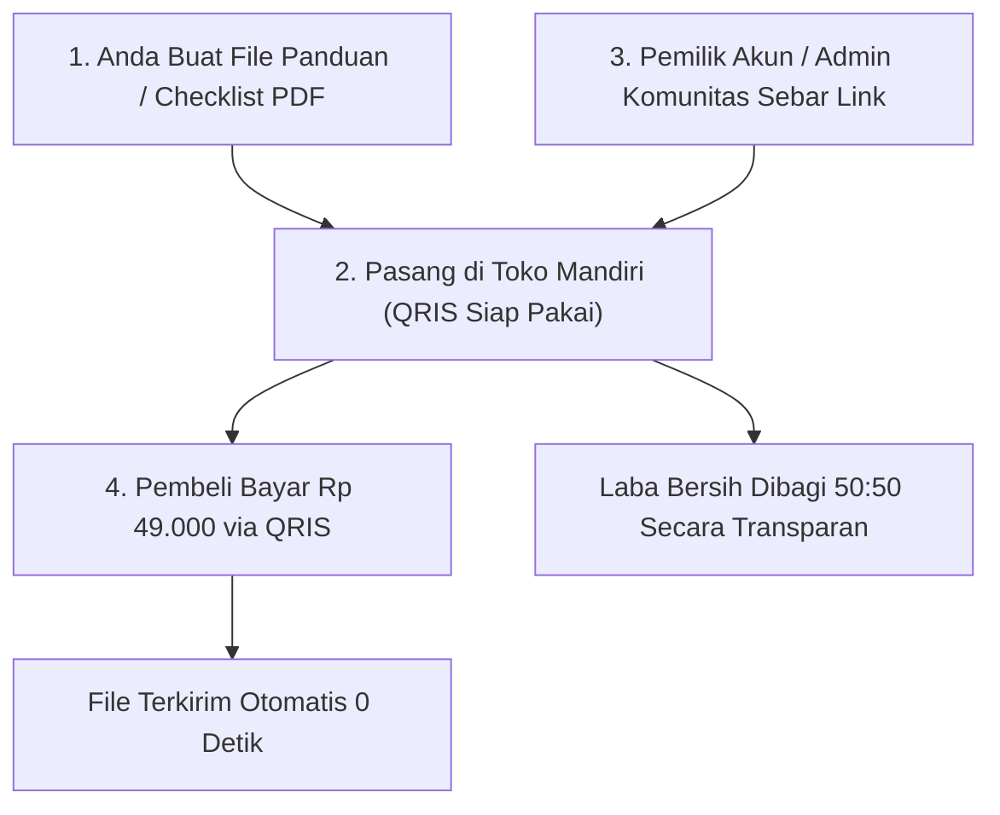

Nasihat bisnis digital yang paling sering membuat orang awam menyerah sebelum mulai adalah: *"Kamu harus bikin konten TikTok setiap hari, cari 10.000 followers dulu, baru bisa mulai jualan."*

Bagi orang yang sibuk kerja, gaptek, atau pemalu yang tidak suka pamer wajah di depan kamera, nasihat itu terasa seperti vonis mati. Membangun akun media sosial dari nol di tahun 2026 membutuhkan waktu berbulan-bulan dan keberuntungan algoritma yang melelahkan.

Kabar baiknya: **Anda sama sekali tidak perlu punya follower untuk menghasilkan uang dari produk digital**.

Ada jalan pintas yang legal, etis, dan sudah dipakai oleh pebisnis cerdas selama ratusan tahun: **Jurus Numpang Kolam (*Borrowing Other People's Audience*)**.

## Logika Dasar: Kenapa Harus Menggali Sumur Jika Sungai Sudah Mengalir?

Bayangkan Anda ingin menjual payung saat hujan. Apakah Anda harus membangun kota sendiri lalu mengundang orang tinggal di sana? Tentu tidak. Anda cukup berdiri di pintu keluar stasiun kereta api di mana orang-orang sudah berkumpul dan basah kuyup.

Di internet, "stasiun kereta api" itu adalah tempat-tempat di mana calon pembeli Anda sudah berkumpul setiap hari:
- **Grup WhatsApp / Telegram Komunitas**: Grup wali murid, grup alumni kampus, grup pengusaha kuliner lokal, grup hobi tanaman hias, atau grup pencari kerja.
- **Kreator Mikro (Micro-Influencer 2.000 – 10.000 Follower)**: Mereka punya audiens yang percaya pada mereka, tapi mereka sering tidak punya waktu atau bingung cara membuat produk digital sendiri.
- **Newsletter atau Pengelola Akun Niche**: Akun kurasi tips karier atau info beasiswa yang punya ribuan pembaca setia.

## 3 Langkah Menjalankan Jurus Numpang Kolam

### 1. Buat Produk Penyelesai Satu Nyeri Spesifik
Jangan buat e-book tebal tentang "Semua Hal Seputar Bisnis". Buat sesuatu yang sangat terarah pada masalah yang sedang dihadapi anggota kolam tersebut.
- *Contoh untuk grup pencari kerja*: "File PDF 5 Halaman: Template Surat Lamaran Kerja dan Jawaban Interview yang Terbukti Dipanggil HRD BUMN".
- *Contoh untuk grup ibu-ibu sekolah*: "Daftar Menu Bekal Sekolah Anak Sebulan Lengkap dengan Takaran Gizi dan Belanja Mingguan di Bawah Rp 200 Ribu".

### 2. Gunakan Penawaran Bagi Hasil (Revenue Share 50:50)
Hubungi admin grup atau pemilik akun mikro yang relevan. Jangan meminta promosi gratis, tapi tawarkan kerja sama bisnis yang saling menguntungkan:
> *"Halo Kak [Nama], saya perhatikan banyak member di komunitas Kakak sering bertanya tentang [masalah X]. Saya sudah merangkum checklist panduan praktis untuk menyelesaikan masalah itu. Bagaimana kalau kita luncurkan ke member Kakak? Harga jualnya Rp 49.000, dan kita bagi hasil 50% untuk Kakak dan 50% untuk saya. Kakak cukup bagikan tautan pembeliannya, sistem checkout dan pengiriman file otomatis ditangani oleh sistem toko saya."*

Bagi pemilik kolam, ini adalah **penghasilan tambahan instan tanpa modal dan tanpa repot**. Mereka dengan senang hati mempromosikannya.

### 3. Otomasi Pengiriman Biar Gak Bikin Pusing
Karena Anda gaptek, jangan lakukan pengiriman manual lewat chat: *"Kak kirim bukti transfer ya, nanti saya kirim file-nya lewat email."* Cara ini bikin Anda begadang dan rentan salah kirim.

Gunakan toko mandiri instan seperti [SitusBisnis](https://situsbisnis.com):
1. Anda cukup upload file PDF panduan tersebut sekali saja.
2. Pasang harga (misal Rp 49.000).
3. Anda langsung mendapatkan tautan link toko resmi siap bayar QRIS.
4. Tautan link itulah yang diberikan ke mitra kolam Anda. Setiap kali ada yang bayar, pembeli langsung otomatis menerima file unduhan detik itu juga di layar ponsel mereka.

## Jalan Pintas Bukan Berarti Curang

Jurus numpang kolam adalah jalan pintas tercepat karena Anda memanfaatkan **kepercayaan (*trust*)** yang sudah dibangun oleh orang lain selama bertahun-tahun. 

Anda membawa solusi nyata, pemilik kolam mendapatkan tambahan uang kas, dan anggota komunitas terbantu masalahnya. Tiga pihak sama-sama menang (*triple win*), dan Anda mengantongi penjualan pertama tanpa perlu pusing memikirkan jumlah follower akun Anda.
