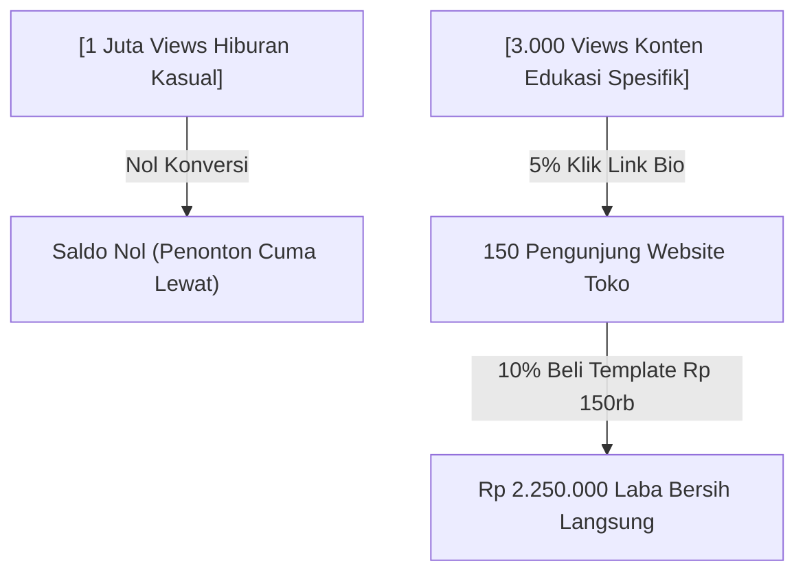

Kamu pasti pernah melihat fenomena ini, atau mungkin kamu sendiri yang mengalaminya:
Video di TikTok atau Reels Instagram kamu tiba-tiba meledak. Angka penonton tembus 500 ribu, 1 juta, bahkan 2 juta views. Notifikasi HP bergetar nonstop sampai baterai drop. Kolom komentar penuh dengan ribuan orang yang tertawa atau berdebat seru.

Kamu merasa sudah berada di puncak dunia kreator.

Tapi begitu kamu mengecek saldo rekening atau penjualan produk di tokomu... angkanya cuma bertambah nol koma sekian persen. Bahkan sering kali **nol besar alias nggak ada yang beli sama sekali**.

Kenapa hal menyakitkan ini bisa terjadi?

Jawabannya sederhana: **Banyak kreator terjebak dalam perangkap angka semu (*vanity metrics*). Mereka jago menghibur orang asing, tapi gagal membangun otoritas dan alasan logis kenapa penonton harus membeli produk dari mereka.**

Di artikel ini, kita akan bedah tuntas kenapa konten viral sering kali bikin kantong kering, dan bagaimana mengubah strategi kontenmu biar views yang sedikit pun tetap bisa menghasilkan jutaan rupiah setiap bulan!

---

## 1. Perbedaan Konten Hiburan Cepat Lupa vs Konten Bernilai Uang

Mari kita bandingkan dua jenis kreator konten di media sosial:

| Karakteristik | Kreator Pemburu Viral (Entertainment Trap) | Kreator Pengusaha Digital (High-Intent Authority) |
| :--- | :--- | :--- |
| **Tujuan Bikin Konten** | Dapat like, share, dan pujian algoritma | Menjawab masalah nyata calon pembeli spesifik |
| **Topik yang Diangkat** | Tren joget, drama orang lain, meme receh | Studi kasus, tutorial praktis, cara kerja sistem |
| **Hubungan dengan Penonton** | Ditonton sambil lalu saat lagi bengong | Disimpan (*bookmark*), dicatat, dan dipelajari ulang |
| **Pertanyaan Pembeli** | *"Kak spill bajunya beli di mana?"* | *"Kak, template kalkulator keuangan ini belinya di mana ya?"* |
| **Hasil Finansial** | Bergantung pada tawaran endorsement murah | Menguasai toko mandiri dengan omzet puluhan juta |

Perhatikan: 3.000 views yang tepat sasaran **jauh lebih bernilai bagi bisnis kamu** daripada 1 juta views orang-orang yang cuma numpang ketawa di kolom komentar.

---

## 2. Tiga Jenis Konten yang Mengalirkan Duit ke Rekening Tokomu

Biar postinganmu nggak sia-sia, mulai besok coba ganti gaya kontenmu dengan 3 format ini:

### 1. Konten "Bongkar Kesalahan Fatal" (The Cost of Doing It Wrong)
Beri tahu audiensmu kerugian atau uang yang bakal melayang kalau mereka terus pakai cara lama:
> *"Kenapa kirim foto invoice manual di WhatsApp bikin olshop kamu kehilangan omzet Rp 5 juta per bulan (dan cara otomatisasinya)."*

### 2. Konten "Behind The Scenes & Studi Kasus Nyata"
Ceritakan eksperimen nyata yang pernah kamu jalankan secara transparan:
> *"Kemarin saya menguji coba ubah tombol checkout dari tulisan 'Beli' jadi 'Akses Instan QRIS'. Hasilnya, transaksi yang lunas naik 34% dalam 7 hari. Ini data lengkapnya..."*

### 3. Konten "The Curated Checklist" (Kemenangan Cepat)
Bagikan daftar ringkas yang langsung bisa dipraktikkan tanpa pusing:
> *"10 Checklist wajib sebelum rilis e-book pertamamu biar nggak sepi pembeli. Simpan postingan ini buat contekan weekend nanti!"*

---

## 3. Selalu Beri "Jembatan" Menuju Toko Mandiri Kamu

Kesalahan kedua dari kreator yang sepi penjualan adalah: **mereka lupa mengajak penonton melangkah ke tahap berikutnya.**

Jangan biarkan audiens selesai nonton lalu langsung scroll ke video orang lain. Selalu cantumkan panggilan aksi (*Call-to-Action*) yang ramah di akhir postingan:
> *"Suka dengan framework tadi? Saya sudah rangkum template spreadsheet dan panduan lengkapnya di link bio ya. Bisa langsung kamu duplikasi ke komputermu hari ini juga!"*

Pastikan link di bio-mu mengarah ke landing page toko yang bersih dan responsif di smartphone seperti yang disediakan oleh [SitusBisnis](https://situsbisnis.com)—bukan link bio berantakan dengan belasan tautan yang membingungkan pengunjung.

---

## Ego Senang, Tapi Rekening yang Menentukan Masa Depan

Views jutaan itu menyenangkan untuk ego, tapi **laba bersih di rekening bank adalah penentu kelangsungan hidup bisnismu**.

Berhentilah mengejar viralitas kosong. Mulailah membuat konten yang menolong masalah nyata segelintir orang, arahkan mereka ke tokomu, dan bangun bisnis digital yang tahan banting sepanjang tahun!
