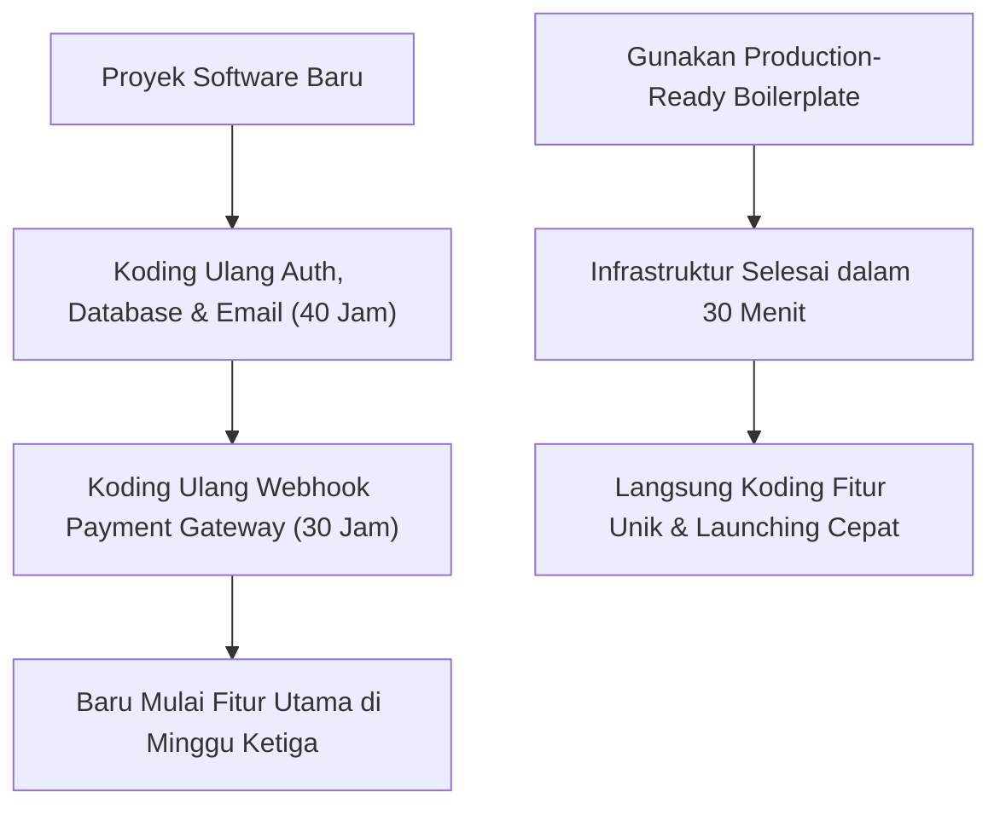
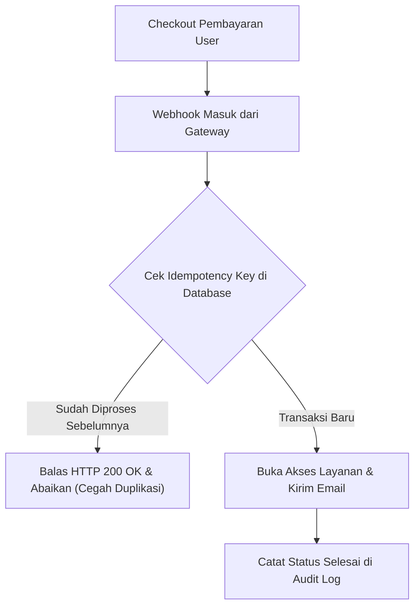

Setiap programmer senior yang pernah membangun aplikasi web dari nol pasti tahu betapa membosankannya mengerjakan hal yang sama berulang kali: menyiapkan sistem login dan reset password, mendesain skema database multi-tenant, mengonfigurasi email transaksional, hingga menghubungkan *webhook* pembayaran.

Rata-rata seorang engineer menghabiskan 40 hingga 80 jam kerja hanya untuk menyiapkan infrastruktur dasar ini sebelum baris pertama kode fitur utama ditulis.

Di pasar global, tren **Boilerplate dan Starter Kit** telah melahirkan solopreneur teknis dengan pendapatan miliaran rupiah. Fenomena serupa kini meledak di pasar Indonesia dan Asia Tenggara, di mana developer lokal mencari fondasi kode yang sudah terintegrasi langsung dengan payment gateway lokal (QRIS, BCA VA, Mandiri) dan arsitektur siap pakai.

## Anatomi Boilerplate yang Layak Dijual Jutaan Rupiah

Programmer tidak mau membayar repositori kode murahan yang sekadar menggabungkan template frontend gratis. Sebuah *starter kit* profesional bernilai tinggi karena menyelesaikan masalah arsitektur teknis yang rumit (*hard technical problems*):

### 1. Integrasi Webhook Payment Gateway Anti-Gagal (Idempotency Engine)
Masalah terbesar sistem pembayaran di Indonesia adalah koneksi internet yang putus-nyambung atau server penyedia pembayaran yang mengirimkan notifikasi *webhook* ganda (*duplicate callbacks*).
- Boilerplate berkualitas tinggi menyertakan tabel *idempotency keys* dan *event queue* (misal menggunakan Redis atau database queue) untuk memastikan saldo pelanggan tidak terpotong ganda.
- Skrip *retry mechanism* otomatis jika server sempat *down* saat verifikasi transaksi berlangsung.

### 2. Arsitektur Multi-Tenant yang Aman
Bagi pengembang yang ingin membuat aplikasi B2B SaaS, pemisahan data antar perusahaan (*tenant isolation*) adalah harga mati:
- Konfigurasi *Row-Level Security* (RLS) di PostgreSQL atau skema *database-per-tenant*.
- Manajemen *Role-Based Access Control* (RBAC): hak akses Administrator, Manajer Cabang, hingga Staf biasa.

### 3. Log Audit dan Error Monitoring Bawaan
- Middleware penangkap error yang otomatis mengirimkan peringatan ke Discord atau Telegram tim engineering.
- Sistem pencatatan riwayat aktivitas pengguna (*audit trail*) untuk keperluan kepatuhan keamanan data.

## Matematika Nilai di Mata Pembeli Engineer

Berapa biaya menyewa seorang *Senior Full-Stack Developer* di Indonesia? Rata-rata gaji berkisar antara Rp 15 juta hingga Rp 30 juta per bulan. Jika dihitung per jam:

$$\text{Tarif per Jam} \approx \frac{\text{Rp } 20.000.000}{160 \text{ Jam}} = \text{Rp } 125.000 \text{ / Jam}$$

Jika sebuah boilerplate menghemat 60 jam kerja tim pengembang:

$$\text{Nilai Penghematan} = 60 \text{ Jam} \times \text{Rp } 125.000 = \text{Rp } 7.500.000$$

Ketika Anda menjual starter kit tersebut seharga **Rp 1.490.000 satu kali beli**, bagi agensi software atau founder teknis, pembelian tersebut adalah investasi yang sangat menguntungkan karena menghemat jutaan rupiah biaya tenaga kerja.

## Alur Distribusi Repositori Otomatis

Bagaimana cara mendistribusikan kode tanpa risiko pembajakan liar dan tanpa repot mengundang akun GitHub satu per satu secara manual?

1. **Undangan Repositori GitHub Otomatis via API**: Saat pembeli menyelesaikan transaksi di halaman checkout, webhook toko mengirim perintah ke GitHub API untuk menambahkan *username* pembeli sebagai kolaborator di repositori privat.
2. **Paket Dokumentasi Step-by-Step**: Buat berkas panduan instalasi lokal dalam format Markdown lengkap dengan konfigurasi berkas `.env.example`, perintah migrasi database, dan instruksi deployment ke server VPS atau platform cloud.
3. **Pilihan Lisensi Komersial**: Sediakan dua tingkat lisensi:
   - *Personal License*: Untuk 1 proyek pribadi (Rp 990.000).
   - *Agency / Unlimited License*: Boleh digunakan untuk membangun proyek tanpa batas bagi klien agensi (Rp 2.900.000).

Melalui etalase toko mandiri seperti [SitusBisnis](https://situsbisnis.com), Anda dapat menjual lisensi repositori kode ini secara instan, menerima pembayaran via QRIS dan Virtual Account, dan mengarahkan pembeli langsung ke dokumentasi instalasi tanpa potongan komisi sepeser pun.
