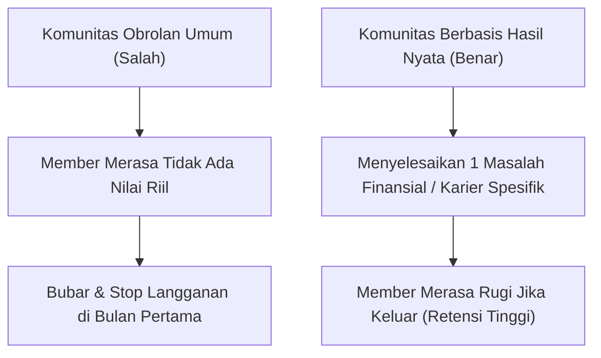
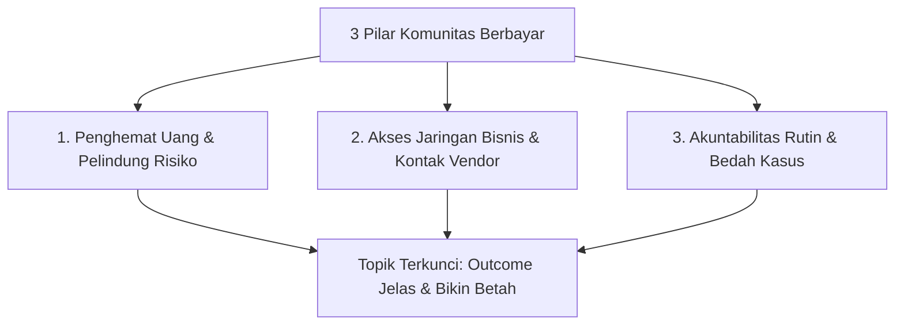

Momen paling menegangkan bagi kreator digital maupun pekerja lepas adalah setiap tanggal 1 awal bulan: saldo omzet penjualan otomatis kembali ke angka Rp 0, dan Anda harus memeras otak mencari cara promosi baru agar dapur tetap mengepul.

Fenomena *roller coaster pendapatan* ini sangat menguras energi. Bulan ini Anda bisa mengantongi Rp 25 juta karena ada peluncuran materi baru, tapi dua bulan berikutnya terjun bebas ke Rp 3 juta karena tenaga Anda habis terkuras.

Satu-satunya penawar paling kokoh untuk menciptakan arus kas yang stabil dan terprediksi adalah **Komunitas Berbayar Mandiri (*Paid Community / Membership*)**.

Namun, 80% pemula langsung tersandung di langkah pertama karena memilih konsep yang salah: membuat *"Grup Ngobrol Santai"* atau *"Komunitas Diskusi Umum"*. Di era banjir informasi gratis, tidak ada orang yang mau membayar iuran bulanan hanya untuk nongkrong di grup obrolan tanpa arah yang bisa mereka dapatkan cuma-cuma di media sosial.

Di artikel pembuka *Masterclass Komunitas Berbayar* ini, kita akan membedah formula memilih topik komunitas berbasis **Hasil Nyata (*Outcome-Driven Community*)**—alasan konkret yang membuat anggota rela memperpanjang keanggotaan setiap bulan karena hidup atau bisnis mereka benar-benar terbantu.

## 3 Pilar Topik Komunitas yang Tahan Banting

Untuk memastikan orang bersedia membayar biaya keanggotaan Rp 49.000 hingga Rp 199.000 setiap bulan, topik komunitas Anda wajib berdiri di atas salah satu dari tiga pilar utama:

### 1. Komunitas Penghemat Uang atau Pelindung Aset (Cost-Saving / Risk Mitigation)
Member bergabung karena komunitas menyelamatkan mereka dari kerugian uang nyata.
- *Contoh*: Komunitas importir pemula yang berbagi info rute kontainer murah dan peringatan regulasi bea cukai terbaru. Jika info di grup menyelamatkan mereka dari denda Rp 5 juta, membayar Rp 99.000/bulan terasa sangat murah.

### 2. Komunitas Akses Jaringan Bernilai (High-Value Curated Network)
Member membayar bukan untuk konten kreator, melainkan untuk bertemu dengan sesama member lain yang berada di level yang sama.
- *Contoh*: Komunitas pemilik gerai F&B dengan omzet di atas Rp 50 juta/bulan untuk saling berbagi kontak supplier bahan baku terpercaya.

### 3. Komunitas Akuntabilitas & Umpan Balik Berkala (Accountability Sprint)
Member membayar agar tidak malas dan memiliki mentor yang mengawasi progres mereka.
- *Contoh*: Komunitas penulis konten LinkedIn harian di mana setiap hari Senin ada sesi bedah draf bersama dan rekap performa mingguan.

## Menentukan Harga yang Pas untuk Pasar Indonesia

Jangan mematok harga terlalu tinggi di awal jika Anda baru memulai:
- **Tingkat Entry-Level (Rp 39.000 – Rp 69.000 / bulan)**: Setara harga satu cangkir kopi kekinian. Hambatan psikologis sangat rendah, cocok untuk komunitas belajar skill atau berbagi aset bulanan.
- **Tingkat Pertumbuhan (Rp 99.000 – Rp 199.000 / bulan)**: Untuk komunitas yang menyertakan sesi Zoom tanya jawab bulanan atau akses database direktori khusus.
- **Paket Tahunan (Annual Pass)**: Berikan diskon 2 bulan gratis (bayar 10 bulan untuk akses 12 bulan) bagi member yang membayar penuh di muka. Ini mengunci komitmen member selama setahun penuh.

## Langkah Pertama Anda Hari Ini

Tentukan formula satu kalimat dari komunitas Anda:
> *"Komunitas ini membantu [siapa targetnya] untuk mencapai [hasil konkretnya] tanpa harus [kendala terbesarnya]."*
> 
> *Contoh*: *"Komunitas ini membantu barista dan pemilik kedai kopi lokal mengunci margin laba 35% tanpa harus pusing sewa konsultan mahal."*

Di bagian selanjutnya (**Part 2: Struktur Onboarding Anggota Baru Biar Gak Sepi di Minggu Pertama**), kita akan membahas ritual 7 hari pertama yang menyulap anggota baru yang pemalu menjadi member aktif yang loyal.
