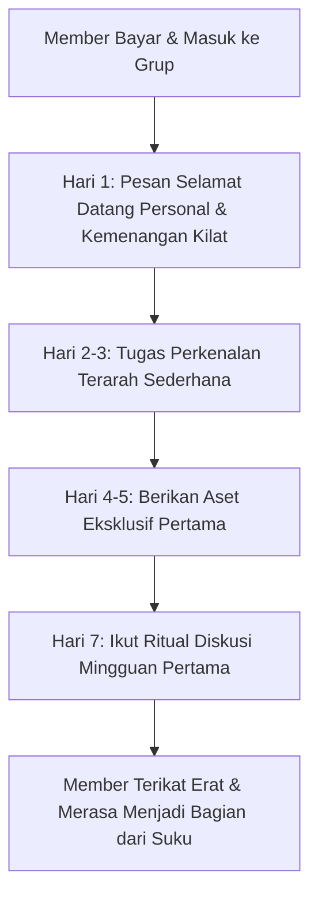
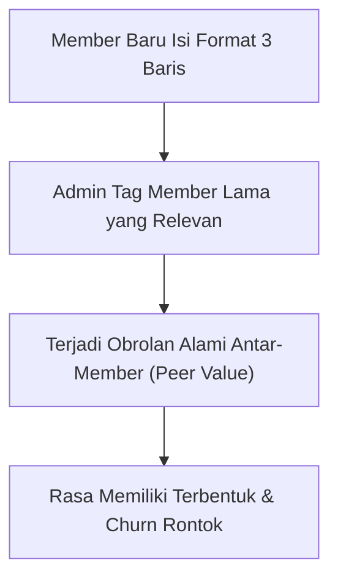

Skenario ini terjadi berulang kali pada komunitas berbayar yang baru diluncurkan: seseorang antusias membayar iuran masuk ke grup Telegram atau WhatsApp VIP, tapi begitu bergabung... hening. Tidak ada petunjuk jelas harus mulai dari mana, suasana obrolan terasa canggung, dan anggota baru cuma bisa jadi penonton pasif (*silent reader*).

Ketika bulan kedua tiba dan tagihan perpanjangan muncul, anggota tersebut langsung membatin: *"Ah, saya tidak dapat apa-apa dari grup ini, mending stop langganan saja."*

Inilah sindrom mematikan bernama *The Crickets Syndrome*—grup sepi bak kuburan yang langsung mengikis angka retensi komunitas Anda di 30 hari pertama.

Setelah di [bagian pertama](/posts/komunitas-berbayar-part-1-memilih-topik-bikin-member-bayar/) kita menentukan topik komunitas berbasis hasil konkret, kini saatnya merancang 'karpet merah' penyambutan: **Struktur Onboarding 7 Hari Pertama** yang dirancang khusus untuk memberi member baru kemenangan instan (*quick-win*) dalam waktu kurang dari 24 jam pertama sejak bergabung.

## Protokol Hari ke-1: Kemenangan Instan dalam 15 Menit

Saat seseorang baru saja mentransfer uang ke toko Anda, tingkat antusiasme mereka berada di titik tertinggi. Manfaatkan momentum ini untuk memberikan aset yang langsung bisa mereka pakai:

1. **Pesan Otomatis WhatsApp Penyambut**: Begitu pembayaran QRIS lunas di toko [SitusBisnis](https://situsbisnis.com), kirimkan pesan selamat datang otomatis lengkap dengan tautan undangan grup privat.
2. **Kirim Aset Kemenangan Cepat (The Quick-Win Asset)**: Jangan suruh mereka membaca arsip diskusi lama. Berikan satu lembar berkas PDF praktis yang langsung bernilai tinggi:
   - *Contoh*: "Katalog 50 Supplier Bahan Baku Terverifikasi Bebas Calo".
   - Dalam 15 menit pertama, member sudah merasa: *"Uang Rp 99.000 yang saya bayar tadi langsung balik modal hanya dari file ini."*

## Templat Perkenalan Anti-Canggung (Structured Introduction)

Jangan biarkan anggota baru hanya menulis *"Halo semua, salam kenal dari Jakarta"*. Format umum seperti itu tidak memancing obrolan lanjutan.

Pasang pesan pin (*Pinned Message*) di grup dengan panduan perkenalan 3 baris:

> **Format Perkenalan Member Baru:**
> 1. **Nama & Usaha/Karier saat ini**: [Contoh: Budi, pengelola 1 kedai kopi di Bandung]
> 2. **Kendala nomor 1 yang paling ingin dibereskan bulan ini**: [Contoh: Mau ngurangin ampas kopi yang kebuang sia-sia]
> 3. **Satu keahlian/pengalaman yang bisa dibagikan ke teman-teman**: [Contoh: Paham cara kalibrasi grinder espresso]

Ketika perkenalan dibuat terstruktur seperti ini, member lama di grup bisa langsung menyapa dan memberikan solusi: *"Wah kebetulan Mas Budi, kemarin Mas Andi baru ngebahas soal pengolahan ampas kopi di catatan minggu lalu!"* Percakapan langsung hidup secara alami.

## Checklist Hari ke-2 sampai Hari ke-7

- **Hari ke-2 (Direct Mention)**: Admin atau moderator menyapa member baru secara langsung: *"Hai [Nama], sudah sempat unduh file katalog kemarin? Kalau ada kolom yang bikin bingung, kabari ya!"*
- **Hari ke-4 (Spotlight Member)**: Angkat satu studi kasus dari member lama yang berhasil memecahkan masalah. Ini membuktikan bahwa proses di komunitas ini benar-benar berhasil.
- **Hari ke-7 (Ritual Mingguan Pertama)**: Ajak member baru berpartisipasi dalam diskusi santai mingguan (misal: *#SeninEvaluasi* atau *#JumatSolusi*).

Di bagian selanjutnya (**Part 3: Mengelola Diskusi Berkualitas Tanpa Anda Harus Online 24 Jam**), kita akan membahas bagaimana mendesain ritual interaksi asinkron agar grup tetap aktif berkualitas tanpa membuat Anda kelelahan membalas chat sepanjang hari.
