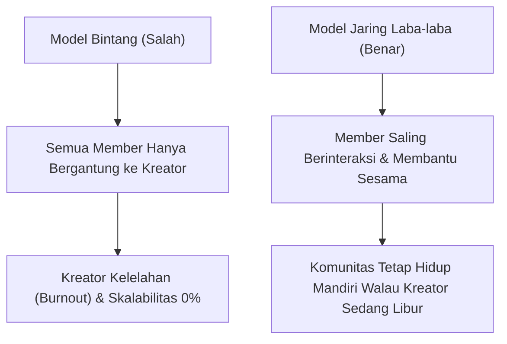
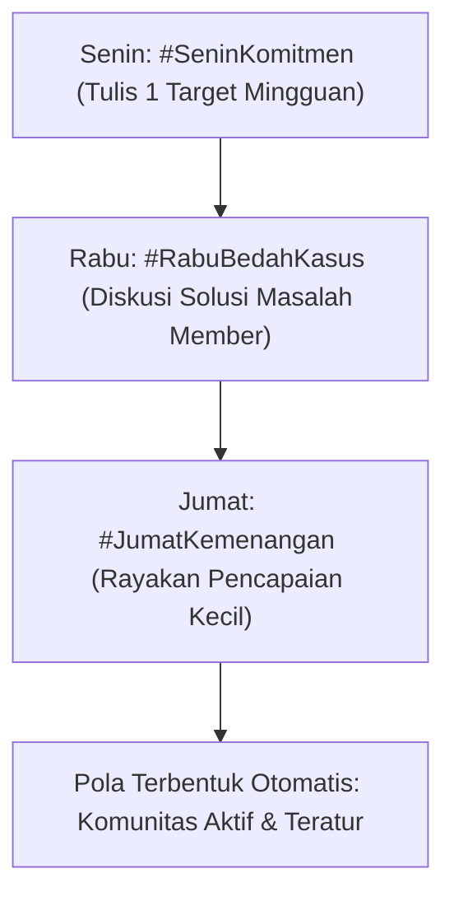

Salah satu ketakutan terbesar yang bikin banyak orang ragu mendirikan komunitas berbayar adalah bayangan mengerikan ini: *"Kalau mereka bayar bulanan, apa artinya saya wajib stand-by online 24 jam nonstop buat balas chat mereka?"*

Banyak pengelola pemula terjebak ilusi keliru bahwa pendiri komunitas harus merangkap jadi satpam obrolan yang sigap merespons setiap ketikan member dalam hitungan detik. 

Dampaknya selalu fatal:
- Waktu istirahat Anda terkuras habis hingga mengalami kelelahan mental (*creator burnout*).
- Anggota jadi pasif dan bergantung 100% pada Anda, tanpa mau berinteraksi satu sama lain.
- Nilai komunitas jadi rapuh: begitu Anda cuti atau sakit selama 3 hari, grup seketika mati suri.

Di [bagian kedua](/posts/komunitas-berbayar-part-2-struktur-onboarding-minggu-pertama/), kita sudah memastikan anggota baru disambut hangat lewat protokol onboarding 7 hari. Sekarang di artikel ketiga ini, kita akan membedah sistem pengelolaan diskusi asinkron: **bagaimana membangun ekosistem di mana sesama member saling berdiskusi dan membantu (*peer-to-peer*)**, sehingga grup tetap hidup dan bernilai tinggi tanpa menyandera waktu istirahat Anda.

## 3 Ritual Mingguan yang Menggerakkan Grup Secara Otomatis

Agar Anda tidak perlu pusing memikirkan topik obrolan setiap hari, tetapkan **Ritual Mingguan Tetap (*Weekly Scheduled Rhythms*)**. Cukup 3 hari dalam seminggu, dan biarkan member yang mengisi daging percakapannya:

### 1. Senin: Matriks Target Mingguan (#SeninKomitmen)
Setiap Senin pukul 09.00 pagi, admin memposting 1 pesan pemantik:
> *"Selamat pagi teman-teman! Apa 1 target paling penting yang wajib selesai di bisnis Anda sebelum hari Jumat jam 5 sore? Tuliskan di bawah agar kita saling mengingatkan."*
- Member akan berlomba-lomba menuliskan target mereka.
- Anda tidak perlu menjawab semua, cukup beri reaksi jempol atau komentar penyemangat singkat.

### 2. Rabu: Studi Kasus & Bedah Masalah (#RabuBedahKasus)
Setiap Rabu, pilih 1 pertanyaan atau kendala paling menarik dari salah satu member untuk dibedah bersama:
> *"Minggu ini kita bantu Kak [Nama] yang lagi bingung memilih vendor kemasan box makanan. Siapa di sini yang punya rekomendasi vendor murah di Jawa Timur?"*
- Member lain yang punya pengalaman akan dengan bangga membagikan kontak dan cerita mereka. Ini menciptakan nilai tanpa Anda harus mengeluarkan energi ekstra.

### 3. Jumat: Pesta Kemenangan & Evaluasi (#JumatKemenangan)
Di akhir pekan, rayakan pencapaian kecil:
> *"Sudah hari Jumat! Apa 1 kemenangan atau pelajaran terbaik yang Anda dapatkan minggu ini? Bagikan di kolom komentar."*

## Menetapkan Batasan Jam Kerja Asinkron (Async Boundaries)

Pasang aturan main tertulis sejak awal di pedoman grup:
1. **Tidak Ada Kewajiban Balas Instan**: Jelaskan bahwa komunitas ini bukan hotline gawat darurat. Admin dan member berdiskusi secara asinkron (respons normal dalam tempo 4 hingga 8 jam).
2. **Kreator Punya Jam Kerja Tertentu**: Sampaikan bahwa Anda hanya aktif meninjau diskusi pada jam 10.00 – 12.00 dan 16.00 – 17.00 WIB. Di luar jam tersebut, ruang obrolan adalah milik sesama member.
3. **Pemberian Apresiasi Member Paling Aktif**: Beri gelar *"Member of the Month"* atau kirimkan merchandise/buku gratis kepada anggota yang paling rajin membantu member lain.

Dengan struktur ini, Anda hanya perlu meluangkan waktu **30 menit di pagi hari dan 30 menit di sore hari**, sementara komunitas Anda tetap hidup dan bernilai tinggi bagi seluruh anggotanya.

Di bagian penutup (**Part 4: Menangani Churn dan Otomasi Perpanjangan Langganan via WhatsApp**), kita akan membahas strategi menjaga agar member terus memperpanjang langganan mereka bulan demi bulan tanpa Anda harus menagih secara manual.
