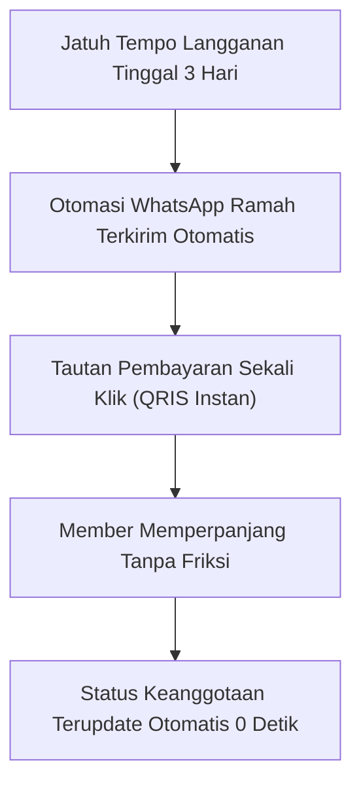
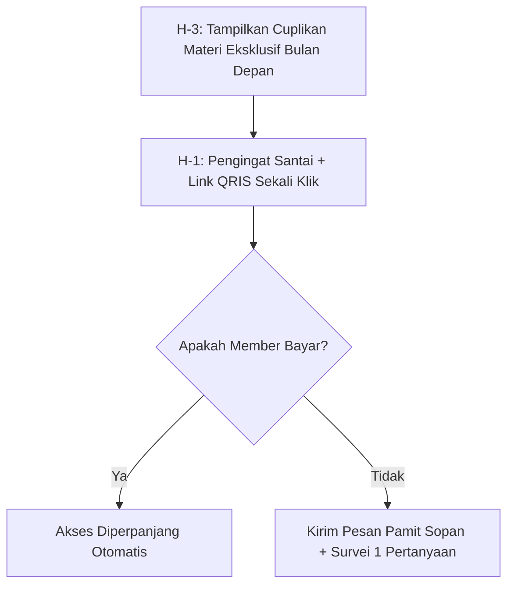

Bayangkan Anda berhasil mengumpulkan 100 orang anggota di bulan pertama. Rasanya sangat memuaskan. Tapi begitu tanggal tagihan bulan kedua tiba... 35 orang mendadak tidak memperpanjang keanggotaan.

Artinya, bulan ini Anda harus bekerja dua kali lipat lebih keras mencari 35 orang baru hanya agar grafik pendapatan Anda tidak anjlok bebas!

Inilah kenyataan pahit *churn rate* (tingkat pembatalan langganan) yang sering membuat pengelola komunitas kehabisan nafas. Menariknya, survei di pasar lokal membuktikan: **kebanyakan orang berhenti langganan bukan karena kecewa pada komunitasnya, melainkan karena hal sepele: lupa tanggal jatuh tempo, atau malas mengulang proses transfer manual**.

Di [bagian ketiga](/posts/komunitas-berbayar-part-3-mengelola-diskusi-tanpa-online-24-jam/), kita telah mengatur ritme interaksi asinkron agar Anda tidak kelelahan. Kini, di artikel penutup seri *Masterclass Komunitas Berbayar*, kita akan mengunci urat nadi finansialnya: **membangun sistem pengingat perpanjangan WhatsApp otomatis dan skema insentif tahunan** agar angka pembatalan bisa ditekan di bawah 8% per bulan secara konsisten.

## Protokol Pengingat Ramah WhatsApp (3-Day Dunning Sequence)

Jangan menagih seperti penagih utang (*debt collector*). Kirimkan pesan bernada apresiasi yang menonjolkan keuntungan eksklusif di bulan berikutnya:

### 1. H-3 Sebelum Masa Berlaku Habis (Pemberitahuan Halus)
> *"Halo Kak [Nama], terima kasih sudah menjadi bagian dari komunitas kita bulan ini! Akses keanggotaan Kakak akan berakhir dalam 3 hari (tanggal [X]).*
>
> *Bulan depan, kita akan membedah topik eksklusif: [Sebutkan 1 topik menarik bulan depan]. Agar akses Kakak ke ruang diskusi dan arsip materi tidak terputus, Kakak bisa memperpanjang masa aktif dengan sekali klik di tautan berikut: [Tautan Perpanjangan Toko SitusBisnis]."*

### 2. H-1 Sebelum Masa Berlaku Habis (Sentuhan Terakhir)
> *"Halo Kak [Nama], sekadar info singkat bahwa besok adalah hari terakhir akses aktif komunitas Kakak. Kami sudah menyiapkan lembar kerja baru untuk bulan depan yang siap diunduh besok pagi. Silakan perbarui keanggotaan Kakak di tautan ini: [Tautan Perpanjangan]. Terima kasih banyak atas kebersamaannya!"*

## Jurus Mengubah Langganan Bulanan Jadi Paket Tahunan (Annual Bridge)

Jalan pintas terbaik untuk melenyapkan masalah churn bulanan adalah **membuat member membayar satu tahun penuh di muka**:

1. **Tawarkan Insentif 2 Bulan Gratis**: Jika biaya bulanan adalah Rp 99.000, biaya tahunan normal adalah Rp 1.188.000. Tawarkan paket tahunan seharga **Rp 990.000** (hemat hampir Rp 200 ribu atau gratis 2 bulan).
2. **Kapan Waktu Terbaik Menawarkannya?**: Tepat di hari ke-14 setelah member bergabung, saat mereka sedang sangat menikmati materi dan relasi baru di komunitas.
3. **Keuntungan Finansial bagi Anda**: Anda langsung mengamankan uang kas operasional Rp 990.000 di depan, dan secara matematis churn rate member tersebut menjadi 0% selama 365 hari ke depan!

## Kelola Komunitas Mandiri Tanpa Potongan Biaya

Platform luar negeri mengenakan potongan biaya 10% hingga 20% untuk setiap transaksi langganan. Di [SitusBisnis](https://situsbisnis.com):
- Anda dapat membuat produk langganan bulanan maupun tahunan dengan mudah.
- Menerima pembayaran QRIS instan dan Virtual Account Bank Nasional.
- Yang paling penting: **0% komisi transaksi**. Seluruh uang iuran komunitas 100% menjadi hak Anda untuk mengembangkan komunitas dan masa depan finansial Anda.

---

### Rangkuman Masterclass Komunitas Berbayar
1. **[Part 1: Memilih Topik yang Bikin Member Rela Bayar](/posts/komunitas-berbayar-part-1-memilih-topik-bikin-member-bayar/)**: Bangun komunitas berbasis hasil nyata yang menghemat uang atau melindungi risiko.
2. **[Part 2: Struktur Onboarding 7 Hari Pertama](/posts/komunitas-berbayar-part-2-struktur-onboarding-minggu-pertama/)**: Berikan quick-win dalam 15 menit pertama dan perkenalan 3 baris anti-canggung.
3. **[Part 3: Mengelola Diskusi Tanpa Online 24 Jam](/posts/komunitas-berbayar-part-3-mengelola-diskusi-tanpa-online-24-jam/)**: Gunakan ritual Senin-Rabu-Jumat dan interaksi asinkron antar-member.
4. **[Part 4: Menangani Churn & Perpanjangan WA](/posts/komunitas-berbayar-part-4-menangani-churn-dan-perpanjangan-wa/)**: Pengingat ramah H-3 di WhatsApp dan insentif paket tahunan hemat 2 bulan.
