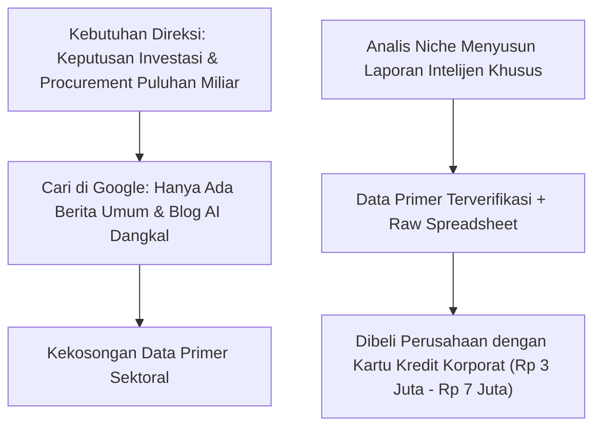
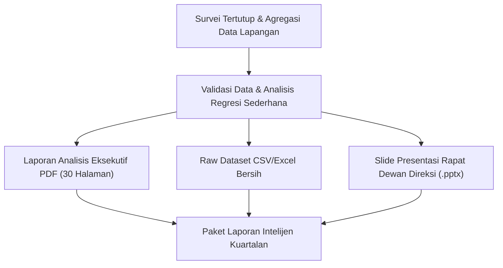

Di era ledakan informasi dan konten AI massal, fakta yang ironis terjadi: **data primer industri yang bersih, terverifikasi, dan relevan dengan pasar lokal justru menjadi komoditas yang sangat langka**.

Para direktur, manajer pengadaan (*procurement*), dan analis strategi di perusahaan-perusahaan Indonesia menghabiskan waktu berminggu-minggu mencari data tolok ukur (*benchmark*) lokal:
- Berapa sebenarnya tarif rata-rata sewa kontainer pendingin antar-pulau dari Surabaya ke Makassar?
- Berapa rentang kompensasi riil staf data engineer di startup tahap Series B di Jakarta?
- Bagaimana tren fluktuasi harga biji kopi arabika di tingkat petani Sumatra pasca perubahan regulasi ekspor?

Lembaga riset raksasa seperti Gartner atau McKinsey mengenakan tarif ratusan juta rupiah untuk laporan makro mereka. Di celah inilah model bisnis **Micro-Intelligence Report** hadir: menjual laporan berkala sektoral seharga Rp 2.500.000 hingga Rp 7.000.000 per edisi.

## Anatomi Laporan Intelijen Industri Bernilai Tinggi

Laporan industri bernilai jutaan rupiah tidak dinilai dari jumlah halamannya, melainkan dari **kedalaman data primer dan kepraktisan rekomendasinya bagi rapat direksi**.

### 1. Data Primer Tanpa Daur Ulang Berita Media
Laporan yang laku keras tidak menyalin ulang berita detik atau kompas. Nilainya berasal dari:
- Survei tertutup berkala terhadap 50–100 praktisi industri di lini depan.
- Agregasi data anonim dari puluhan kontrak kerja sama atau invoice pengiriman riil.
- Observasi lapangan yang tidak bisa diakses oleh mesin pencari Google.

### 2. Tabulasi Data Mentah (Raw Dataset Attachment)
Para analis korporat tidak hanya ingin membaca kesimpulan Anda; mereka ingin memverifikasi angka-angka tersebut di spreadsheet internal mereka sendiri:
- Sertakan berkas Excel/CSV yang rapi dan terstruktur rapi.
- Sertakan metodologi pengumpulan data, marjin kesalahan (*margin of error*), dan batasan sampel riset.

### 3. Ringkasan Eksekutif Satu Halaman (Executive Board Slide)
Para direktur tidak punya waktu membaca 60 halaman teks. Mereka membutuhkan:
- Satu diagram visual ringkas yang merangkum arah tren kuartal berikutnya.
- Tiga poin rekomendasi aksi taktis (*key strategic imperatives*).
- File pendamping presentasi PowerPoint ringkas yang siap mereka salin ke slide rapat dewan direksi (*board meeting*).

## Siapa Pembelinya dan Bagaimana Menjangkau Mereka?

Anda tidak menjual laporan ini dengan beriklan massal di media sosial. Strategi pemasarannya sangat berorientasi pada reputasi otoritas (*authority-led marketing*):

1. **Rilis Cuplikan Data Kontroversial di LinkedIn**: Publikasikan satu grafik paling mengejutkan dari riset Anda (misalnya: "72% Vendor Logistik Lokal Mengalami Keterlambatan Pembayaran Lebih dari 60 Hari"). Beri analisis tajam di pos tersebut.
2. **Kirim Email Dingin ke Manajer Terkait**: Hubungi 30 Head of Supply Chain atau Chief Strategy Officer melalui LinkedIn/Email: *"Selamat pagi Pak [Nama], kami baru menyelesaikan benchmark tarif logistik dingin Q3 mencakup 45 operator di Indonesia timur. Berikut ringkasan 2 halaman tanpa biaya. Jika tim Anda butuh raw dataset lengkapnya, dokumen lengkap tersedia di tautan berikut."*
3. **Penyediaan Skema Langganan Kuartalan (Annual Pass)**:
   - Satu Laporan Tunggal: Rp 3.500.000.
   - Akses Penuh 4 Kuartal Sepanjang Tahun: Rp 9.900.000 (mengunci arus kas berulang).

## Menjual Riset Melalui Etalase Profesional

Klien korporat sangat memperhatikan format transaksi. Mereka membutuhkan konfirmasi pembayaran instan, faktur resmi perusahaan (*corporate invoice*), dan tautan unduh terenkripsi.

Dengan platform toko digital mandiri seperti [SitusBisnis](https://situsbisnis.com), Anda bisa menyajikan halaman unduhan berwibawa, menerima pembayaran instan via Virtual Account korporat atau kartu kredit tanpa biaya perantara komisi yang merugikan.
