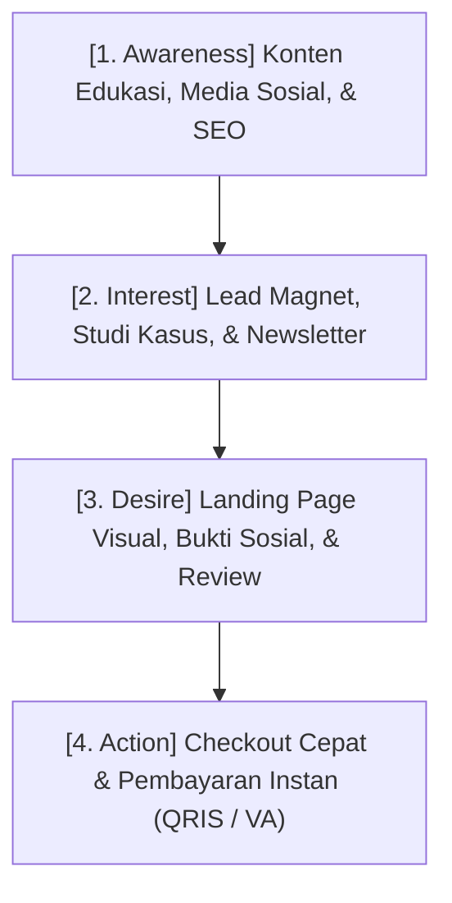

Di era *creator economy* saat ini, tantangan terbesar bagi kreator konten, mentor, dan praktisi ahli bukanlah kemampuan memproduksi konten berkualitas, melainkan **membangun sistem konversi** yang mampu mengubah penonton kasual menjadi pembeli loyal secara konsisten.

Banyak pebisnis digital terjebak dalam mitos bahwa *"asalkan follower banyak, penjualan pasti mengalir"*. Kenyataannya, tanpa arsitektur *sales funnel* yang matang, potensi pendapatan sering kali bocor di setiap titik sentuh (*touchpoint*).

Tulisan ini menguraikan prinsip fundamental dalam merancang alur penjualan yang sehat, terukur, dan berkelanjutan.

---

## 1. Anatomi Funnel Penjualan Digital

Secara garis besar, perjalanan calon pembeli digital terbagi ke dalam empat fase utama:

### A. Titik Masuk (Top of Funnel - ToFU)
Di fase ini, audiens belum mengenal produk berbayar Anda. Mereka datang mencari solusi atas masalah spesifik atau wawasan baru. Konten pada fase ini harus murni memberikan nilai edukatif tanpa *hard-selling*.

### B. Pertimbangan Mendalam (Middle of Funnel - MoFU)
Ketika audiens menyadari bahwa mereka membutuhkan solusi yang lebih terstruktur, di sinilah kredibilitas Anda diuji. Studi kasus nyata, ulasan teknis, dan esai mendalam membantu membangun rasa percaya (*trust*).

Dokumentasi arsitektur sistem konversi bertahap.

### C. Keputusan Transaksi (Bottom of Funnel - BoFU)
Halaman penawaran (*landing page*) dan formulir pembayaran (*checkout*). Titik ini adalah tempat paling sering terjadinya *drop-off* (pembatalan transaksi).

> **Prinsip Mengurangi Gesekan (Friction):**
> Semakin sedikit langkah yang dibutuhkan pembeli dari mengklik tombol "Beli" hingga menyelesaikan pembayaran, semakin tinggi rasio konversi Anda. Hindari formulir bertele-tele dan integrasikan metode pembayaran lokal instan seperti QRIS Dinamis dan Virtual Account.

---

## 2. Mengukur Metrik yang Benar-Benar Berarti

Jangan terjebak pada *vanity metrics* seperti jumlah *likes* atau impresi semata. Untuk bisnis produk digital, perhatikan metrik berikut:

| Metrik | Definisi | Target Acuan |
| :--- | :--- | :--- |
| **CTR (Click-Through Rate)** | Persentase audiens yang mengklik tautan menuju landing page | > 2% - 5% |
| **Page-to-Checkout Rate** | Pengunjung landing page yang melanjutkan ke form checkout | > 10% - 20% |
| **Checkout Conversion Rate** | Pembeli yang benar-benar menyelesaikan pelunasan invoice | > 60% - 80% (untuk QRIS/VA otomatis) |

Ketenangan pikiran datang dari alur transaksi yang berjalan otomatis.

---

## 3. Langkah Selanjutnya

Membangun bisnis digital yang mandiri berarti memiliki kendali penuh atas audiens, katalog produk, dan proses transaksi Anda.

Jika Anda ingin mulai memasarkan e-book, kelas online, layanan konsultasi, atau produk fisik dengan alur *checkout* cepat dan landing page visual modern, pelajari ekosistem lengkapnya di [SitusBisnis.com](https://situsbisnis.com).
