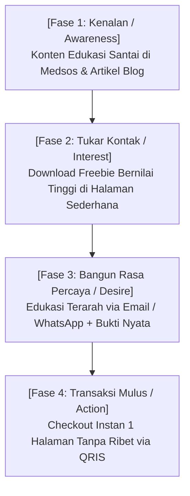
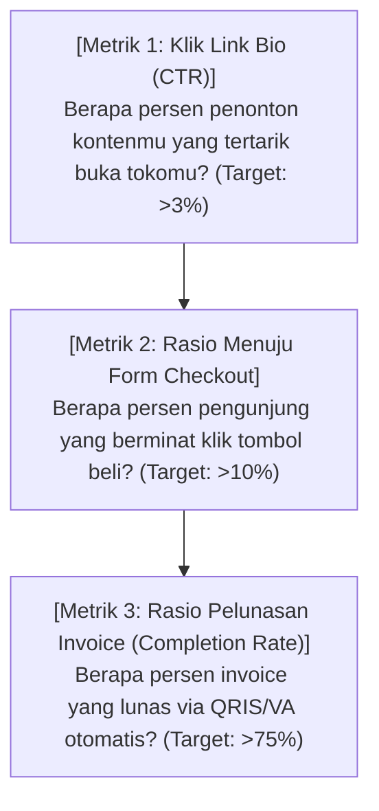

Pernah nggak kamu bertanya-tanya pada diri sendiri:
> *"Kenapa ya, ada orang yang posting konten santai seminggu dua kali, tapi rekeningnya selalu terisi orderan masuk tiap pagi. Sementara ada orang yang bikin konten tiap hari sampai matanya panda, tapi pas coba jualan... yang beli cuma teman dekatnya sendiri?"*

Perbedaan antara kedua kreator tersebut bukan terletak pada faktor keberuntungan atau paras wajah yang rupawan.

Perbedaannya ada pada **arsitektur mesin penjualannya (sales funnel)**.

Banyak kreator pemula mengira jalan menuju kebebasan finansial adalah dengan memproduksi konten sebanyak-banyaknya di media sosial. Mereka terjebak menjadi kuli algoritma yang kelelahan (*burnout*).

Padahal, media sosial hanyalah etalase luar toko. Kalau di dalam tokomu tidak ada alur yang jelas untuk menyambut orang asing, membimbing rasa penasarannya, dan memudahkan cara bayarnya... maka jutaan orang yang lewat di depan tokomu hanya akan melenggang pergi begitu saja.

Di artikel ini, kita bakal membedah cara membangun mesin konversi digital yang rapi, tenang, dan bekerja mengalirkan pendapatan harian secara otomatis.

---

## 1. Anatomi Alur Penjualan yang Sehat dan Manusiawi

Jangan bayangkan *sales funnel* sebagai diagram korporat yang rumit. Funnel sebenarnya hanyalah **perjalanan sebuah hubungan pertemanan**:

Mari kita perhatikan bagaimana setiap fase bekerja di dunia nyata:

### Fase 1: Kenalan (Top of Funnel)
Di tahap ini, orang baru pertama kali melihat postinganmu di feed mereka. 
- **Aturan emas:** Jangan pernah langsung jualan produk mahal di fase ini. Orang belum kenal kamu, belum percaya reputasimu. 
- Fokuslah memberikan satu sudut pandang baru yang mencerahkan atau membongkar mitos salah yang selama ini mereka yakini.

### Fase 2: Tukar Kontak (Middle of Funnel)
Begitu mereka suka caramu menjelaskan masalah, tawarkan hadiah kecil (seperti checklist, template, atau kalkulator) yang bisa diunduh secara gratis. Di sinilah mereka secara sukarela memberikan email atau nomor WhatsApp mereka.

### Fase 3: Bangun Kepercayaan (The Nurture Stage)
Sekarang kamu punya jalur komunikasi langsung di saku mereka. 
- Jangan langsung kirim promo bertubi-tubi.
- Kirim cerita tentang bagaimana kamu atau orang lain berhasil mengatasi rintangan tersebut. Tunjukkan bahwa kamu benar-benar mengerti rasa frustrasi yang sedang mereka alami.

### Fase 4: Transaksi Mulus (Bottom of Funnel)
Saat mereka sudah siap membeli, pastikan gerbang tokomu terbuka lebar:
- Jangan paksa mereka mengisi 10 kolom formulir yang membingungkan.
- Jangan suruh mereka menunggu konfirmasi admin manual di chat.
- Biarkan mereka scan QRIS atau bayar via Virtual Account dalam 3 detik, dan sistem langsung mengirimkan akses produk detik itu juga!

---

## 2. Tiga Titik Kebocoran yang Sering Bikin Omzet Kreator Anjlok

Kalau tokomu saat ini sepi pembeli, kemungkinan besar ada kebocoran di salah satu dari 3 titik ini:

| Titik Kebocoran | Gejala Nyata yang Kamu Rasakan | Solusi Perbaikan Cepat |
| :--- | :--- | :--- |
| **Bocor di Titik Masuk (Trafik)** | Postinganmu cuma dapat sedikit klik ke link bio. | Ganti hook postingan dengan kalimat yang menyentuh akibat nyata menunda solusi. |
| **Bocor di Halaman Penawaran** | Banyak yang klik link bio, tapi langsung tutup tab. | Sederhanakan landing page: perjelas apa untungnya buat pembeli, bukan membanggakan diri sendiri. |
| **Bocor di Gerbang Pembayaran** | Banyak yang klik 'Beli', tapi nggak pernah transfer. | Hilangkan cara manual kirim nomor rekening di chat. Ganti dengan checkout instan QRIS otomatis. |

> **Catatan Buat Kamu:**
> Kebocoran di gerbang pembayaran adalah yang paling menyakitkan. Membiarkan orang yang sudah berniat beli terhambat karena proses transfer yang rumit sama saja membuang uang tunai ke tong sampah.

---

## 3. Matriks Metrik yang Benar-Benar Berarti (Bukan Jumlah Likes!)

Mulai hari ini, berhenti terobsesi dengan berapa banyak likes atau views di videomu. Perhatikan angka-angka yang langsung berhubungan dengan isi dompetmu:

Ketika kamu memantau tiga metrik di atas secara teratur, kamu tidak lagi meraba-raba dalam kegelapan. Kamu tahu persis bagian mana dari tokomu yang perlu diperbaiki.

---

## Inti Pelajaran

Membangun bisnis digital mandiri bukan tentang menjadi selebriti internet yang dielu-elukan jutaan orang. 

Ini tentang memiliki **sebuah mesin konversi yang tenang, beradab, dan terpercaya** di platform toko mandiri seperti [SitusBisnis](https://situsbisnis.com)—sebuah sistem yang memungkinkanmu hidup tenang, tetap produktif berkarya, dan menikmati aliran rezeki tanpa harus mengorbankan waktu istirahatmu.
