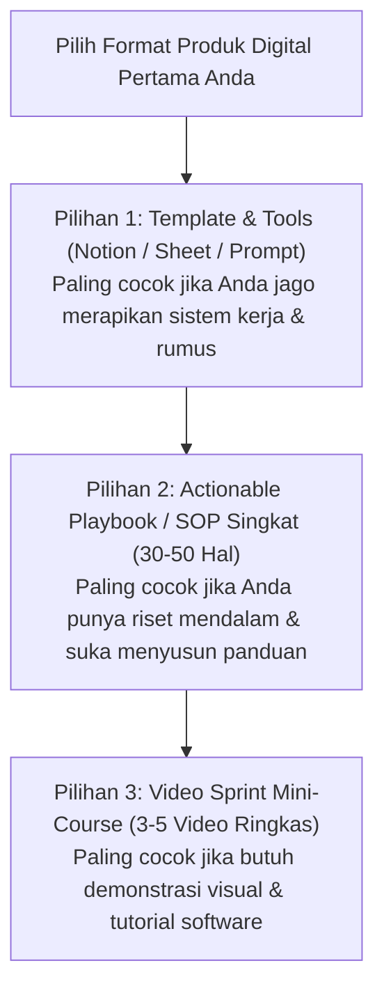

Pertanyaan nomor satu yang paling sering menghantui calon solopreneur dan kreator pemula adalah:
> *"Saya punya keahlian dan pengalaman kerja, tapi bentuk produk digital apa yang harus saya buat pertama kali? Apakah saya harus langsung membuat video course lengkap, menulis buku digital PDF, atau membuat template alat kerja?"*

Memilih format produk yang salah di awal perjalanan bisnis dapat berakibat fatal:
- Jika Anda memilih format yang **terlalu rumit** (seperti kursus video berdurasi 30 jam dengan rekaman kamera profesional), Anda berisiko kehabisan energi (*burnout*) sebelum produk sempat diterbitkan.
- Jika Anda memilih format yang **terlalu generik** (seperti ringkasan PDF 5 halaman), Anda akan kesulitan menetapkan harga yang pantas dan dipandang sebelah mata oleh pasar.

Dalam esai ini, kita akan membedah perbandingan objektif antara tiga format produk digital terpopuler, kelebihan dan kekurangannya, serta peta jalan memilih format yang paling sesuai dengan fase Anda saat ini.

---

## 1. Matriks Perbandingan Format Produk Digital

Berikut adalah perbandingan mendalam berdasarkan 5 parameter kritis:

| Parameter Evaluasi | 1. E-Book / Playbook PDF | 2. Template / Tool Siap Pakai (Spreadsheet, SOP, Dashboard) | 3. Video Masterclass / Online Course |
| :--- | :--- | :--- | :--- |
| **Waktu Produksi Awal** | 1 – 2 Minggu | 3 – 7 Hari | 3 – 8 Minggu |
| **Alat / Peralatan yang Dibutuhkan** | Google Docs / Office + PDF Export | Google Sheets, Excel, atau Workspace | Mic kondensor, screen recorder, pencahayaan |
| **Persepsi Nilai Pembeli (Perceived Value)** | Rendah – Menengah (Rp 49rb – Rp 199rb) | Menengah – Tinggi (Rp 99rb – Rp 349rb) | Sangat Tinggi (Rp 299rb – Rp 1.500.000+) |
| **Tingkat Konsumsi Pembeli (Completion Rate)** | 10% – 20% (banyak yang menimbun PDF) | **80% – 95%** (langsung diduplikasi & dipakai) | 20% – 35% (banyak yang mandek di modul tengah) |
| **Friksi Pembuatan Bagi Introvert** | Sangat Rendah (cukup menulis) | Sangat Rendah (fokus logika sistem) | Menengah – Tinggi (harus bicara di rekaman) |

---

## 2. Bedah Karakteristik Masing-Masing Format

### Format 1: Template & Tools (The High-Utility Asset)
Template—seperti dashboard spreadsheet manajemen proyek, template spreadsheet keuangan UMKM, atau preset desain media sosial—adalah format produk digital dengan **rasio waktu-ke-pendapatan terbaik di era sekarang**.

**Mengapa format ini sangat dicintai pembeli?**
- Pembeli tidak membeli teori. Mereka membeli jalan pintas untuk tidak perlu mendesain dari kanvas kosong.
- Tingkat kepuasan langsung instan (*instant utility*): pembeli klik tombol *"Duplicate to my workspace"*, dan dalam 2 menit mereka sudah menikmati hasil kerjanya.

### Format 2: Actionable Playbook / E-Book Mini
Hindari menulis buku teks tebal 200 halaman. Format yang paling diminati saat ini adalah **Micro-Book atau Field Manual** berorientasi hasil yang berisi 30–50 halaman padat.

Fokuskan isi buku pada:
1. Studi kasus nyata yang pernah Anda selesaikan.
2. Kesalahan-kesalahan fatal yang harus dihindari.
3. Lembar kerja (*checklist*) harian yang bisa dicetak pembeli.

### Format 3: Video Course Sprint
Jika keahlian Anda menuntut demonstrasi visual (seperti tutorial analisa saham, desain UI/UX, atau manipulasi data di Excel), video course adalah format terbaik.

Namun, terapkan aturan **Sprint Mini-Course**:
- Batasi total durasi antara 60 hingga 120 menit saja.
- Bagi menjadi 6–8 video ringkas dengan durasi maksimal 10–15 menit per modul.
- Jangan menunggu membeli kamera cinema puluhan juta; rekaman layar bersih dengan audio mikrofon jernih sudah lebih dari cukup untuk dinilai profesional.

---

## 3. Strategi Hybrid: The Product Stacking Playbook

Alih-alih memilih satu format secara kaku, kreator yang cerdas mengombinasikan ketiganya dalam sebuah ekosistem peluncuran:

1. **Langkah 1 (Bulan ke-1):** Luncurkan *Template Spreadsheet & SOP / Excel* seharga Rp 99.000 untuk memvalidasi minat pasar dan mengumpulkan ulasan perdana.
2. **Langkah 2 (Bulan ke-2):** Tulis *E-book Panduan Strategis* yang menjelaskan filosofi di balik template tersebut, lalu jual paket bundling seharga Rp 199.000.
3. **Langkah 3 (Bulan ke-3):** Rekam *3 Video Studi Kasus Implementasi*, lalu jadikan Paket Pro/Masterclass seharga Rp 399.000 di toko [SitusBisnis](https://situsbisnis.com) Anda.

Dengan cara ini, Anda tidak pernah memulai dari nol, dan setiap aset baru yang Anda buat langsung melipatgandakan nilai produk sebelumnya.

---

## Wadah Boleh Berbeda, Hasil Nyata Tetap yang Utama

Format produk hanyalah wadah pengiriman solusi. Yang sebenarnya dicari dan dibayar oleh audiens adalah **kepastian hasil dan penghematan waktu mereka**.

Mulailah dengan format yang paling cepat bisa Anda selesaikan dalam 7 hari ke depan. Dapatkan penjualan pertama Anda, pelajari masukan pembeli, dan kembangkan secara bertahap.
