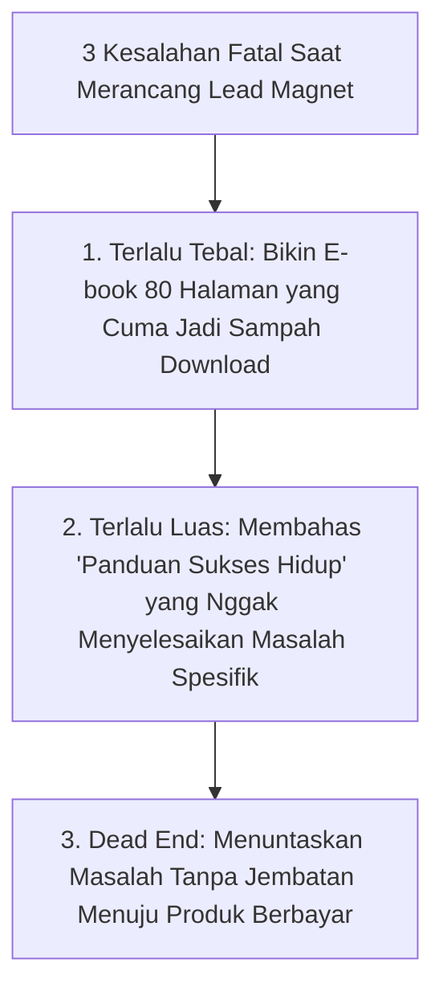
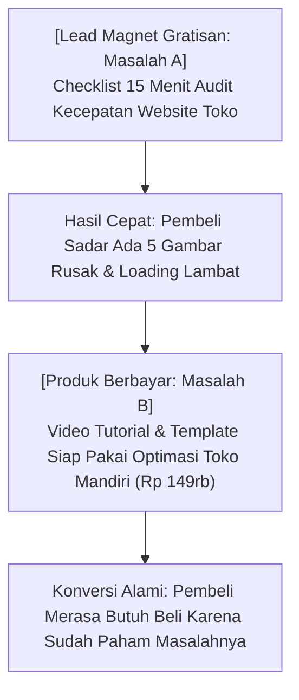

Pernah nggak kamu nemu website yang pas dibuka langsung memunculkan pop-up besar bertuliskan:
> *"Daftarkan email kamu sekarang untuk berlangganan newsletter mingguan kami!"*

Jujur, seberapa sering kamu mau ngetik alamat emailmu di form kayak gitu? 

Hampir nggak pernah, kan?

Kecuali kamu adalah penggemar fanatik dari penulis tersebut, kita semua sudah terlalu lelah dengan inbox email yang penuh sesak oleh newsletter membosankan. Kita nggak butuh "bacaan mingguan baru". Kita butuh **solusi cepat atas masalah yang lagi bikin kita pusing hari ini**.

Inilah kenapa kreator yang cerdas nggak pernah minta email secara cuma-cuma. Mereka menawarkan **Lead Magnet**—sebuah hadiah kecil bernilai tinggi yang bisa langsung diunduh, dipraktikkan dalam 10 menit, dan bikin si pembaca bergumam: 
> *"Gila, gratisannya aja sedaging ini, gimana produk berbayarnya ya?"*

Kalau kamu bisa memicu reaksi batin seperti itu, jalanmu menuju ratusan penjualan pertama bakal terbuka lebar.

---

## 1. Tiga Dosa Besar Bikin Lead Magnet yang Sering Dilakukan Pemula

Sebelum bikin aset gratisanmu, hindari 3 jebakan klasik ini:

### Dosa 1: Bikin E-Book Tebal 80 Halaman
Banyak orang mengira semakin tebal file gratisannya, semakin kagum orang yang download. 

Kenyataannya? Orang zaman sekarang gampang terbebani. Begitu mereka download file PDF 80 halaman, mereka bakal mikir: *"Nanti malam deh saya baca pas senggang."* 

Dan tebak apa yang terjadi? Nggak pernah dibaca sama sekali. File itu cuma menumpuk di folder Downloads laptop mereka. Kalau materi gratisanmu nggak pernah mereka buka, rasa percaya (*trust*) nggak akan pernah terbangun.

### Dosa 2: Topiknya Terlalu Mengawang-awang
Judul seperti *"Panduan Memulai Bisnis dari Nol"* adalah resep instan sepi peminat. Kenapa? Karena topiknya terlalu umum dan sudah dibahas jutaan kali di Google.

Bandingkan dengan judul ini:
- ❌ *"Tips Manajemen Keuangan UMKM"* (Membosankan, terlalu luas)
- ✅ *"Template Excel Otomatis: Hitung HPP dan Margin Makanan Tanpa Pusing Rumus"* (Spesifik, langsung pakai, solutif)

### Dosa 3: Tidak Ada Jembatan ke Produk Utama (The Dead End)
Lead magnet yang bagus harus menyelesaikan **Langkah Pertama (Masalah A)**, yang kemudian secara alami membuka mata calon pembeli bahwa mereka butuh **Sistem Lengkap (Masalah B)** yang kamu jual.

---

## 2. Rumus Jembatan Alami Menuju Produk Berbayar

Coba lihat bagaimana alur hubungan antara hadiah gratis dan produk komersialmu seharusnya bekerja:

Perhatikan polanya:
- Freebie-nya memberikan **diagnosa atau kemenangan kecil**.
- Produk berbayarmu memberikan **obat lengkap atau jalan pintasnya**.

---

## 3. Format Lead Magnet yang Paling Banyak Diunduh di Indonesia

Berdasarkan data perilaku pengguna internet lokal, ini 4 format gratisan dengan rasio konversi tertinggi:

| Format Lead Magnet | Kenapa Orang Suka? | Contoh Nyata |
| :--- | :--- | :--- |
| **Template Spreadsheet / Notion** | Menghemat waktu koding dan bikin rumus dari nol. | Spreadsheet tracker pemasukan olshop harian. |
| **Swipe File / Kumpulan Contoh** | Orang malas mikir kata-kata dari kanvas kosong. | 30 Template pesan balasan komplain pelanggan di WhatsApp. |
| **Kalkulator Interaktif** | Memberikan angka riil yang relevan buat kondisi mereka. | Kalkulator simulasi dana darurat untuk pekerja freelance. |
| **Checklist Audit 1 Halaman** | Memberikan panduan langkah demi langkah yang bisa dicentang. | 10 Hal yang wajib dicek sebelum upload produk digital ke toko. |

---

## 4. Cara Menaruh Lead Magnet Biar Ramai Peminat

Aset gratisanmu nggak akan ada yang download kalau kamu cuma taruh link-nya di pojok bawah website.

Coba terapkan langkah distribusi ini:
1. **Pasang di Bio Medsos:** Gunakan satu link bio bersih yang langsung mengarah ke halaman download (bukan linktree dengan 15 tombol yang bikin orang bingung).
2. **Pakai Trik Postingan 'Angkat Tangan':** Ceritakan studi kasus di Threads atau X, lalu bilang: *"Saya baru selesai merapikan template spreadsheet ini. Ada yang mau contek? Komen 'MAU' ya."*
3. **Kirim Otomatis:** Sambungkan form pendaftaran ke sistem toko mandiri seperti [SitusBisnis](https://situsbisnis.com), biar file-nya langsung terkirim otomatis ke email dan WhatsApp calon pembeli detik itu juga.

---

## Inti Pelajaran

Lead magnet bukan tempat untuk memamerkan seberapa banyak teori yang kamu tahu. Ini adalah tempat untuk membuktikan bahwa **kamu adalah orang yang tepat yang bisa menyelesaikan masalah mereka dengan cepat dan tanpa ribet**.

Bikin satu aset sederhana yang beneran berguna minggu ini, bagikan ke audiensmu, dan lihat bagaimana orang asing mulai berdatangan menjadi calon pembeli loyalmu!
