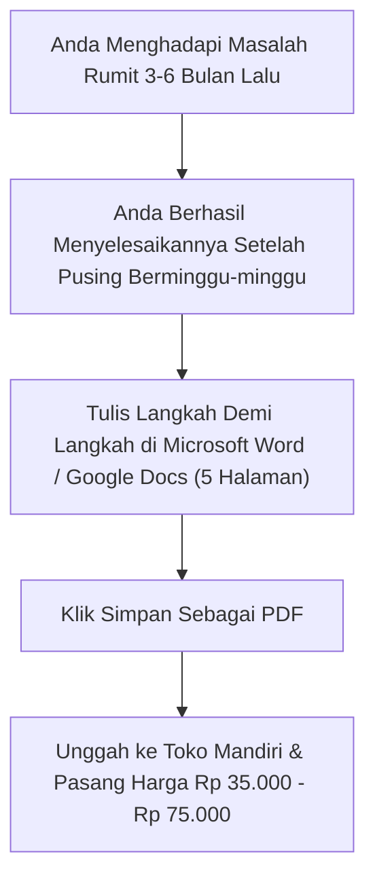
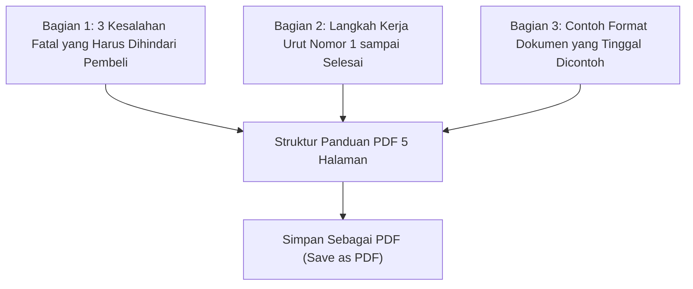

Ketakutan terbesar orang awam ketika mendengar istilah "produk digital" adalah sindrom merasa diri bukan siapa-siapa (*imposter syndrome*).

Pikiran Anda mungkin langsung berbisik:
- *"Saya bukan dosen, bukan influencer, bukan pakar bersertifikat."*
- *"Saya gak paham cara koding website atau bikin aplikasi."*
- *"Saya gak bisa nulis buku tebal ratusan halaman."*

Hentikan pikiran itu sekarang juga. **Pembeli di internet tidak peduli dengan gelar akademis atau berapa ratus halaman buku Anda**. 

Yang mereka pedulikan hanya satu hal: **Apakah file ini bisa menghemat waktu saya dan menyelesaikan masalah yang sedang bikin saya pusing hari ini?**

Jika Anda pernah berhasil melewati satu rintangan hidup yang menyebalkan 3 hingga 6 bulan yang lalu, Anda sudah punya modal lebih dari cukup untuk membuat produk digital pertama Anda.

## Rumus Emas: Cari Masalah yang Baru Saja Selesai

Orang yang paling pas diajari oleh Anda bukanlah orang yang sudah sukses, melainkan **orang yang posisinya berada tepat di tempat Anda berdiri 3 bulan lalu**.

Berikut adalah contoh produk digital nyata dari orang awam yang laris manis di Indonesia:

| Masalah yang Selesai di Kehidupan Nyata | Wujud Produk Digital Sederhana | Harga Jual |
| :--- | :--- | :--- |
| **Berhasil mengurus izin edar PIRT & Halal sendiri** | File PDF 7 Halaman: Daftar dokumen yang dicek petugas dinas + contoh surat pernyataan bebas biaya | Rp 45.000 |
| **Lolos seleksi berkas administrasi CPNS / PPPK** | Checklist 1 Lembar: Ukuran kompresi file foto, tata letak materai elektronik, & format CV anti-gagal | Rp 29.000 |
| **Renovasi rumah subsidi tipe 36 tanpa ditipu tukang** | Spreadsheet Sederhana: Rincian belanja semen, pasir, dan estimasi ongkos borongan tukang per hari | Rp 49.000 |
| **Manajemen MPASI bayi anti-stres untuk ibu bekerja** | Jadwal Menu Bulanan PDF: Takaran bahan, cara simpan di freezer, dan tips masak kilat 15 menit | Rp 39.000 |

Lihat contoh di atas. Tidak ada yang membutuhkan koding. Tidak ada yang membutuhkan studio rekaman video mahal. Semuanya hanya **rangkuman pengalaman nyata yang dirapikan agar orang lain tidak perlu mengulang rasa sakit yang sama**.

## 4 Langkah Mudah Bikin File Siap Jual Tanpa Koding

### Langkah 1: Buka Microsoft Word atau Google Docs
Jangan pakai software desain rumit jika Anda tidak terbiasa. Buka aplikasi pengolah kata yang sudah ada di laptop atau ponsel Anda.

### Langkah 2: Gunakan Struktur 3 Bagian Sederhana
1. **Daftar Masalah & Kesalahan Fatal**: Tulis 3 hal yang biasanya bikin orang gagal atau buang uang (misal: *"Jangan pernah beli pasir jenis X karena akan bikin dinding retak"*).
2. **Langkah Kerja Berurutan (Step-by-Step)**: Tulis urutan apa yang harus dikerjakan di hari ke-1, hari ke-2, dst. Gunakan nomor urut (1, 2, 3) dan kalimat pendek.
3. **Format Siap Salin (Copy-Paste Template)**: Sertakan contoh surat, tabel anggaran, atau pesan chat yang tinggal disalin oleh pembeli.

### Langkah 3: Simpan Sebagai PDF
Setelah ketikan selesai (cukup 5 sampai 10 halaman, tidak perlu panjang-panjang), klik menu **File $\rightarrow$ Save As $\rightarrow$ Pilih format PDF**. Selesai! Produk digital Anda sudah berwujud nyata.

### Langkah 4: Sambungkan ke Mesin Kasir Otomatis
Ini bagian yang sering bikin orang gaptek bingung: *"Gimana cara nerima pembayaran QRIS tanpa harus punya PT atau mesin EDC?"*

Jawabannya adalah menggunakan platform toko instan seperti [SitusBisnis](https://situsbisnis.com):
1. Buat akun toko gratis dalam 2 menit.
2. Unggah file PDF yang baru saja Anda simpan.
3. Tentukan harga (misal Rp 39.000).
4. Anda akan langsung mendapatkan halaman pembayaran resmi dengan tombol **Bayar QRIS Instan**.

Begitu pembeli memindai QRIS menggunakan aplikasi bank apa pun (BCA, Mandiri, BRI) atau e-wallet (GoPay, OVO, ShopeePay), sistem toko otomatis memverifikasi pembayaran detik itu juga dan langsung mengunduhkan file PDF ke ponsel pembeli. 

Anda tidak perlu memeriksa mutasi bank manual, dan Anda **tidak dipotong biaya komisi transaksi**. Anda resmi menjadi pemilik bisnis digital mandiri dari kamar tidur Anda.
